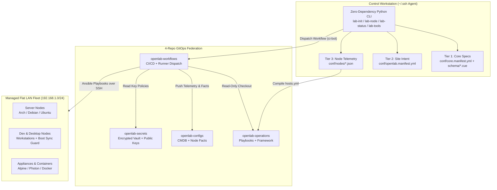
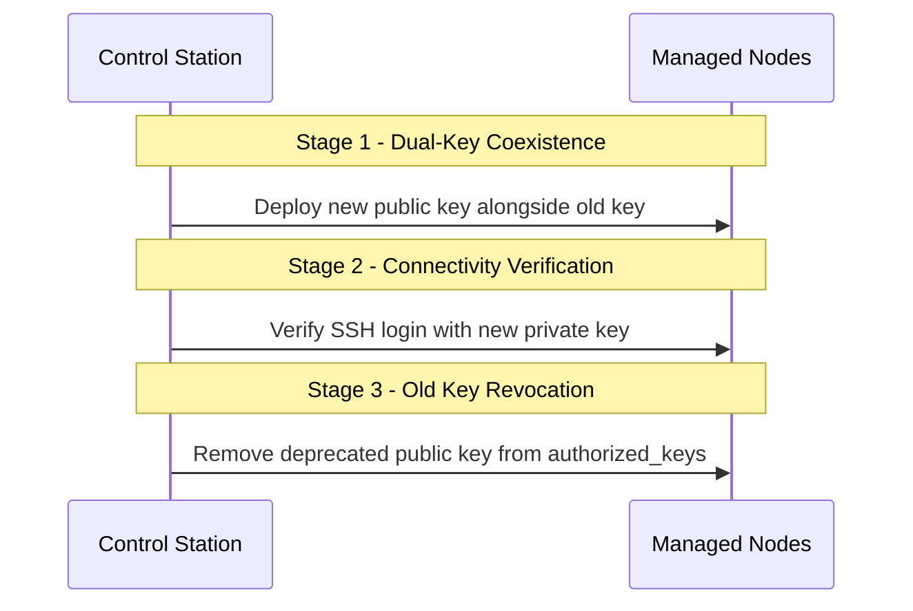
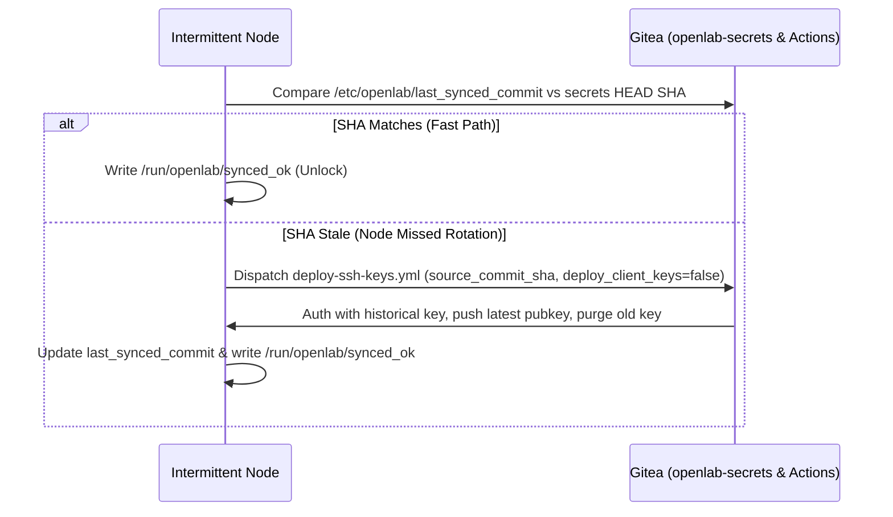

# OpenLabOps: Zero-Dependency Declarative Homelab Operations Framework

[](https://www.python.org/)
[](https://opensource.org/licenses/Apache-2.0)
[-success.svg)](#invariants)
[-orange.svg)](#architecture)
[](https://openlabops.github.io/openlabops/)

**OpenLabOps** is an open-source, turnkey operations control hub and GitOps management framework for modern homelabs and private servers. Built with **100% standard library Python** and stateless Ansible playbooks, it delivers automated node onboarding, three-phase zero-downtime SSH key rotation, sensory hardware discovery, and declarative GitOps synchronization without third-party Python dependencies (`NO pip`, `NO requests`, `NO pyyaml`).

📖 **Full Documentation (EN / 繁體中文 / 日本語):** [OpenLabOps Wiki](https://openlabops.github.io/openlabops/)

---

## 🏗️ Architecture

OpenLabOps separates immutable framework contracts, declarative site intent, and live node telemetry across a 4-repository GitOps federation with blast-radius token isolation.



### Three-Phase Zero-Downtime Key Rotation



### Boot-Time Stale Key Auto-Sync & Lockout Guard (`lab-boot-sync`)

Offline or intermittent nodes (workstations, laptops) that missed a key rotation automatically catch up on boot without downloading private keys over HTTP:



---

## 🚀 Key Features

* **Zero External Python Dependencies**: Runs entirely on the Python 3 standard library.
* **Day-0 Turnkey Onboarding (`lab-init`)**: Interactive TUI wizard guides initial fleet ingestion in an isolated `/tmp` workspace and generates permanent management keys.
* **Three-Phase Zero-Downtime Key Rotation**: Seamless key lifecycle management (Stage 1: Add $\rightarrow$ Stage 2: Verify $\rightarrow$ Stage 3: Remove).
* **Boot-Time Stale Key Auto-Sync (`lab-boot-sync`)**: Intermittent nodes compare `/etc/<prefix>/last_synced_commit` against `openlab-secrets` HEAD SHA and trigger a roll-forward sync using `source_commit_sha` while protected by a lockout guard (`/run/<prefix>/synced_ok`).
* **Flat LAN Architecture**: Pre-configured for standard single-subnet local area networks (`192.168.1.0/24`).
* **Multi-Distribution Linux Support**: Native support for Arch Linux, Debian, Ubuntu, Alpine, Photon OS, and generic systemd-based Linux systems.
* **Dynamic Ground-Truth Telemetry**: Machine hardware and service facts probed live via native shell scripts and compiled directly into Ansible inventories.

---

## 🛠️ Quickstart

### 1. Fast One-Line Install
```bash
curl -fsSL https://raw.githubusercontent.com/openlabops/openlabops/main/scripts/install.sh | bash
```

Or clone manually:
```bash
git clone https://github.com/openlabops/openlabops.git ~/.openlabops
cd ~/.openlabops
./bin/lab-dev-setup
```

### 2. Day-0 Cluster Onboarding
Launch the interactive onboarding wizard to configure your homelab and onboard nodes:
```bash
lab-init
```

### 3. Dynamic Fleet Operations
Manage nodes and inspect cluster health:
```bash
# Ingest a new node
lab-node add 192.168.1.50 --user admin

# Inspect fleet status and SSH key health
lab-status -k

# Launch interactive Curses operations TUI
lab-tools

# Decommission an existing node
lab-node remove node-hostname
```

---

## 📐 Invariants & Architectural Contract

* **`[INV-01]` Zero External Dependencies**: 100% Python standard library only.
* **`[INV-02]` Zero Plaintext Keys in Repository**: Private keys reside strictly on designated dev control stations in `~/.ssh/`.
* **`[INV-03]` Three-Tier Separation**:
  - `Tier 1 (core)`: `conf/core.manifest.yml` (Framework constants and specs).
  - `Tier 2 (site)`: `conf/openlab.manifest.yml` (Declarative site parameters and cluster intent).
  - `Tier 3 (node)`: Dynamic sensory facts collected into `conf/nodes/*.json` and compiled to inventory.

---

## 💬 Community & Maintenance Philosophy

* **Built with Google Antigravity (AGY) Vibe Coding**: OpenLabOps is co-authored through structured human-AI Vibe Coding using **Google Antigravity (AGY)**. By pairing a machine-enforced engineering contract (`AGENTS.md`), immutable `schema/*.cue` invariants, and a Spec-First workflow, AI agents iterate rapidly on code while staying strictly bounded. Read more in the **[AI Collaboration & SRE Methodology Wiki](https://openlabops.github.io/openlabops/methodology)**.
* **AI-Ready SRE Boundaries (`AGY-Remote`)**: The 4-repo blast-radius isolation, zero-plaintext-key design, and non-interactive CLI flags (`lab-status --json`, `lab-tools --plain`, `lab-init --with-remote-dev`) allow `AGY-Remote` agents to safely participate in daily SRE diagnostics and GitOps workflow dispatch without risking credential leakage or lockout.
* **Discussions Only**: GitHub Issues and Pull Requests are disabled. If you have questions, ideas, or feedback, join the **GitHub Discussions**.
* **Fork-Friendly**: OpenLabOps is built to be a strong foundation for private homelabs. You are warmly encouraged to **fork this repository** and customize the manifests, playbooks, and TUI to match your exact hardware and network setup.
* **AS IS**: Provided without warranties or commercial SLAs (Apache 2.0).

---

## 💖 Acknowledgments & Credits

OpenLabOps is distilled from the upstream Operations Framework, adapted and generalized for the global open-source homelab community.

