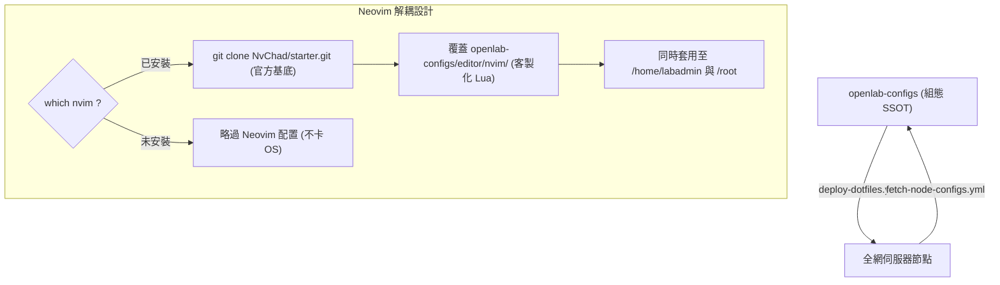

# Shell 與編輯器環境部署劇本說明文件 (Dotfiles & Editor Deployment Specification)

本文件詳細說明 [`playbooks/deploy-dotfiles.yml`](../../../ansible/playbooks/deploy-dotfiles.yml) 與 [`playbooks/fetch-node-configs.yml`](../../../ansible/playbooks/fetch-node-configs.yml) 的設計架構、雙向同步機制以及核心規範。

---

## 1. 架構原則與設計決策



### 1.1 Neovim / NvChad 精簡打包原則
* **不打包外掛 Runtime**：儲存庫中僅存放自定義的 Lua 原始碼（`init.lua`、`lazy-lock.json`、`lua/`）。
* **官方庫動態自舉**：劇本先檢查節點 `.config/nvim/.git` 是否存在；若為空則執行 `git clone https://github.com/NvChad/starter.git --depth 1`，隨後再以 `copy` 模組疊加覆蓋個人客製設定。
* **卡 Neovim 安裝而非卡 OS**：解除過往「只有 ArchLinux 才能裝 NvChad」的限制，只要節點有 `nvim` 指令（經由 `which nvim` 判定），一律自動套用。

### 1.2 使用者環境對齊 (Root & labadmin Parity)
* **工具鏈一致**：`root` 與 `labadmin` 帳號同時部署完整的 Shell 設定（Bash, Zsh, Csh）與編輯器配置（Vim, Neovim），確保管理員在兩種身分下均享有相同的別名（Aliases）、函數與命令列體驗。
* **提示字元色彩分離**：底層全域 RC 檔案透過 `UID` / `EUID` 進行動態色彩渲染：普通使用者（`labadmin`）呈現舒適的青/綠色主題；當切換為超級使用者（`root`, UID=0）時，自動切換為紅色醒目標示，兼具安全性與視覺辨識。

---

## 2. 標籤分類 (Playbook Tags)

[`deploy-dotfiles.yml`](../../../ansible/playbooks/deploy-dotfiles.yml) 支援精細化的 Tags 控制：

| 標籤 (Tag) | 作用範圍 | 說明 |
| :--- | :--- | :--- |
| `shell` | 僅部署 Shell 環境 | 部署全域 `/etc/...` 基底與使用者家目錄的特化組態 (`.bashrc`, `.zshrc`, `.cshrc`) |
| `editor` | 僅部署編輯器組態 | 包含 Vim (`.vimrc`) 與 Neovim (NvChad) 兩大編輯器環境 |
| `vim` | 僅部署 Vim 組態 | 依節點是否安裝 `vim` 決定是否部署 `/root/.vimrc` 與 `/home/labadmin/.vimrc` |
| `nvim` | 僅部署 Neovim 組態 | 依節點是否安裝 `nvim` 決定是否拉取 NvChad 並覆蓋個人設定 |

---

## 3. 執行範例 (Usage Examples)

```bash
# 1. 全量部署所有受控節點之 Shell 與 Editor 環境
ansible-playbook -i inventory/hosts.yml playbooks/deploy-dotfiles.yml

# 2. 僅更新編輯器環境 (Vim + Neovim)
ansible-playbook -i inventory/hosts.yml playbooks/deploy-dotfiles.yml --tags "editor"

# 3. 僅針對 srv-node1 更新 Neovim NvChad
ansible-playbook -i inventory/hosts.yml playbooks/deploy-dotfiles.yml --tags "nvim" -e "target_hosts=srv-node1"

# 4. 反向自節點採集組態備份至 openlab-configs
ansible-playbook -i inventory/hosts.yml playbooks/fetch-node-configs.yml -e "source_host=base"
```
