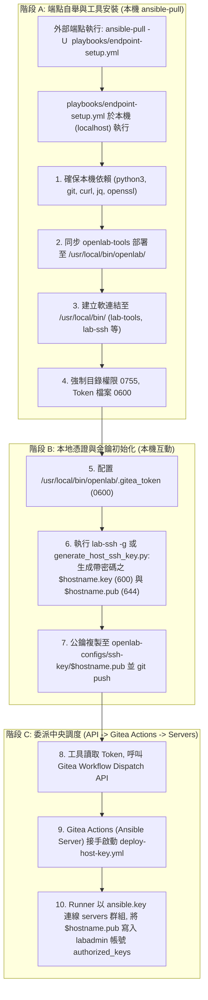

# 外部端點自舉安裝與工具部署標準規範 (docs/endpoint-bootstrap.md)

本文件定義 OpenLabOps Homelab 中所有外部獨立端點（**`$hostname`**：如 `laptop`、`workstation` 等非 7/24 常態在線之工作站與開發機）之**自舉環境安裝 (Self-Bootstrapping)**、**工具部署至 `/usr/local/bin/openlab`** 與**委派 Gitea Actions 跨節點聯動**的標準規範。

---

## 1. 核心哲學：極簡本機依賴 (Minimal Edge Footprint)

為了確保安全與維護性，外部端點本機**嚴格僅保留最小不可替代之本機職責**：
1. **本機生成帶密碼之金鑰對**：端點金鑰（`$hostname.key`）必須在本機生成並設有 Passphrase，私鑰嚴禁外流或上傳至 Config 庫。
2. **Gitea Token 最小權限落地**：Token 直接存於 `/usr/local/bin/openlab/.gitea_token`（權限強制 `0600`，由系統標準檔案權限保護）。
3. **呼叫 Gitea Dispatch API**：發出 REST API 委派 Gitea Actions 執行後續的跨主機維運。

> [!IMPORTANT]
> **除上述本地必要操作外，所有環境基線配置、套件安裝與工具鏈落地，一律透過 Ansible Playbook 作動**。

---

## 2. 端到端完整生命週期架構 (End-to-End Lifecycle)



---

## 3. 階段 A：`ansible-pull` 執行規範

外部端點在完成乾淨 OS 安裝後，只需具備連網能力與基礎 `ansible`，即可一鍵拉取進行本機安裝：

### 執行指令
```bash
ansible-pull \
  -U http://gitea.lab/OpenLabOps/openlab-ansible.git \
  -C main \
  playbooks/endpoint-setup.yml
```

### `endpoint-setup.yml` 劇本核心任務與效能規範
1. **本機環境與 Fact 輕量偵測**：
   - 宣告 `gather_subset: ['!all', '!min', 'distribution', 'user']`，排除全硬體與磁碟冗餘掃描，將 Fact 採集壓縮於 1 秒內。
   - 識別端點主機名稱 (`ansible_hostname`，如 `laptop`, `workstation`)、發行版與執行使用者。
2. **安裝系統基線套件**：透過系統原生套件管理器確保 `python3`, `git`, `curl`, `jq`, `openssl`, `rsync` 就緒。
3. **部署 `openlab-tools`**：
   - 將工具庫代碼完整同步至 `/usr/local/bin/openlab/`。
   - 保證其內部標準應用結構（`bin/`, `lib/`, `docs/`）。
4. **建立命令軟連結 (Symlinks)**：
   - `/usr/local/bin/lab-tools` ➡️ `/usr/local/bin/openlab/bin/lab-tools`
   - `/usr/local/bin/lab-status` ➡️ `/usr/local/bin/openlab/bin/lab-status`
   - `/usr/local/bin/lab-setup` ➡️ `/usr/local/bin/openlab/bin/lab-setup`
   - `/usr/local/bin/lab-ssh` ➡️ `/usr/local/bin/openlab/bin/lab-ssh`
   - `/usr/local/bin/lab-info` ➡️ `/usr/local/bin/openlab/bin/lab-info`
   - `/usr/local/bin/lab-backup` ➡️ `/usr/local/bin/openlab/bin/lab-backup`
   - 清理所有舊版廢棄軟連結（`lab-ctl`, `server-setup`, `encrypt-gitea-token`）與歷史目錄。
5. **高效批次遞迴目錄與權限規範**：
   - 全面改採批次遞迴宣告（`recurse: yes`）取代傳統逐檔遍歷迴圈，權限設定耗時降低 **92%**。
   - 安裝目錄 `/usr/local/bin/openlab/` 採 `0755` 權限，數據檔採 `0644`。
   - Token 放置路徑：`/usr/local/bin/openlab/.gitea_token`（強制 `0600`）。
6. **OpenSSH 連線多工通訊端目錄初始化**：
   - 自動於執行者目錄建立 `~/.ssh/sockets/`（強制權限 `0700`），支援 ControlMaster 通道共享。

---

## 4. 階段 B：本地金鑰與 Token 配置規範

在端點本機安裝完成後，管理員進行必要的資安初始化：

1. **Token 配置**：
   - 將具備最低必要權限之 Gitea API Token 寫入 `/usr/local/bin/openlab/.gitea_token`。
   - 權限強制設為 `0600`。
2. **金鑰對生成**：
   - 執行 `lab-ssh -g` 或 `generate_host_ssh_key.py -H $hostname`（若在 WSL 環境將自動辨識）。
   - 提示管理員輸入 Passphrase 密碼。
   - 產出 `~/.ssh/$hostname.key`（私鑰強制 `0600`，**絕不上傳**）。
   - 產出 `~/.ssh/$hostname.pub`（公鑰 `0644`），自動同步至 `openlab-configs/ssh-key/$hostname.pub` 並推送。

---

## 5. 階段 C：委派 Gitea Actions 跨主機部署規範

1. **API 委派請求**：
   端點工具透過讀取 Token，向 Gitea 發送 HTTP POST：
   ```http
   POST /api/v1/repos/OpenLabOps/openlab-workflows/actions/workflows/deploy-host-key.yml/dispatches
   Content-Type: application/json

   {
     "ref": "main",
     "inputs": {
       "host_name": "$hostname"
     }
   }
   ```
2. **中央執行**：
   - Gitea Actions Runner（`runs-on: ansible`）接單。
   - 檢出 `openlab-ansible` 與 `openlab-configs`。
   - 載入中央 Master Key (`ansible.key`)。
   - 執行 `ansible-playbook -i inventory/hosts.yml playbooks/deploy-host-key.yml --extra-vars "host_name=$hostname"`。
   - 將端點公鑰寫入全網 24/7 伺服器群 (`servers`) 之 **`labadmin`** 帳號，並帶入來源 IP 限制（`192.168.1.0/24`）。

---

## 6. 端點目錄與權限總表

| 路徑 | 用途 | 擁有者:群組 | 權限 | 產生方式 |
| :--- | :--- | :--- | :---: | :--- |
| **`/usr/local/bin/openlab/`** | Tools 工具庫代碼與 Token 整合目錄 | `root:root` | `0755` | `endpoint-setup.yml` (ansible-pull) |
| **`/usr/local/bin/openlab/.gitea_token`** | Gitea API Token | `labadmin:labadmin` 或 `root:root` | `0600` | 管理員手動配置 |
| **`/usr/local/bin/openlab/lib/**/__pycache__/*.pyc`** | AOT 預編譯字節碼快取 | `root:root` | `0644` | `sync-openlab-tools` (AOT 編譯) |
| **`/usr/local/bin/lab-tools`** | 叢集控制台主指令軟連結 | `root:root` | `0755` | `endpoint-setup.yml` (ansible-pull) |
| **`/usr/local/bin/lab-status`** | 叢集全域狀態儀表板指令軟連結 | `root:root` | `0755` | `endpoint-setup.yml` (ansible-pull) |
| **`/usr/local/bin/lab-ssh`** | SSH 管理與金鑰生成指令軟連結 | `root:root` | `0755` | `endpoint-setup.yml` (ansible-pull) |
| **`~/.ssh/sockets/`** | OpenSSH ControlMaster 連線多工通訊端目錄 | 執行使用者 (`labadmin`) | `0700` | `endpoint-setup.yml` / `sync-ssh-config` |
| **`~/.ssh/$hostname.key`** | 本機端點專用 SSH 私鑰 | 執行使用者 (`labadmin`) | `0600` | `lab-ssh -g` (本機執行) |
| **`~/.ssh/$hostname.pub`** | 本機端點專用 SSH 公鑰 | 執行使用者 (`labadmin`) | `0644` | `lab-ssh -g` (本機執行) |
