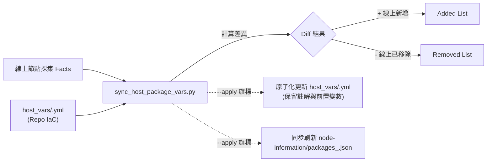

# sync_host_package_vars.py 工具說明文件

## 1. 工具定位
[`scripts/sync_host_package_vars.py`](../../../ansible/scripts/sync_host_package_vars.py) 是 OpenLabOps Homelab 實現 **GitOps / IaC 雙向同步** 的核心本地輔助腳本。它負責比對遠端採集到的套件事實（Live State）與儲存庫中 `host_vars/<hostname>.yml` 宣告的套件清冊（Desired State），計算漂移並進行原子化寫入。

---

## 2. 核心架構與設計原則



1. **零污染與前置變數保護**：
   - 採用正規表示法錨定 `# IaC Package Specification (Managed by sync-package-inventory.yml)` 或 `installed_packages:` 開頭行。
   - 保留檔案前方的 `ansible_host`、`hostname`、註解與檔案標頭，僅精準替換套件陣列區塊。
2. **Arch Linux 官方庫與 AUR 分流**：
   - 自動將 `source: yay` 或 `repo: aur` 的套件分流至 `aur_packages:` 區塊。
   - 官方倉庫套件分流至 `installed_packages:` 區塊。
   - 非 Arch 系統（BSD, PhotonOS, OracleLinux）則僅輸出統一的 `installed_packages:`。
3. **原子化雙寫**：
   - 當傳入 `--apply` 時，同時更新 `openlab-ansible/host_vars/<hostname>.yml` 與 `openlab-configs/node-information/packages_<hostname>.json`，確保 IaC 與 CMDB 狀態 100% 同步。

---

## 3. 命令列介面與參數 (CLI Usage)

```bash
# 參數語法
python3 scripts/sync_host_package_vars.py --host <hostname> [選項]
```

| 參數 | 說明 |
| :--- | :--- |
| `--host <hostname>` | **必填**。Ansible Inventory 主機名稱（例如 `srv-node1`, `srv-node2`, `gw-node`） |
| `--host-vars-dir <dir>` | 指定 `host_vars` 目錄路徑（預設：自動搜尋 `../host_vars`） |
| `--configs-dir <dir>` | 指定 `node-information` 目錄路徑（預設：`/home/labadmin/openlab-configs/node-information`） |
| `--live-json <path>` | 指定遠端主機產出之 Facts JSON 暫存檔路徑（亦支援由 stdin 管道傳入） |
| `--diff` | 比對差異並以 JSON 格式輸出漂移報表（預設行為） |
| `--apply` | 將線上主機現況原子化寫入 `host_vars/<hostname>.yml` 與資產 JSON |

---

## 4. 輸出資料格式 (JSON Diff Schema)

```json
{
  "has_drift": true,
  "live_count": 10,
  "repo_count": 9,
  "added": [
    "tar"
  ],
  "removed": [],
  "live_official": [
    "docker-compose", "git", "jq", "nfs-utils", "nodejs", "perl", "rsync", "tar", "vim-extra", "wget"
  ],
  "live_aur": [],
  "repo_installed": [
    "docker-compose", "git", "jq", "nfs-utils", "nodejs", "perl", "rsync", "vim-extra", "wget"
  ],
  "repo_aur": []
}
```

---

## 5. Playbook 整合調用

在 [`playbooks/sync-package-inventory.yml`](../../../ansible/playbooks/sync-package-inventory.yml) 中透過 `delegate_to: localhost` 調用：
```yaml
- name: 比對線上主機現況與 Repo host_vars IaC 清單
  ansible.builtin.command:
    cmd: >-
      {{ playbook_dir }}/../scripts/sync_host_package_vars.py
      --host {{ inventory_hostname }}
      --diff
    stdin: "{{ live_facts | to_json }}"
  delegate_to: localhost
  register: diff_raw
```
