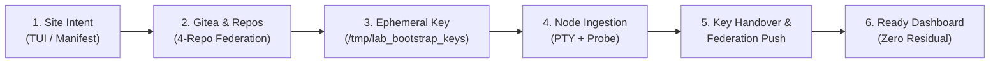

# `lab-init` — Day-0 Initialization Commander

**Entrypoint:** `bin/lab-init` → **Engine:** `engine/initialize.py`

`lab-init` is OpenLabOps's interactive Day-0 cluster bootstrapper (inspired by `archinstall`). It guides operators through site intent collection, provisions the 4-repository Gitea federation, onboards target hosts using ephemeral bootstrap keys, rotates to permanent subnet-restricted SSH keys, and deploys the operations tool suite.

## Synopsis

```bash
lab-init [--lang {zh_TW,en_US,ja_JP}] [--manifest FILE] [--legacy-key FILE]
         [--non-interactive] [--with-gitea-runner] [--with-remote-dev]
         [--skip-nodes HOSTS] [--include-appliances] [--include-endpoints]
```

## Options

| Flag | Description |
| :--- | :--- |
| `--lang {zh_TW,en_US,ja_JP}` | Language/locale for the setup wizard and deployed cluster. |
| `--manifest FILE` | Declarative Day-0 onboarding manifest (skips interactive prompts). |
| `--legacy-key FILE` | Legacy SSH private key path for mixed-scenario initial onboarding. |
| `--non-interactive` | Run unattended without interactive TUI/CLI prompts. |
| `--with-gitea-runner` | Configure and build the Gitea Act Runner container (`ansible-core`). |
| `--with-remote-dev` | Provision the optional Remote-Dev container. |
| `--skip-nodes HOSTS` | Comma-separated hostnames to skip during Day-0 onboarding. |
| `--include-appliances` | Include appliance nodes (storage/virtualization) in Day-0 onboarding. |
| `--include-endpoints` | Include endpoint workstations in Day-0 onboarding. |

## 6-Step Execution Lifecycle



1. **Isolated `/tmp` Workspace (`LAB_INIT_WORK_DIR`)**:
   At startup, `lab-init` creates a temporary workspace (`/tmp/lab_init_work_*`, cleaned up automatically on exit). All Day-0 intermediate artifacts—exported manifest (`conf/<prefix>.manifest.yml`), probed node facts (`conf/nodes/*.json`), compiled `hosts.yml`, and `tools.config.json`—are written inside `/tmp` rather than mutating the incubator repository.
2. **Gitea & 4-Repo Federation Provisioning**:
   Ensures the target Gitea organization, `ci-bot` service account + token, and the four downstream repositories (`<prefix>-operations`, `<prefix>-workflows`, `<prefix>-configs`, `<prefix>-secrets`) exist and receive baseline commits.
3. **Ephemeral Bootstrap Key (`/tmp/lab_bootstrap_keys/`)**:
   Generates a temporary Ed25519 keypair in `/tmp` (never in `~/.ssh/`) with no `from="..."` IP restriction so initial discovery probes can connect across any bootstrap path (`[INV-02]`).
4. **Dynamic Node Ingestion**:
   Calls `onboard_node()` (`engine/onboard.py`) with `ephemeral_pubkey` for each selected host, then runs `engine/classifier.py --apply` inside the `/tmp` workspace to build `current.json` and `ansible/inventory/hosts.yml`.
5. **Permanent Key Handover & Federation Push**:
   * **Private/Public Key Consistency**: Derives the authoritative public key directly from `~/.ssh/<ansible_user>.key` using `ssh-keygen -y -P "" -f`, automatically repairing any stale or mismatched `*.key.pub` files before rotation.
   * **3-Stage Rotation**: Injects the permanent key with `from="<allowed_subnets>"` restriction, verifies `BatchMode=yes` connectivity, and removes the ephemeral bootstrap key.
   * **Rate-Limit Resilience (`_run_ssh_with_backoff`)**: Automatically retries transient SSH handshake errors (`kex_exchange_identification`, `Connection reset by peer`, `Connection timed out`) with exponential backoff to avoid triggering `MaxStartups` or firewall throttling.
   * **Compile & Push**: Compiles downstream templates into `/tmp`, pushes fresh `node-information/node_*.json`, manifest, and public keys to Gitea `configs` and `secrets`, and deploys the `lab-*` CLI suite via `deploy-ops-tools.yml`.
6. **Ready Dashboard**:
   Prints cluster summary, masked `ci-bot` token location (`/usr/local/bin/<prefix>/.gitea_token`, mode `0600`), active `from="..."` CIDR restriction, and confirms zero local residual.
