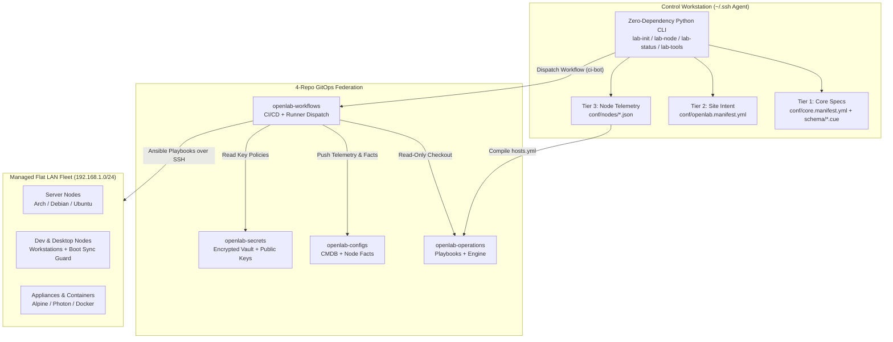

# System Architecture

OpenLabOps is designed around strict separation of concerns: immutable framework contracts, declarative site parameters, and live probed machine telemetry are decoupled across three tiers and four downstream GitOps repositories.

## 1. Three-Tier Separation

1. **Tier 1 (`core`): Immutable Framework Specification**
   * Stored in `conf/core.manifest.yml` and `schema/*.cue`.
   * Defines the 4-repository federation topology, canonical key roles (`ansible`, `user`, `git`), security baselines, and CUE validation rules.
2. **Tier 2 (`site`): Site-Specific Declarative Intent**
   * Stored in `conf/openlab.manifest.yml`.
   * Captures cluster name, domain, Flat LAN subnet (`192.168.1.0/24`), gateway, admin/ansible usernames, and Gitea endpoint. Generated interactively by `lab-init` (like `archinstall`) and exported for reproducible unattended runs.
3. **Tier 3 (`node`): Dynamic Machine Telemetry Facts**
   * Stored in `conf/nodes/*.json` (inventory classification) and `node-information/node_<hostname>.json` (CMDB hardware/container/SSH key facts).
   * Never hardcoded in static manifests; probed live via `lab-node` and `lab-discover`, then compiled directly into `ansible/inventory/hosts.yml` by `engine/classifier.py`.

## 2. Four-Repository GitOps Federation & Blast-Radius Isolation

Instead of granting CI bots write access to Ansible playbooks, OpenLabOps splits downstream state into four repositories:

* **`openlab-operations`**: Ansible playbooks, roles, engine, and CLI tools.
* **`openlab-workflows`**: Gitea Actions workflows and composite actions. The automation token (`ci-bot`) is strictly scoped here and **physically barred** from modifying `openlab-operations`.
* **`openlab-configs`**: Host hardware facts (`node-information/node_*.json`), package lists, and rendered Markdown node manuals.
* **`openlab-secrets`**: Public keys, endpoint key registries, and encrypted secrets.

## 3. Flat LAN & Multi-Distro Linux Support

* **Network Schema (`schema/network.cue`)**: Pre-configured for standard Flat LAN topologies (`192.168.1.0/24`), with CUE invariants preventing overlapping subnets or invalid gateway assignments.
* **Supported Distributions**: Native classification and package/SSH management for **Arch Linux**, **Debian**, **Ubuntu**, **Oracle Linux**, **Alpine Linux**, **VMware Photon OS**, and generic systemd Linux hosts.

## 4. Zero-Dependency Python Engine

All control tools (`bin/lab-*` and `tools/bin/lab-*`) share `tools/lib/core/` (`config.py`, `yaml_parser.py`, `gitea_api.py`, `live_probe.py`, `lockout.py`, `i18n.py`, `ui_curses.py`, `ui_menu.py`, `ui_theme.py`, `version.py`), written purely in the Python 3 standard library. Endpoints only need Python 3 and OpenSSH—Ansible is never required on managed nodes and runs centrally inside the Gitea Act Runner container.
