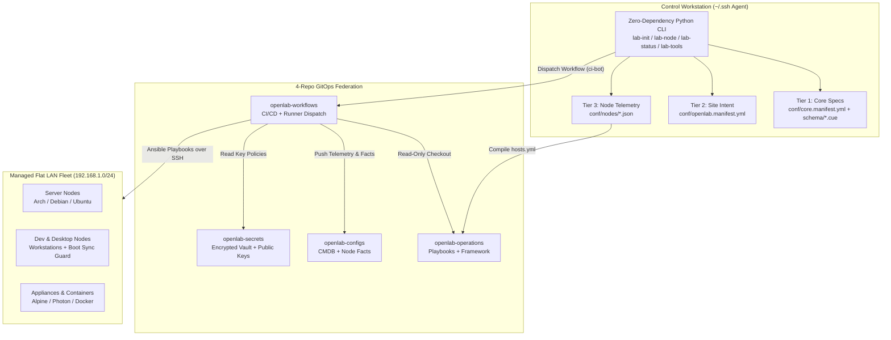

# System Architecture

OpenLabOps is a **Zero-Dependency Declarative Homelab Operations Framework** designed around strict separation of concerns: immutable framework contracts, declarative site parameters, and live probed machine telemetry are decoupled across three tiers and four downstream GitOps repositories.



## 1. Repository Topology

```text
openlabops/
├── bin/                        # Control-plane entrypoints (lab-init, lab-node, lab-apply, lab-test)
├── engine/                     # Core Python framework (compiler, classifier, discover, initialize, onboard)
├── schema/                     # Immutable CUE contracts (invariants, network, roles, keys, nodes)
├── conf/                       # SSOT manifests & dynamic node classification (nodes/*.json)
├── ansible/                    # Stateless playbooks, roles, group_vars, and custom fact modules
├── tools/                      # Zero-dependency endpoint & operator CLI (bin/lab-* & lib/core/*)
├── workflows/                  # Gitea Actions workflows & composite actions
├── templates/                  # Downstream federation templates (ansible, configs, workflows)
├── lang/                       # Multi-locale i18n dictionaries (en_US.json, zh_TW.json, ja_JP.json)
└── tests/                      # Unit tests, Dagger DinD E2E, and multi-distro Docker sandbox
```

## 2. Three-Tier Separation Model

1. **Tier 1 (`core`): Immutable Framework Specification**
   * Stored in `conf/core.manifest.yml` and `schema/*.cue`.
   * Defines the 4-repository federation topology, canonical key roles (`ansible`, `user`, `git`), security baselines, and CUE validation rules.
2. **Tier 2 (`site`): Site-Specific Declarative Intent**
   * Defined by `conf/openlab.manifest.yml` (or passed via `--manifest`).
   * Captures cluster name, domain, Flat LAN subnet (`192.168.1.0/24`), gateway, admin/ansible usernames, and Gitea endpoint. Generated interactively by `lab-init` inside an isolated `/tmp/lab_init_work_*` workspace (`LAB_INIT_WORK_DIR`), compiled cleanly, and pushed to `openlab-configs` without mutating the incubator repository.
3. **Tier 3 (`node`): Dynamic Machine Telemetry Facts**
   * **Inventory Classification (`conf/nodes/*.json`)**: Stores only classification attributes (`os_family`, `distribution`, `role`, `capabilities`). Never stores hardware telemetry (`mac_address`, `cpu_cores`, `memory_mb`).
   * **CMDB Hardware Telemetry (`node-information/node_<hostname>.json`)**: Probed independently by `lab-discover` (`engine/bootstrap_probe.sh`), recording RAM, CPU, disks, Docker containers, listening ports, and `authorized_keys` fingerprints.
   * **Dynamic Compilation**: `engine/classifier.py` compiles `conf/nodes/*.json` directly into `ansible/inventory/hosts.yml` using pure Python stdlib—zero runtime CUE dependency.

## 3. Four-Repository GitOps Federation & Blast-Radius Isolation

Instead of granting CI bots write access to Ansible playbooks, OpenLabOps splits downstream state into four repositories:

| Repository | Contents | `ci-bot` Permission |
| :--- | :--- | :--- |
| **`openlab-operations`** | Ansible playbooks, roles, framework engine, CLI tools | **Read-Only** (physically barred from mutation) |
| **`openlab-workflows`** | Gitea Actions workflows & composite actions | **Read / Dispatch** |
| **`openlab-configs`** | CMDB `node-information/node_*.json`, package lists, Markdown node manuals | **Write Telemetry** |
| **`openlab-secrets`** | Public keys, endpoint key registries, encrypted secrets | **Read Key Policies** |

## 4. Zero-Dependency Framework & Gitea Act Runner Model

* **100% Python Standard Library (`[INV-01]`)**: Built-in `tools/lib/core/yaml_parser.py` handles YAML parsing without `pyyaml`; `gitea_api.py` uses `urllib.request` without `requests`; `ui_curses.py` uses built-in `curses`.
* **Zero Ansible on Endpoints**: Managed hosts and operator workstations only require Python 3 and OpenSSH. All Ansible playbooks execute centrally inside the **Gitea Act Runner** container (`ansible-core` pre-installed), triggered via `gitea_api.gitea_dispatch()`.
* **Flat LAN & Multi-Distro Support**: `schema/network.cue` enforces standard Flat LAN (`192.168.1.0/24`) boundaries, while `engine/classifier.py` natively classifies **Arch Linux**, **Debian**, **Ubuntu**, **Oracle Linux**, **Alpine Linux**, **VMware Photon OS**, and generic systemd Linux hosts.
