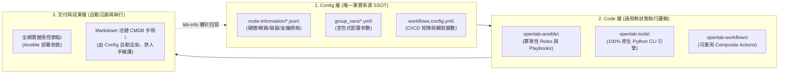

# OpenLabOps Homelab: Code + Config 架構分離實施規劃書
## (Architecture Blueprint: Code & Config Decoupling Specification)

---

## 1. 執行背景與核心目標 (Background & Objectives)

### 1.1 現狀痛點分析
目前 OpenLabOps 體系雖然已具備高度自動化與五大倉庫分工，但在實務運作上仍存在**「參數定義散落」**與**「代碼與設定混雜」**的技術債務：
1. **參數散落於 Markdown 文件**：部分網段、Port、主機用途與金鑰註解寫在各個 `docs/*.md` 的表格或文字段落中。程式無法直接 `import` 或載入 Markdown，AI Agent 需依賴模糊文字搜尋，格式微調便容易解析失敗。
2. **Playbook 內硬編碼 (Hardcoded Tasks)**：多數 Ansible Playbook 中仍直接寫死目標使用者、路徑與特定的 `shell` 參數，缺乏變數抽象層。
3. **文檔與實機漂移 (Documentation Drift)**：人工維護 Markdown 手冊的代價高昂，手動調整實機後往往忘記同步更新文檔，導致 CMDB 迅速過期失效。

### 1.2 重構核心目標
打造 **「Config 為唯一真理，Code 保持純粹通用，Markdown 由 Config 自動編譯」** 的現代化架構：



---

## 2. 五大倉庫之 Code vs. Config 職責劃分矩陣

| 倉庫名稱 | 歸屬範疇 | 具體內容定義 (What is Code / What is Config) | 重構動作與改造目標 |
| :--- | :--- | :--- | :--- |
| **`openlab-ansible`** | **Code 90%**<br>**Config 10%** | • **Code**：`roles/` (模組化角色)、`playbooks/` (調度邏輯)、`library/` (自訂模組)。<br>• **Config**：`inventory/hosts.yml` (拓撲)、`group_vars/` (環境特異性參數)。 | 將 Playbook 內的硬編碼變數全部抽離至 `group_vars/`。將 19 支劇本重構成 4 大標準 Roles。 |
| **`openlab-secrets`** | **純 Config**<br>*(機密憑據)* | • **Config**：SSH 私鑰（0600）、Gitea API Token、Age/SOPS 加密密鑰。<br>• **Code**：僅保留極簡之密鑰解密輔助腳本。 | 維持高純度憑據隔離，配合 `0600` 權限與生命週期標記。 |
| **`openlab-tools`** | **純 Code**<br>*(100% 邏輯)* | • **Code**：`lab-status`、`lab-ssh`、`lab-info`、Markdown 渲染引擎、各節點審計 Python 腳本。<br>• **Config**：嚴禁存放任何叢集特異性參數。 | 確保工具箱具備無狀態（Stateless）特質，參數一律由外部 Config 注入。 |
| **`openlab-workflows`** | **Code 80%**<br>**Config 20%** | • **Code**：可複用 Composite Actions、標準 CI/CD 執行管線樣板。<br>• **Config**：觸發矩陣 (Matrix)、Gitea 組織變數、排程 Cron 表達式。 | 消除 17 支工作流中的重複代碼，提煉為自訂 Actions，實現參數化驅動。 |

---

## 3. 核心解密：Workflows (Gitea Actions) 如何實現 Code 與 Config 分離？

許多開發者對「CI/CD 工作流如何做 Code/Config 分離」感到困惑。在傳統寫法中，每個 `.yaml` 往往寫死了 Git 倉庫 URL、分支、Runner 標籤與複雜的 bash 指令。

在 Code + Config 架構下，**Gitea Actions 的分離策略如下**：

### 3.1 什麼是 Workflows 中的「Code」？（可重用 Action 邏輯）
將重複出現的管線邏輯提煉為 **Composite Actions (複合動作)**，存放在 `openlab-workflows/.gitea/actions/` 內：

#### 範例：提煉通用檢出動作 `.gitea/actions/checkout-ecosystem/action.yml` (Code)
```yaml
name: "Checkout Homelab Ecosystem"
description: "以淺層拉取 (--depth 1) 快速檢出五大關聯倉庫"
inputs:
  org_url:
    description: "Gitea 組織基礎路徑"
    required: false
    default: "http://gitea.lab:3000/OpenLabOps"
  deploy_key:
    description: "SSH 檢出私鑰"
    required: true

runs:
  using: "composite"
  steps:
    - name: Setup SSH Deploy Key
      shell: bash
      run: |
        mkdir -p ~/.ssh && chmod 700 ~/.ssh
        echo "${{ inputs.deploy_key }}" > ~/.ssh/id_ed25519
        chmod 600 ~/.ssh/id_ed25519
        ssh-keyscan -p 3000 gitea.lab >> ~/.ssh/known_hosts 2>/dev/null || true

    - name: Fast Clone Repositories
      shell: bash
      run: |
        for repo in openlab-ansible openlab-configs openlab-secrets openlab-tools; do
          if [ ! -d "$repo" ]; then
            git clone --depth 1 "${{ inputs.org_url }}/${repo}.git" "$repo"
          fi
        done
```

#### 範例：提煉通用 Ansible 執行動作 `.gitea/actions/run-ansible-playbook/action.yml` (Code)
```yaml
name: "Run Ansible Playbook"
description: "標準化執行 Ansible 劇本並處理日誌與計時"
inputs:
  playbook:
    description: "要執行的劇本相對路徑"
    required: true
  inventory:
    description: "主機清單路徑"
    required: false
    default: "openlab-ansible/inventory/hosts.yml"
  extra_vars:
    description: "額外注入之變數"
    required: false
    default: ""

runs:
  using: "composite"
  steps:
    - name: Execute Playbook
      shell: bash
      run: |
        ansible-playbook -i "${{ inputs.inventory }}" "${{ inputs.playbook }}" ${{ inputs.extra_vars }}
```

---

### 3.2 什麼是 Workflows 中的「Config」？（環境與參數宣告）

1. **Gitea 組織/倉庫變數 (Org & Repo Variables)**：
   - `VARS.ORG_NAME`：組織名稱（如 `OpenLabOps`）。
   - `VARS.DEPLOY_RUNNER_LABEL`：執行節點標籤（如 `[self-hosted, linux, x86_64]`）。
   - `VARS.MANAGEMENT_CIDR`：核心網段白名單。
2. **工作流宣告檔簡化為純 Config 呼叫 (`deploy.yml`)**：
   重構後的工作流文件將由原本的 150 行大幅縮減為 **不到 30 行的純宣告檔**：

```yaml
# ==============================================================================
# openlab-workflows/.gitea/workflows/deploy-node-ssh.yml (純 Config 宣告)
# ==============================================================================
name: Deploy Node SSH Security Baseline
on:
  push:
    branches: [main]
    paths:
      - 'openlab-configs/node-information/**'
      - 'openlab-ansible/playbooks/deploy-node-ssh-keys.yml'

jobs:
  deploy:
    runs-on: ${{ vars.DEPLOY_RUNNER_LABEL || 'self-hosted' }}
    steps:
      # 調用通用 Code 動作，傳入 Config 參數
      - name: Checkout Ecosystem
        uses: ./.gitea/actions/checkout-ecosystem
        with:
          deploy_key: ${{ secrets.GITEA_DEPLOY_KEY }}

      # 執行部署，傳入目標劇本
      - name: Execute Deployment
        uses: ./.gitea/actions/run-ansible-playbook
        with:
          playbook: "openlab-ansible/playbooks/deploy-node-ssh-keys.yml"

      # 部署後自動觸發審計與活體 CMDB 回寫
      - name: Trigger Living CMDB Audit
        shell: bash
        run: |
          python3 openlab-ansible/scripts/audit-all-nodes.py
```

---

## 4. Markdown 的救贖：從「人肉手冊」轉型為「編譯式活體 Wiki」

### 4.1 核心原則：永遠不允許在 Markdown 內首次定義參數
* **錯誤模式（舊模式）**：在 `docs/network.md` 表格裡手動輸入 `node1: 192.168.1.101`，然後程式試圖去爬這份文件。
* **正確模式（新架構）**：
  1. `network/vlans.json` 與 `node_node1.json` 宣告真實 IP 與網卡。
  2. Ansible 負責將 IP 部署並確保在機器上。
  3. `render_node_doc.py` 讀取 JSON Config，**自動生成 `node_node1.md` 與全網拓撲手冊**。

### 4.2 編譯流水線架構 (Doc Compiler Pipeline)
```text
                     │
                     ▼ (Python 原生 Jinja/字串格式化渲染器)
            openlab-tools/bin/render-node-doc
                     │
                     ▼ (自動輸出)
[docs/nodes/node_*.md] + [docs/network/topology.md]
```
* **效益**：
  - 人類想看漂亮文檔？隨時讀取自動渲染的 Markdown Wiki。
  - AI 想做自動化判斷？直接讀取機器友好的 JSON Config。
  - 兩者永遠精準對齊，100% 杜絕人工維護文檔的痛苦與失誤。

---

## 5. 分階段重構實施路線圖 (Step-by-Step Migration Roadmap)

### Phase 1: Config 收斂與基準固化
1. **清理 Markdown 表格**：盤點 `openlab-configs/docs/`，將仍有參考價值的硬體、網路、套件參數全面提煉為 `node_*.json` 欄位。
2. **鎖定 SSOT 格式**：固化 `node_*.json` 之 Schema（包含 `system`, `network`, `storage`, `docker`, `authorized_keys`）。

### Phase 2: Ansible Roles 抽象化模組重構
1. **建立標準目錄**：在 `openlab-ansible/roles/` 建立 `baseline`, `security`, `dotfiles`, `docker`。
2. **抽取 Procedural Tasks**：將 `endpoint-setup.yml`、`node-provisioning.yml` 內的通用 task 移入 Roles。
3. **收斂變數**：Playbook 內硬編碼的路徑統一替換為 `group_vars/all.yml` 之變數。

### Phase 3: Gitea Actions Composite Actions 改造
1. **建立 `.gitea/actions/`**：封裝 `checkout-ecosystem` 與 `run-ansible-playbook`。
2. **精簡 17 支工作流**：逐一將現有工作流替換為簡短的 Composite Action 調用模式。

### Phase 4: 文檔編譯全自動化 (Living Wiki)
1. 在每次 Ansible 部署或定時巡檢結束後，自動觸發 `render-node-doc`。
2. 若檢測到 Markdown 內容有異動，由 Actions 機器人自動 commit 並推送回 `openlab-configs`，實現真正「寫入即代碼、變更即文檔」的 SRE 境界。
