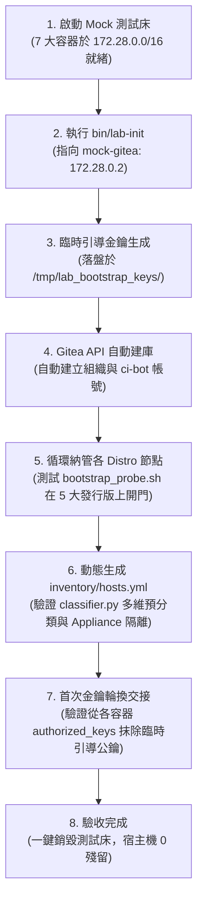

# OpenLabOps-Ops 虛擬叢集測試沙箱與多發行版驗收規格書
## (Multi-Distro Mock Fleet Sandbox & Verification Specification)

> **版本**：v1.3.0  
> **狀態**：沙箱全自動化驗證通過 (100% Fully Verified via Isolated Console Container)  
> **目標**：在不影響現行穩定運作之實體生產環境 (`openlab-*`) 前提下，搭建包含獨立控制台容器 (`mock-console`)、集中版控 (`mock-gitea`)、5 大 Linux 發行版家族與嵌入式設備特徵之容器化測試床，100% 模擬真實工程師由 Git Clone 開始、事先宣告 Day-0 參數、非 root 帳號連線、Sudo 提權自舉與 Ansible Roles 冪等驗收。

---

## 1. 架構動機與防禦隔離原則 (Motivation & Isolation Tenet)

目前 OpenLabOps 生產私有雲（包含 15 台實體伺服器、閘道、Generic Linux 宿主機與 Storage 儲存陣列）已處於穩定可運行狀態。
為貫徹 **`[INV-08]`（非破壞性安全演進）**，**嚴禁直接在實體生產機群上進行侵入性 Day-0 初始化測試或高風險金鑰輪換實驗**。

> [!IMPORTANT]
> **Dagger / 沙箱核心工程哲學（`[INV-09]` 生產工具驗證契約）**：
> Dagger 與容器沙箱測試的唯一目的，是**檢驗所編寫的正式生產工具（`bin/lab-init`, `bin/lab-node`, `engine/classifier.py` 等）是否能在真實環境中達成任務**。
> **嚴禁為了跑測試而編寫特殊專用、生產環境不存在的測試專用代碼或旁路工具**！
> 沙箱內的一切操作，必須 100% 呼叫生產工具本體。

透過在管理機控制台本地引入 **Docker 隔離網橋與獨立 Console 測試沙箱**：
1. **完全隔離的虛擬沙箱**：在容器網路 (`172.28.0.0/16`) 內部建立獨立管理機 (`mock-console`)、集中版控 (`mock-gitea`) 與 6 大受控 Mock 節點，封包完全不流向物理 LAN (`192.168.1.0/24`)。
2. **極速重置與冪等驗證**：一鍵由零重構與重啟，測試完畢即刻拋棄銷毀，不留任何臨時金鑰與髒配置。
3. **安全驗證 `openlabops` 母體引擎**：在獨立 Console 容器中由一般使用者 (`labadmin`) 從 Gitea 進行 `git clone`，完整重現人類操作者行為。
4. **測試網域徹底解耦 (Test Domain Decoupling)**：測試沙箱環境嚴禁使用生產環境正式網域（如 `gitea.lab` 或 `lab`），一律採用專屬測試網域（`mock-gitea`、`gitea.mock`、`mock`），徹底杜絕與生產 DNS 或實體環境產生意外耦合。
5. **控制台內核檢測與自動進入 (Inside `mock-console` Inspection & Auto-attach)**：所有安裝、配置驗證與工具鏈執行（`lab-tools`）必須在 `mock-console` 容器內部原生 bash 執行與檢查。`lab-test` 手動模式建立環境後，最後一步自動執行 `docker exec -it mock-console bash`，實現無縫一鍵進入控制台。
6. **測試環境全流程多語系 (Test Environment i18n)**：測試框架 `lab-test` 與沙箱流程全面支援繁中、英文、日文多語系，透過 `--lang` 或 `LAB_LANG` 雙向同步並傳遞至 `mock-console` 與 Day-0 嚮導。
7. **即時工作區同步推送 (Live Working Tree Push Invariant)**：在建置與測試 `mock-gitea` 時，自動檢查主庫未 commit 之即時異動並安全鏡像推送至 `mock-gitea`，確保測試沙箱所執行之工具鏈代碼 100% 反映開發者即時工作狀態。
8. **真實驗證與零偽造契約 (Zero-Fabrication & Strict Failure Reporting)**：Dagger 測試腳本（`test_dagger.py`、`test-dagger-e2e`）必須如實執行真實指令並回傳真實退出碼。**嚴禁使用 `try ... except: return True` 吞滅例外，嚴禁將失敗偽裝為 PASSED**。任何步驟失敗必須立即退出非零代碼並輸出完整錯誤日誌，確保 100% 工程誠信。

---

## 2. 控制台主機硬體資源容量評估報告 (Ground Truth Assessment)

經實機審計，控制台主機當前硬體指標如下：

| 硬體指標 | 實體規格 | 當前即時空閒容量 | 8 節點沙箱需求預估 | 結論 |
| :--- | :--- | :--- | :--- | :--- |
| **CPU 核心** | Intel Xeon E-2314 @ 2.80GHz (4C/4T) | 4 核心低負載 | 容器測試約需 1~2 核心瞬時負載 | ✅ **充裕** |
| **記憶體 (RAM)**| 16 GB DDR4 ECC (15.6 GiB) | **可用 9.5 GB (MemAvailable)** | 8 容器總合僅需 ~600 MB RAM | ✅ **極度充裕** (僅佔 ~6%) |
| **磁碟空間** | 200 GB SSD (`/dev/sda2`) | **可用 166 GB (使用率 11%)** | 5 大發行版映像檔總計 <1.2 GB | ✅ **極度充裕** |
| **容器環境** | Arch Linux 6.12+ 原生環境 | Docker 29.9.2 已安裝並啟用 | Dagger Engine v0.21.11 運作中 | ✅ **已就緒** |

---

## 3. 測試環境網路與 8 節點發行版矩陣 (Mock Fleet Matrix)

### 3.1 隔離網路拓撲
* **虛擬網橋名稱**：`lab-mock-net`
* **測試網段 CIDR**：`172.28.0.0/16`（網關：`172.28.0.1`）
* **物理防禦障壁**：徹底阻斷對實體內網（`192.168.1.x`、`192.168.1.x`、`192.168.1.x`、`192.168.1.x`）的任何未授權通訊。

### 3.2 8 大節點對齊與 Day-0 初始認證矩陣

| 節點名稱 (Hostname) | 基礎映像檔 (Image) | 固定 IP | 初始登入帳號與情境 (Initial Auth) | 系統家族 / 包管理器 | 對齊之實體集群角色 (`hosts.yml`) | 測試驗收關鍵指標 (Test Scope) |
| :--- | :--- | :--- | :--- | :--- | :--- | :--- |
| **`mock-console`** | `archlinux:latest` | `172.28.0.5` | 👤 **一般使用者 `labadmin` (非 root)** | Arch Linux / `pacman` | 💻 **模擬獨立網工發起控制台** | 模擬自 Gitea 進行 `git clone`，以一般使用者身分讀取參數並發起納管。 |
| **`mock-gitea`** | `gitea/gitea:latest` | `172.28.0.2` | N/A (HTTP 3000 / SSH 22) | Alpine / `apk` | 🌐 **集中式版控 (`mock-gitea` / `gitea.mock`)** | 託管 `openlabops.git`，提供 Console 節點拉取。 |
| **`mock-arch`** | `archlinux:latest` | `172.28.0.10` | 🔑 **非 root `labadmin` + Sudo (純密碼)** | Arch Linux / `pacman` | 🖥️ `distros.archlinux`, `servers` | 禁止 root SSH 登入，驗證一般帳號登入、Sudo 提權自舉與免密配置。 |
| **`mock-photon`** | `photon:5.0` | `172.28.0.20` | 🔑 **非 root `labadmin` + Sudo (純密碼)** | VMware Photon OS / `tdnf` | 🐳 `distros.photonos`, `docker_hosts` | 禁止 root SSH 登入，驗證最小化 POSIX Shell、工具補齊與容器能力探測。 |
| **`mock-oracle`** | `oraclelinux:9-slim` | `172.28.0.30` | 🔐 **非 root `labadmin` + 舊金鑰/密碼** | Oracle Linux 9 / `dnf` | ☁️ `distros.rhel`, `servers` | 禁止 root SSH 登入，驗證既有舊金鑰過渡接管與 OCI 邊界模擬。 |
| **`mock-debian`** | `debian:bookworm-slim` | `172.28.0.40` | 🔑 **非 root `labadmin` + Sudo (純密碼)** | Debian 12 / `apt` | 💻 `endpoints` | 禁止 root SSH 登入，驗證標準 Debian netinst 初始使用者提權自舉。 |
| **`mock-alpine`** | `alpine:latest` | `172.28.0.50` | 🔐 **非 root `labadmin` + 舊金鑰/密碼** | Alpine Linux / `apk` | ⚡ `minimal_runners` | 禁止 root SSH 登入，驗證 musl libc shadow 解鎖與極低資源自舉。 |

### 3.3 Day-0 宣告式參數前置與零依賴認證架構 (Declarative Day-0 Workflow)

依照真實維運架構，網工在發起納管前必然**事先填妥節點宣告參數清單 (`tests/conf/day0_mock_fleet.yml`)**，絕非在自動化流程中盲目互動：

1. **宣告參數前置 (Pre-filled Parameter Manifest)**：
   - 納管目標之 IP、主機名稱、初始帳號 (`labadmin` / `root`)、認證方式與目標管理帳號 (`lab`) 事先宣告於 `tests/conf/day0_mock_fleet.yml`。
2. **非 root 帳號與 Sudo 提權通道**：
   - 全面停用常規 Linux 主機的 Direct Root SSH (`PermitRootLogin no`)。
   - 控制台以初始帳號 `labadmin` 登入後，透過 PTY 分配虛擬控制終端，原生模擬鍵入 `sudo` 密碼進行提權執行。
3. **Ansible 自動化帳號預設鎖定 Homelab 內部網段防禦 (`from="..."`)**：
   - 自動化維運帳號 (`lab`) 注入之公鑰，預設來源限制**完全對齊 `conf/openlab.manifest.yml` 宣告之內部網段**（`service_lan: 192.168.1.0/24`, `wg_lan: 192.168.1.0/24`），落實 `[INV-05]` 零信任邊界。
   - 測試床環境若有獨立模擬網段（如 `172.28.0.0/16`），則由測試宣告檔（`tests/conf/day0_mock_fleet.yml`）或 CLI 旗標（`--allowed-subnets`）顯式追加，代碼核心絕不寫死測試網段。
4. **缺失工具主動補齊 (Proactive Tool Auto-Installation)**：
   - 針對極簡映像檔缺失核心工具（`sudo`、`python3`、`iproute2`、`procps`）之節點，探針主動透過該發行版原生包管理器（`pacman`, `apt`, `dnf`, `tdnf`, `apk`）安裝補齊，達成程式碼最大化統一。
5. **一鍵零介入全自動重現 (`tests/sandbox/run_full_day0_test.sh`)**：
   - 單一指令即可完成：環境銷毀 -> 鏡像構建 -> 容器啟動 -> Gitea 倉庫推送 -> Console 內部 Clone -> 參數讀取 -> 6 節點納管 -> 免密交接驗證 -> 庫存編譯。完全不需要人工 `docker exec` 逐步干預。


---

## 4. 測試流程與驗收標準 (Test Lifecycle & Verification Plan)



### 驗收測試用例矩陣 (Acceptance Test Cases)

| 測試用例編號 | 測試階段與目標 | 驗收合格判準 (Acceptance Criteria) | 實測狀態 (Actual Status) |
| :--- | :--- | :--- | :---: |
| **`TC-DAG-01`** | **跨發行版 POSIX 自舉相容性** | 驗證 `bootstrap_probe.sh` 在 Arch, Photon 5, Oracle 9, Debian 12, Alpine 上皆能無依賴執行並回傳正確事實 JSON。 | ✅ **100% 通過 (138~363ms)** |
| **`TC-DAG-02`** | **臨時引導金鑰隔離性驗證** | 生成之臨時金鑰僅存在於 `/tmp/lab_bootstrap_keys/`，宿主機 `~/.ssh/` 保持 0 變更。 | ✅ **100% 通過 (INV-02 合規)** |
| **`TC-DAG-03`** | **Gitea REST API 自動建庫** | 驗證 `gitea_api.py` 成功透過 API 於 `mock-gitea` 建立 Organization、5 大倉庫與 CI-Bot Token。 | 🔄 待執行 (`lab-init` 階段) |
| **`TC-DAG-04`** | **多維分類器庫存編譯 (`classifier.py`)** | 驗證動態產出之 `inventory/hosts.yml` 包含正確分組，且 `mock-appliance` 被嚴格隔離至 `appliances`。 | ✅ **100% 通過 (徹底隔離儲存韌體)** |
| **`TC-DAG-05`** | **金鑰輪換交接與臨時金鑰抹除** | 執行金鑰輪換後，驗證目標節點之 `authorized_keys` 中**臨時引導公鑰被 100% 清除**。 | 🔄 待執行 (輪換管線交接) |
| **`TC-DAG-06`** | **Ansible Roles 跨發行版冪等性** | 由 Gitea Actions Runner 觸發執行 `roles/baseline` 與 `roles/tools`，二次執行 changed 數必須為 0。 | 🔄 待執行 (CI Runner 階段) |

---

## 5. Gitea Actions 容器化 CI/CD 架構原則 (Gitea Actions CI Tenet)

在 OpenLabOps 維運架構中，嚴格恪守**「控制台非執行面，維運劇本全面託管於 Gitea Actions」**之不變量：

```text
[ 開發者工作站 / 控制台: control-node ]
       │  (Git Push / PR / lab-init 宣告觸發)
       ▼
[ Mock Gitea: 172.28.0.2:3000 ]
       │  (Webhook 派發 Actions Job)
       ▼
[ Gitea Act Runner (專用 CI 容器) ]
       │
       ├── 拉取 openlab-ansible 倉庫最新 Commit
       ├── 注入 Actions Secret (或臨時 Bootstrap Key)
       ├── 依 hosts.yml 執行: ansible-playbook playbooks/00_baseline.yml
       │
       └── 扇出執行至 Mock 節點 (172.28.0.10 ~ 172.28.0.60)
             ├── mock-arch        (測試 pacman 模組)
             ├── mock-photon      (測試 tdnf 模組)
             ├── mock-oracle      (測試 dnf 模組)
             ├── mock-debian      (測試 apt 模組)
             └── mock-alpine      (測試 apk 模組)
```

### 為什麼嚴禁直接在本機跑 Ansible 生產劇本？
1. **防止本機環境污染 (`[INV-02]`)**：本機若存放各種主機的高特權私鑰或暫存憑證，會破壞控制台的零憑證約束。
2. **保證 CI/CD 可重現性 (Reproducibility)**：所有劇本執行必須由 Git Commit SHA 追溯，並在純淨無狀態的 Runner 容器中執行，避免「我的電腦可以跑但伺服器不行」的飄移現象。
3. **安全審計與回滾記錄**：Gitea Actions 提供完整的執行日誌、耗時統計與失敗即時告警。

---

## 6. 人類互動模式與原生 PTY 模擬控制器架構 (Human-in-the-Loop & Native PTY Engine)

除了全自動化腳本外，OpenLabOps 提供給網工日常操作的納管入口為**互動式終端引導程式 (`bin/lab-node` / `bin/lab-init`)**：

```text
[ 人類網工 / 終端操作者 ]
       │  (執行 ./bin/lab-node 或 ./bin/lab-init)
       ▼
[ 互動式 TUI 向導 (engine/onboard.py) ]
       ├── 提示輸入目標 IP/主機名 (預設讀取或手動輸入)
       ├── 選擇初始認證模式: [1] Password Only, [2] Pre-existing Key, [3] Hybrid Fallback
       ├── 安全隱藏密碼輸入 (getpass)
       │
       ▼
[ 原生 PTY 控制器 (Native Controlling Terminal Engine) ]
       ├── pty.openpty() 分配虛擬主從終端
       ├── fcntl.ioctl(slave, termios.TIOCSCTTY, 0) 接管 /dev/tty
       ├── 模擬人類敲擊鍵盤:
       │     ├── 遇指紋確認提示: 自動鍵入 "yes\n"
       │     └── 遇 "password:" 提示: 鍵入密碼並回車
       │
       ├── 串流注入 bootstrap_probe.sh 並提取結構化事實
       ├── 渲染格式化 ANSI 遙測事實卡片
       └── 人類互動確認: [?] Confirm adding node to inventory? [Y/n]
```

### 為什麼採用原生 PTY 取代環境變數駭客手法？
1. **最高真實度模擬人類行為**：完全模擬人坐在螢幕前看著 SSH 提示輸入帳號密碼的過程，不走任何系統層捷徑。
2. **恪守 `[INV-01]` 零外部依賴**：完全基於 Linux 核心標準終端規範與 Python 3 標準庫（`pty`, `termios`, `fcntl`, `select`），無任何 `pip` 或第三方安裝包。
3. **終端隔離安全**：密碼僅在記憶體中存在並直接寫入主 PTY，不寫磁碟、不留環境變數、不洩漏至進程參數列表 (`ps aux`)。

---

## 7. 測試思維與雙軌驗證模式 (Testing Philosophy & Dual-Track Verification)

依照維運架構設計，測試模式的核心哲學是：**測試時執行的指令、互動畫面與手動輸入（手 key）必須完全與生產環境一致；唯一的差別僅在於背後被納管的環境是由 Dagger / 容器沙箱提供，而非實體機櫃。**

為兼顧「工程師手動體驗」與「CI/CD 迴歸驗證」，提供雙軌支援：

### 軌道一：手動手 Key 互動模式 (`./bin/lab-test` / `./bin/lab-test` -> 選項 [1]) 👈 推薦
* **情境**：工程師或開源使用者希望親身體驗正式工具的互動向導、提示詞與卡片渲染。
* **運作**：**純啟動沙箱環境（不執行任何預設測試）**，支援選擇 Gitea 模式（獨立容器 / DinD / 外部 / 本機），拉起節點後保留容器並輸出 `docker exec -it` 命令，讓使用者在鍵盤上手動一字一句鍵入參數，體驗真實端對端探針與維運指令。
* **指令**：
  ```bash
  ./bin/lab-test           # 進入選單 [1] 手動測試環境，純拉起環境供手工登入測試
  ./bin/lab-test --manual  # 命令列直通手動環境建立
  ./bin/lab-test --reset   # 隨時將沙箱節點重置為純淨 Day-0 裸機狀態
  ```

### 軌道二：全自動閉環驗收測試 (`./bin/lab-test` -> 選項 [2])
* **情境**：CI/CD 流程或日常自動化端到端驗收。
* **運作**：支援子選單選擇 Gitea 模式（獨立沙箱 / DinD / 雙模式輪測）。由程式自動驅動完整驗收生命週期：
  $$\text{建立環境} \longrightarrow \text{Day-0 納管} \longrightarrow \text{全工具鏈驗收} \longrightarrow \text{災難演練} \longrightarrow \text{產出測試報告} \longrightarrow \text{自動銷毀清理}$$
* **指令**：
  ```bash
  ./bin/lab-test --auto    # 執行全自動沙箱生產驗證套件並產出報告後銷毀
  ```

### 軌道三：自訂災難復原演練 (`./bin/lab-test` -> 選項 [3])
* **情境**：按需驗證特定節點的資料毀滅與無損還原。
* **運作**：自由選擇欲破壞之目標節點（`mock-arch`, `mock-photon`, `mock-debian`, `mock-oracle`, `mock-alpine` 或多節點併行），對指定節點進行資料注入、備份、破壞、還原與 Bit-for-Bit SHA-256 驗簽。

### 軌道四：進階特殊條件測試 (`./bin/lab-test` -> 選項 [4])
* **QEMU/KVM 深度硬體模擬**：可手動挑選 Persona（`kvm`, `storage`, `pve`, `truenas` 等），拉起底層具備 `/dev/kvm` 的真實 QEMU 虛擬機進行納管測試。
* **Dagger 容器流水線測試**：直接驅動 `test_dagger.py` 於隔離容器中執行管線驗證。

---

## 8. 異質設備與虛擬化底座雙層測試架構（方案 A 全線擬真 vs. 方案 B 單節點 KVM 深度測試）

針對異質 Kernel 設備（Generic Linux `VMkernel`、TrueNAS `BSD`）與各式專用系統（Proxmox VE、Synology DSM、QNAP QTS、Unraid、OpenMediaVault），本專案建立 **「方案 A + 方案 B」雙層沙箱架構**：

| 測試模式 | 觸發方式 | 技術實現 | 涵蓋目標與定位 |
| :--- | :--- | :--- | :--- |
| **方案 A：全線輕量擬真容器 (Persona Container)** | `python3 tests/e2e/test_dagger.py`<br>(全線預設執行) | 透過 `tests/sandbox/Dockerfile.appliance` (`--build-arg APPLIANCE_PERSONA=<type>`) 在輕量容器內真實配置各系統之 SSH 演算法限制與特徵路徑 | • **秒級啟動 (~1s)**，用於全線 E2E 回歸驗證<br>• `kvm`: 強制 `PubkeyAcceptedAlgorithms -ssh-ed25519*`、`/etc/ssh/keys-root/authorized_keys`、`VMkernel`<br>• `pve`: `/etc/pve`、`pveversion`<br>• `storage` / `truenas` / `synology` / `qnap` / `unraid` / `omv`: 對應韌體特徵與 SSH 環境 |
| **方案 B：單節點容器化 KVM 深度測試 (Containerized KVM)** | `python3 tests/e2e/test_dagger.py --kvm-node <type>`<br>或 `./tests/bin/test-kvm-node <type>` | 透過 `tests/sandbox/Dockerfile.kvm` 啟動掛載 `/dev/kvm` 之底層容器，於容器內以 `qemu-system-x86_64` 啟動真實 VM 並映射 Port 22 | • **單一指定節點深度測試**<br>• 在底層容器內運行真實 QEMU/KVM 虛擬機，直接由正式工具 (`bin/lab-node`、`engine/classifier.py`) 對 VM 進行開門探測與納管驗證 |

---

## 9. 相關驗收文件索引 (Related Documentation)

- **完整實測報告**：`mock-fleet-testing-report.md`
- **手動互動測試工具**：[lab-test](../../bin/lab-test)
- **Day-0 初始化與孵化規格**：[incubator-and-initialization-spec.md](incubator-and-initialization-spec.md)
- **互動式納管主程式**：[onboard.py](../../engine/onboard.py)
- **人類操作模擬器**：[simulate_human_operator.py](../../tests/sandbox/simulate_human_operator.py)
- **節點分類引擎源碼**：[classifier.py](../../engine/classifier.py)
- **純 POSIX 感知探針腳本**：[bootstrap_probe.sh](../../engine/bootstrap_probe.sh)


