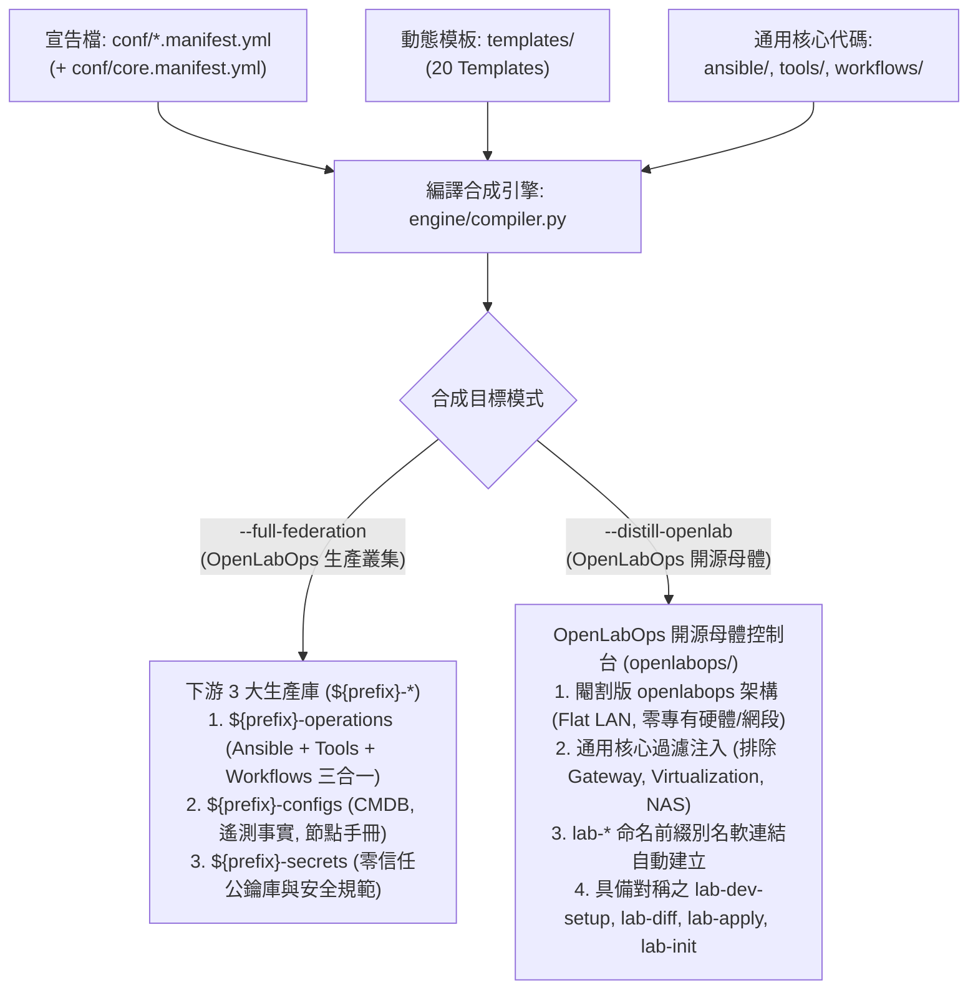

# OpenLabOps-Ops 聯邦母體全量合成與 OpenLabOps 開源蒸餾規格書
## (Master Federation Full Synthesis & OpenLabOps Generic Distillation Specification)

> **版本**：v1.1.0  
> **狀態**：正式落實 (Fully Implemented & Verified [✓])  

---

## 1. 架構願景與核心動機 (Vision & Strategic Tenets)

在過去維運模式中，配置檔案容易產生職責混淆。為貫徹 **「母體即通用無狀態引擎」**、**「執行期動態抓取金鑰與備份」** 與 **「參數化衍生開源版（Declarative Distillation）」** 原則：

1. **母體無狀態與 GitOps 解耦原則**：
   - `openlabops` 不存放實體節點備份設定檔（如 `pf.conf`、`host_vars/`、`shell/*.rc`、`editor/nvim/`）。
   - `openlabops` 的唯一責任是：**建立出可運作的 GitOps 執行環境**（渲染模板、建立聯邦倉庫、配置 CI/CD Actions 工作流、發布自動化劇本與 CLI 工具）。
   - 當 GitOps 環境建立完成後，運維 Playbooks 與 Actions 執行期會**自動至 `secrets` 倉庫動態抓取新金鑰**，並**自動至 `configs` 倉庫抓取對應節點的備份設定檔**來進行部署與還原。
2. **全量母體合成（Full Federation Synthesis）**：
   - `openlabops` 是母體源代碼庫（Source of Truth）。
   - 透過單一站點宣告檔（`conf/<site>.manifest.yml`）一鍵編譯渲染下游 3 大生產庫的宣告與通用無狀態代碼：
     - `*-operations`：整合 Ansible IaC、Ops CLI Tools、Gitea Workflows 於單一維運倉庫。
     - `*-configs`：純動態硬體遙測、節點手冊與備份。
     - `*-secrets`：公鑰與安全存取規範（[INV-02] 零私鑰入庫）。
3. **開源通用蒸餾（OpenLabOps Distillation）**：
4. **選配式容器化與 Dockerfile 規範**：
   - **Gitea Runner** 與 **AGY-Remote** 開發容器嚴禁寫死或強制依賴外部預建 image 存檔；一律在專案內提供標準 `Dockerfile`。
   - 生產環境中 Gitea Runner 與遠端環境常由維運人員手工建立，因此兩者在 CLI 指令（`lab-init`、`lab-dev-setup`）與 Ansible 劇本中皆設為**選配參數（預設關閉，參數觸發）**。

---

## 2. 三層分離與資料流架構 (Three-Tier Separation & Data Flow)

```text
openlabops/ (無狀態母體控制台)
├── conf/
│   ├── core.manifest.yml              # [Immutable] 5庫聯邦規格與安全 Schema
│   ├── openlab.manifest.yml         # [Site Declarative] OpenLabOps 站點實體宣告
├── schema/                            # [Immutable CUE] 不可變約束定義
├── ansible/                           # [Core Code] 通用 IaC 核心 (Playbooks, Roles, Scripts)
├── tools/                             # [Core Code] 通用 CLI 工具鏈 (bin, lib, conf)
├── workflows/                         # [Core Code] 通用 Composite Actions (.gitea/actions/)
├── templates/                         # [Core Code] 20 大動態 Jinja2 模板
├── docker/                            # 🐳 容器化環境定義檔 (含 Dockerfile，參數化選配)
│   ├── gitea-runner/Dockerfile        # Gitea Act Runner 獨立建置 Dockerfile
│   └── remote-dev/Dockerfile          # AGY 遠端代理人開發環境 Dockerfile
└── engine/                            # 編譯、分類與初始化引擎 (compiler, classifier, initialize)

運行時資料動態流向 (Runtime GitOps Data Flow):
┌──────────────────────────────────────────────────────────────┐
│                    GitOps Runner / CI / Agent                │
│                                                              │
│  1. 執行 openlabops 生成之 Playbooks / Workflows           │
│  2. 動態讀取 <site>-secrets 取得授權私鑰與 Token               │
│  3. 動態讀取 <site>-configs 取得目標主機備份檔 (pf.conf 等)     │
│  4. 對目標節點進行冪等配置收斂與狀態漂移修復                   │
└──────────────────────────────────────────────────────────────┘
```

---

## 3. 合成編譯器引擎工作原理 (`engine/compiler.py`)

合成編譯器引擎支援單一 CLI 入口，具備 Dry-run 比對 (`--diff`) 與覆寫套用 (`--apply`)：



### 3.1 核心指令速查

| 維運目標任務 | CLI 執行指令 | 說明與產出 |
| :--- | :--- | :--- |
| **比對 OpenLabOps 聯邦差異** | `python3 engine/compiler.py --diff --full-federation` | 檢查 3 大下游庫模板與核心通用代碼變更 |
| **一鍵合成套用至 `${prefix}-*`** | `python3 engine/compiler.py --apply --full-federation` | 覆寫渲染 3 大庫（operations, configs, secrets），達成與實體生產環境 100% 同步 |
| **一鍵蒸餾產出 `openlabops`** | `python3 engine/compiler.py --apply --distill-openlab` | 產出開源母體控制台 `openlabops` 與 `lab-*` 指令鏈 |

---

## 4. OpenLabOps 蒸餾過濾規則與雙軌架構 (Isolation & Decoupling Contract)

為嚴格遵循 OpenLabOps [`[INV-04] Core Scope Boundaries`](file:///home/labadmin/openlabops/AGENTS.md) 與 [`[INV-05] Extensible Isolation`](file:///home/labadmin/openlabops/AGENTS.md)，合成引擎在執行 `--distill-openlab` 時將 `openlabops` 母體直接蒸餾成開源版 `openlabops` 控制台，強制實施以下過濾、解耦與自舉機制：

1. **Ansible 角色、劇本與變數過濾**：
   - 排除 `roles/gateway/`（BSD 專屬防火牆）。
   - 排除私有主機群組變數（`appliances.yml`, `kvm.yml`, `storage.yml`, `openlab.yml`, `oci*.yml` 等）。
   - 保留標準伺服器基線 (`baseline`)、容器運行時 (`docker_runtime`)、使用者管理 (`users`)、Dotfiles (`dotfiles`)、維運工具 (`tools`) 與金鑰管理 (`ssh_keys`)。

2. **Schema 規格庫解耦 (Flat LAN & 6-Role Contract & Invariants)**：
   - 嚴禁直接直通鏡像 OpenLabOps 6 大 pf 子網與 Gateway 規格。
   - 注入純淨 Flat LAN 網路規格：`openlabops/schema/network.cue` 鎖定 `flat_lan` (`192.168.1.0/24`)。
   - 注入通用 6 大 Linux 伺服器角色合約：`openlabops/schema/roles.cue` 排除 `gateway` 角色。
   - 注入開源專屬不變量規格：`openlabops/schema/invariants.cue`（對齊 `[INV-05] Flat LAN` 與 `[INV-02] ansible.key`，清除母體 pf.conf 6 大子網與私有金鑰殘留）。
   - 確保 `openlabops/` 根目錄執行 `cue eval ./schema/...` 100% 通過。

3. **機密脫敏、獨立宣告與 Group Vars 生成**：
   - 嚴禁直接拷貝包含私有硬體清冊之 `tools/conf/tools.config.json`。
   - 自動生成中性脫敏之 `openlabops/tools/conf/tools.config.json`（僅含範例節點與 `ansible.key` / `git.key`）。
   - 注入預設乾淨之 `openlabops/conf/openlab.manifest.yml` 作為 Day-0 SSOT 宣告檔。
   - **動態渲染開源 `group_vars/all.yml`**：蒸餾時以 `conf/openlab.manifest.yml` 為輸入，調用編譯引擎將 `templates/ansible/group_vars_all.yml.j2` 渲染為 `openlabops/ansible/group_vars/all.yml`，確保全網通用變數無缺口。

4. **子系統完整同步 (i18n & Docs & Tests & Root Files)**：
   - **多語系 (`lang/`)**：同步 `lang/*.json`，使 OpenLabOps 具備完整繁中、英文、日文國際化支援。
   - **文件庫與終端手冊 (`docs/`)**：同步 `docs/`（包含架構手冊與 `docs/user_manual/`），並自動建立 `bin/lab-man` 與 `tools/bin/lab-man` 軟連結，提供開箱即用之終端手冊瀏覽。
   - **測試沙箱與單元測試雙軌相容 (`tests/`)**：同步 `tests/bin/`、`tests/sandbox/`、`tests/unit/` 與 `tests/conf/openlab.manifest.test.yml`；單元測試 `test_core_units.py` 具備雙軌識別能力，自動偵測環境加載對應之 manifest 與指令驗收，確保 100% 綠燈通過。
   - **根目錄資產**：注入 100% 英文專業 `README.md`、`NOTICE`（致敬上游）、`LICENSE`、`AGENTS.md`、`.gitignore` 與 `.geminipromptignore`。

5. **Tools CLI 前綴別名綁定與雙模態自適應**：
   - 自動在 `openlabops/bin/` 建立對應於 `lab-*` 之開源對稱軟連結：
     - `lab-test` $\rightarrow$ `lab-test` (手動手 Key 互動測試模式與沙箱驗證)
     - `lab-init` $\rightarrow$ `lab-init`
     - `lab-node` $\rightarrow$ `lab-node`
     - `lab-dev-setup` $\rightarrow$ `lab-dev-setup`
     - `lab-diff` $\rightarrow$ `lab-diff`
     - `lab-apply` $\rightarrow$ `lab-apply`
     - `lab-discover` $\rightarrow$ `lab-discover`
     - `lab-config` $\rightarrow$ `lab-config`
     - `lab-man` $\rightarrow$ `lab-man`
   - 自動在 `openlabops/tools/bin/` 建立 `lab-status`, `lab-ssh`, `lab-backup`, `lab-tools`, `lab-upgrade`, `lab-man` 等指令。
   - `engine/initialize.py`, `engine/onboard.py`, `engine/classifier.py` 與 `tools/lib/sync_ops_tools.py` 具備環境感知能力：
     - 當處於 `openlabops` 時預設採用 `OpenLab` 集群名稱、`ansible` 運維帳號、`labadmin` 管理者、`ansible.key`、`lab` 網域與 `192.168.1.0/24` Flat LAN 來源限制。

---

## 5. 容器化開發、Runner 與測試環境參數化架構

在 `openlabops` 與 `openlabops` 中，所有容器化組件皆有透明標準之 `Dockerfile`，並嚴格遵循**參數控制原則**：

### 5.1 Gitea Act Runner (`docker/gitea-runner/Dockerfile`)
- **定位**：內部 CI/CD 執行節點，預載 Python3、OpenSSH、Ansible-Core、Docker CLI。
- **建置方式**：以 `docker/gitea-runner/Dockerfile` 本地編譯，取代靜態 Image 歸檔。
- **選配開關**：
  - `lab-init --with-gitea-runner`：僅在明確傳入該參數時，才引導註冊與啟動 Runner；未帶參數時自動跳過（預設使用者手工維護）。

### 5.2 AGY-Remote 開發環境 (`docker/remote-dev/Dockerfile`)
- **定位**：供 Antigravity AI Agent 進行遠端連線開發之容器化工作區，提供完整 OpenSSH Server、CUE、Dagger、Docker CLI 與 Python 工具鏈。
- **選配開關**：
  - `lab-dev-setup --with-remote-dev` 或 `ansible-playbook dev-environment.yml -e setup_agy_remote=true`：僅在指定時進行 Docker Build 並啟動容器；預設僅配置本地工作機工具鏈。

### 5.3 沙箱 Mock Fleet 測試床
- **選配開關**：
  - `./bin/lab-dev-setup --dev-only` (預設)：僅確保開發環境滿足 (Python, CUE, Dagger, Docker Net, Hooks)。
  - `./bin/lab-dev-setup --with-test-fleet` (全量)：一併編譯並拉起沙箱測試床容器。
- 在 `openlabops` 中完全對稱支援 `./bin/lab-dev-setup [--with-test-fleet|--with-remote-dev|--dev-only]`。

---

## 6. 驗證結論 (Verification)

* **OpenLabOps 差分核驗**：執行 `python3 engine/compiler.py --apply --full-federation`，全數模板與通用核心代碼 100% 同步，且母體庫零備份檔案污染。
* **OpenLabOps 產出核驗**：執行 `python3 engine/compiler.py --apply --distill-openlab`，成功將 `openlabops` 核心過濾蒸餾至 `/home/labadmin/openlabops/` 作為獨立開源維運控制台，`lab-*` 入口指令鏈完整就緒。
