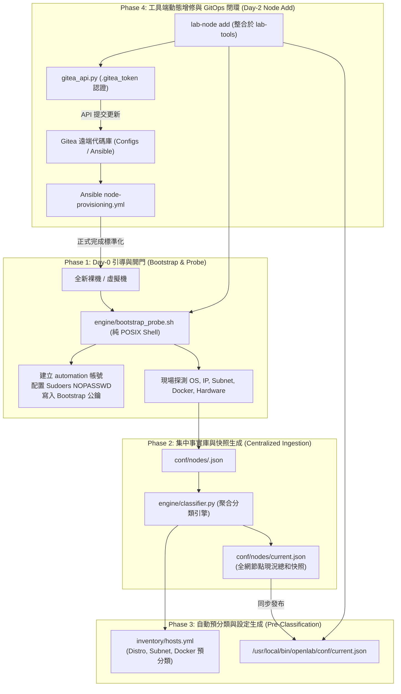

# 節點動態納管與自動預分類架構規格書 (Node Onboarding & Ingestion Specification)
> **規範層級**：核心架構標準 (Core Architecture Specification)  
> **適用範圍**：OpenLabOps Operations Hub (`openlabops`) 與 OpenLabOps 開源體系  
> **目標**：解決 Day-0 節點初始引導（開門）的雞生蛋問題，並在 Day-2 提供零人工登錄的動態節點增修（Node-Add）與自動拓撲分類機制。

---

## 1. 問題意識與架構目標

在傳統的 IaC 維運流程中，普遍存在兩大痛點：
1. **Day-0 Bootstrap 雞生蛋矛盾**：全新安裝的作業系統尚未配置自動化帳號（如 `lab`）、Sudoers 免密權限或 SSH 公鑰。Ansible 在此階段無法透過 SSH 進入節點，導致自動化劇本無法在第一時間派發。
2. **手動登錄導致維運漂移**：維運者需手動查閱機器 IP、網卡 MAC、作業系統版本，再手動修改 `hosts.yml` 或 `manifest.yml`。此過程極易發生打字錯誤，且難以維護即時的硬體事實（Ground Truth）。

本規範提出 **「引導開門 + 即時事實探測 + 集中聚合快照 + Gitea API 閉環納管」** 的架構標準。

---

## 2. 核心架構四階段閉環



---

## 3. 節點端輕量引導腳本規範 (`engine/bootstrap_probe.sh`)

### 3.1 設計約束
* **零依賴 (Zero Dependency)**：純 POSIX Shell 腳本，完全相容 Linux (`sh`, `bash`) 與 BSD (`sh`)，不依賴 `curl`, `jq`, `python` 是否已安裝。
* **安全自舉 (Safe Bootstrap)**：
  - 檢測或建立自動化專用帳號（預設 `lab`，支援參數傳入）。
  - 配置 `/etc/sudoers.d/<automation_user>`（權限 `0440`，visudo 檢驗）。
  - 建立 `/home/<automation_user>/.ssh/authorized_keys`（目錄 `0700`，檔案 `0600`）並寫入傳入之 Bootstrap 公鑰。
  - 確保 OpenSSH daemon 處於運行狀態。

### 3.2 節點 Inventory 分類資料結構 (`conf/nodes/<hostname>.json`)
> [!IMPORTANT]
> **職責邊界（Inventory 分類專用 vs. CMDB 硬體遙測）**：
> `conf/nodes/<hostname>.json` 的唯一用途是**提供 `classifier.py` 自動分類與建立 Ansible Inventory (`hosts.yml`)**，因此**僅保留 Ansible Inventory 分群所需的分類欄位**，嚴禁鎖定 `mac_address` 或混入 `kernel`、`cpu_cores`、`memory_mb`、`disk_total_gb` 等 Ansible Inventory 用不到的硬體細節（詳細硬體資訊專屬於 `openlab-configs/node-information/node_<hostname>.json`，由 `lab-discover` 獨立蒐集，與 `lab-node` 無關）。

```json
{
  "hostname": "srv-node1",
  "fqdn": "srv-node1.local",
  "primary_ip": "192.168.1.10",
  "subnet_cidr": "192.168.1.0/24",
  "node_category": "server",
  "always_online": true,
  "is_immutable": false,
  "appliance_type": "none",
  "key_profile": "standard",
  "os_family": "PhotonOS",
  "distribution": "VMware Photon OS",
  "capabilities": {
    "has_docker": true,
    "has_python": true
  }
}
```

---

## 4. 兩層式節點分類體系 (`standard` vs. `appliance`)

分類聚合引擎讀取 `conf/nodes/*.json` 後，依據兩大頂層架構大類將節點自動歸類到 `inventory/hosts.yml`：

1. **`standard`（標準通用作業系統）**：
   - **`dev`**：常駐開發控制台（`control-node`, `dev-client`），強制 `always_online: true`，唯一允許持有維運私鑰（`ansible.key`, `id_user.key`, `git.key`）之節點。
   - **`server`**：7/24 常駐服務伺服器（`always_online: true`），僅部署 `authorized_keys` 公鑰。
   - **`desktop`**：間歇在線之個人工作站/筆電（`always_online: false`），**嚴格禁止設為 `dev`**。
   - **衍生 Inventory 分群屬性**：透過 `os_family`、`distribution` 與 `capabilities` (`has_docker`, `has_python`) 自動衍生出 `[distros:*]` 與 `[capabilities:docker]` 群組。
2. **`appliance`（封閉韌體與專用設備）**：
   - **`hypervisor`（虛擬化宿主機）**：
     - Generic Linux (`appliance_type: "kvm"`, `is_immutable: true`, `key_profile: "kvm"`，使用 `root` 與專用 `ansible.key`)。
     - Proxmox VE (`appliance_type: "pve" | "proxmox"`, `key_profile: "standard"`，Debian 核心底座虛擬化平台)。
   - **`storage`（NAS 儲存設備 OS）**：
     - 支援常見 NAS 系統：Storage (`"storage"`)、TrueNAS CORE/SCALE (`"truenas"`)、Synology DSM (`"synology"`)、QNAP QTS/QuTS (`"qnap"`)、Unraid (`"unraid"`)、OpenMediaVault (`"omv"`)，統一使用儲存設備金鑰規格 (`key_profile: "storage"`)。
   - **防禦性隔離**：所有 `appliance` 嚴格隔離於 `[appliances:children:hypervisors]` 或 `[appliances:children:storage]`（及對應子群組），嚴禁混入 `[distros]` 或 `[servers]`。

### 4.1 作業系統發行版群組 (Distro Groups)
* **目的**：決定基礎環境部署（`roles/baseline`）時所呼叫的底層套件管理命令與系統行為。
* **分類規則 (僅針對 `node_category == "server"`)**：
  - `PhotonOS` $\rightarrow$ `[photonos]` (tdnf)
  - `BSD` $\rightarrow$ `[bsd]` (pkg)（僅限非韌體之常規 BSD 節點，如 Gateway）
  - `Archlinux` / `ArchLinux` $\rightarrow$ `[archlinux]` (pacman)
  - `Debian` / `Ubuntu` $\rightarrow$ `[debian]` (apt)
  - `RedHat` / `OracleLinux` / `Rocky` $\rightarrow$ `[rhel]` (dnf)
  - `Alpine` $\rightarrow$ `[alpine]` (apk)
  - `Suse` $\rightarrow$ `[suse]` (zypper)

### 4.2 子網路群組 (Subnet Groups)
* **目的**：決定防火牆白名單（pf tables / iptables）、路由與網段邊界。
* **分類規則**：
  - 根據探測到的 `subnet_cidr` 自動分組。
  - 若命中國內或站點定義表（如 `service_lan: 192.168.1.0/24`），優先套用站點群組別名；否則命名為 `subnet_<network_id>`（如 `subnet_192_168_131_0`）。

### 4.3 運行能力群組 (Capability Groups)
* **目的**：讓後續特定專案的 Playbook 能直接鎖定通用目標。
* **分類規則**：
  - `capabilities.has_docker == true` $\rightarrow$ `[docker_hosts]`（自動納入容器維運管轄）
  - `capabilities.has_python == false` $\rightarrow$ `[raw_bootstrap_required]`（標記需要 raw module 安裝 Python）
  - 角色為 Default Gateway 者 $\rightarrow$ `[gateways]`

---

## 5. 快照聚合與動態維護規範 (`current.json` & SSOT)

1. **零預載節點原則 (Zero-Preloaded Nodes Invariant)**：
   - 官方倉庫與全新專案環境預設不包含任何預設機台之靜態 `conf/nodes/*.json`。
   - 全網所有被納管之節點事實均經由 `lab-init`（Day-0 引導精靈）或 `lab-node add`（動態納管指令）現場探測產生。

2. **即時動態掃描優先與 Manifest 參考降級 (Live Ground-Truth Priority & Manifest Reference-Only)**：
   - `lab-node list`、`lab-discover`、`classifier.py` 與所有運維工具 (`config.py`) 查詢集群清單時，**一律優先讀取實機抓到的 `conf/nodes/*.json` (`current.json`) 作為唯一事實源 (SSOT)**。
   - `*.manifest.yml` (`openlab.manifest.yml` / `openlab.manifest.yml`) 僅作為 Day-0 引導參考或匯出快照，**嚴禁以 `*.manifest.yml` 靜態設定或 `tools.config.json` 覆蓋 `conf/nodes/*.json` 實際探測到的節點屬性**；僅在尚未有任何 `conf/nodes/*.json` 時才允許作為初始引導參考備援。
   - 快照檔案 `current.json` 定位為由 `engine/classifier.py` 自動編譯之衍生產物，供邊緣工具作為快速讀取快取。

3. **同步除役與快照即時收斂 (Synchronous Decommission)**：
   - 當節點執行除役 (`lab-node remove` 或精靈除役) 時，系統必須同步執行 `classifier.py --apply`。
   - 同時強制更新全域安裝路徑 `/usr/local/bin/openlab/conf/current.json` 與本地 `conf/nodes/current.json`，確保已除役節點立即自所有清單中消失，杜絕快照脫節。

4. **表單輸入即時提示區塊 (In-Form Help Block)**：
   - 互動式納管表單提供視窗內建的動態說明區塊 (Contextual Info Block)，當游標移動至 `role` (server / dev / desktop / hypervisor / storage) 等特定輸入框時，主動顯示該選項之架構意圖與定義，輔助使用者填寫。

---

## 6. Day-2 增修工作流、即時 PTY 密碼攔截與單節點即時收斂 (`lab-node` & `lab-init`)

`lab-init`（Day-0 叢集引導精靈）與 `lab-node`（Day-2 節點管理）共用同一套底層納管與救援引擎（[`engine/onboard.py`](../../engine/onboard.py) 與 [`engine/bsd_dialog.py`](../../engine/bsd_dialog.py)）：

### 6.1 即時 PTY 互動式密碼攔截與異常防卡死
1. **宣告式意圖優先 (No Silent Account Guessing)**：在連線檢驗與開門階段，引擎嚴格遵循宣告清單或維運者指定之帳號與金鑰設定進行檢驗，絕不在背景擅自以其他帳號（如 `lab` 或 `root`）進行隱性猜測；若需要更換帳號或提供密碼，由維運者在提示或救援流程中明確指定。
2. **運行中 PTY 即時密碼攔截 (In-flight Interactive Password/Passphrase Interception)**：
   在執行 `execute_pty_ssh` 串流執行探針腳本時，若遠端主機彈出：
   - `[sudo] password for <user>:`（Sudo 提權密碼提示）
   - `Enter passphrase for key ...:`（私鑰密碼鎖定提示）
   - `<user>@<host>'s password:`（SSH 密碼驗證提示）
   引擎會透過 `prompt_callback` **即時彈出 `bsdinstall` 風格密碼輸入對話框（`password_dialog`）或終端隱蔽提示**，維運者可當場鍵入密碼，密碼即時傳入 PTY 虛擬終端繼續執行探針，**完全無須中斷程式或重啟探針流程**。若使用者按 `<Cancel>` 或 `<Esc>` 放棄，引擎立即發送中斷碼 `\x03` 退出，絕不發生 25 秒盲等逾時。
3. **單節點即時收斂工作流 (Per-Node Streamlined Onboarding)**：
   在節點引導與納管時，採取「單節點即時完成」策略：
   - 每個節點在被指定或輸入後，立刻執行連線與開門探測；
   - 若發生密碼提示，當場攔截輸入；若連線失敗，當場彈出該節點之專屬救援對話框（`prompt_node_rescue_dialog`），允許維運者選擇 `<Retry Node>` 即時修正設定重試，或選擇 `<Skip Node>` 略過；
   - 解決以往「全部輸入完才整批執行、整批失敗後又一輪輪重複救援」的多輪重複等待痛點。

### 6.2 `lab-node` 與 `lab-init` 統一操作流程
在控制台執行 `lab-node`（或 `lab-node add <ip>`）時之內部處理流程（僅負責建立/刪除 Ansible Inventory，不觸碰 `node-information`）：
1. **統一 `bsdinstall` TUI 介面**：提供與 `lab-init` 完全一致的藍底灰框對話介面（新增/救援節點、檢視已納管節點清單、移除/除役節點、重編譯 Inventory）。
2. **開門與探測**：遠端建立 `lab` 帳號、注入管理私鑰對應之公鑰，並回傳分類所需之最小 JSON（當指定明確管理 IP 時，保留該可達 IP 作為 `primary_ip`）。
3. **寫入分類檔與更新 Inventory**：寫入 `conf/nodes/<hostname>.json`，並呼叫 `classifier.py --apply` 自動更新 `conf/nodes/current.json`、`/usr/local/bin/openlab/conf/current.json` 與 `ansible/inventory/hosts.yml`。
4. **Ansible 自動固化上線**：
   - 本地或透過 Gitea Actions 觸發：
     ```bash
     ansible-playbook -i inventory/hosts.yml playbooks/node-provisioning.yml -e "target_hosts=<hostname>"
     ```
   - 遠端節點正式完成標準化，進入生產就緒狀態。
