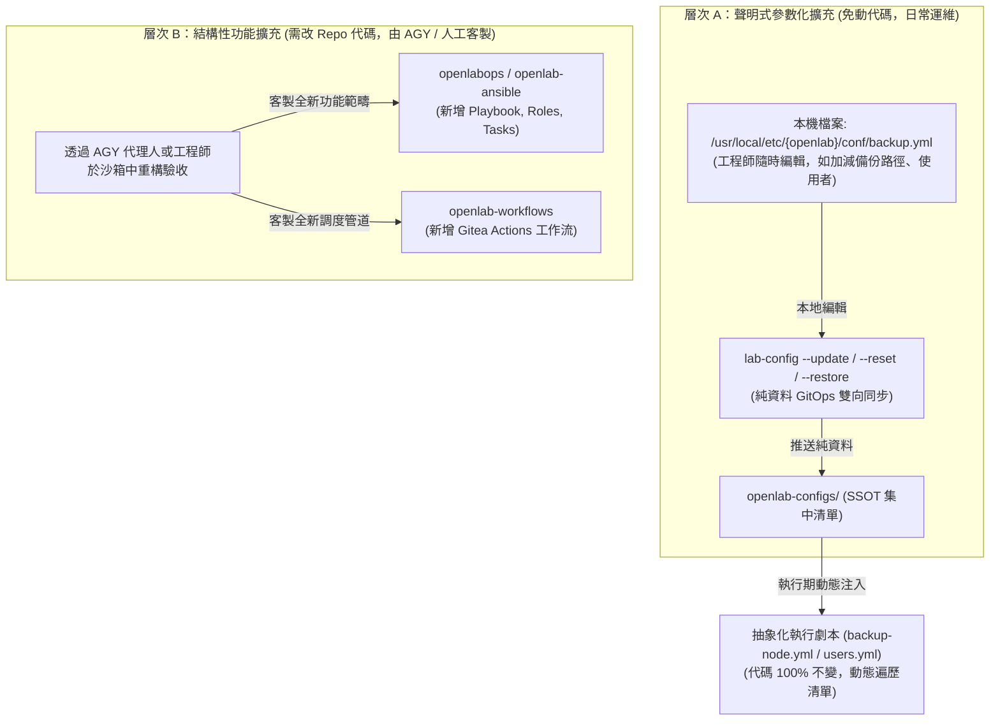

# 劇本參數抽象化與聲明式擴充架構規格書
## (Playbook Parameterized Abstraction & Declarative Extension Specification)
<!-- MACHINE-OPTIMIZED CONTEXT SPECIFICATION: MANDATORY FOR ALL AGY / AI AGENTS -->

> **系統定位**：
> 本規範確立 OpenLabOps 與 OpenLabOps 的 **Playbook 抽象化核心哲學** 與 **雙層擴充邊界模型 (Two-Tier Extension Boundary)**。
> 解決「傳統 Ansible 劇本將目標路徑寫死導致維運頻繁改動代碼」與「如何讓網工以最自然的 Unix/BSD 設定檔維運」之間的矛盾。

---

## 1. 架構原則：為什麼 `conf/backup_profiles.yml` 不應在母體靜態存在？

### 1.1 恪守 `[INV-03] Zero Static Config in Master`
* **母體角色 (`openlabops`)**：通用、無狀態之代碼編譯母體與執行引擎。
* **`conf/` 目錄純淨性合約**：母體的 `conf/` 僅允許留存：
  1. `core.manifest.yml` (Tier 1 框架不可變規格)
  2. `openlab.manifest.yml` / `openlab.manifest.yml` (Tier 2 站點宣告)
  3. `nodes/` (Tier 3 動態機器活體事實)
* **產出物歸屬原則**：
  - 具體的備份檔案清單（Backup Profiles）本質是**站點配置產出物 (Artifact/CMDB)**，屬於配置庫 (`openlab-configs` / `openlab-configs`)。
  - 其原始樣板定義於 [`templates/configs/backup_profiles.yml.j2`](../../templates/configs/backup_profiles.yml.j2)。
  - 由編譯引擎（`compiler.py`）或初始化嚮導（`lab-init`）在跑完後動態渲染產出至下游 `configs/conf/backup_profiles.yml`，母體目錄絕不保留靜態硬編碼檔案。

---

## 2. 劇本抽象化與雙層擴充邊界模型 (Two-Tier Extension Model)

為了杜絕每次微調配置就必須修改 Ansible Playbook YAML 代碼的劣質體驗，系統確立嚴格的雙層擴充邊界：



---

## 3. 層次 A：聲明式參數化擴充 (Declarative Parameter-Driven Extension)

### 3.1 適用情境 (日常標準運維)
* 為特定主機增加或減少備份目標檔案（如新增 `/etc/resolv.conf`）。
* 新增日常系統帳號或修改 sudoers 授權群組。
* 調整受控服務監聽端口或 Docker 容器環境變數。
* 宣告新的靜態 DHCP 租約或 DNS 轉發主機。

### 3.2 運作機制
1. **Ansible 原生變數哲學 (Native Variable Paradigm)**：
   - 備份路徑本質上就是 Ansible 的**標準變數清單 (`backup`)**，可定義於群組層級 (`group_vars`) 或節點特化層級 (`host_vars`)。
   - 模板樣板（`templates/configs/backup_profiles.yml.j2`）**絕不硬編碼任何 pf.conf、rc.conf 或特定設備路徑**。
   - 於 `initialize` 或編譯流程中，模板**自動動態展開 Inventory 內的所有節點 (`nodes`) 與群組 (`groups`)**：
     ```yaml
     groups:
       <group_name>:
         backup:
           - src: ""
             dest: ""
     nodes:
       <node_name>:
         backup:
           - src: ""
             dest: ""
     ```
   - 初始狀態下 `src` 與 `dest` 均為空字串 `""`，交由維運者自行填寫需要備份的設定檔路徑，徹底告別特定平台綁定。

2. **抽象通用劇本架構 (`backup-node.yml` / `restore-node.yml`)**：
   - 連線參數（IP、SSH Port、User、Key）完全由 Inventory 掌控，劇本代碼 100% 靜態且通用。
   - 劇本核心僅單純遍歷節點上的 `backup` 變數：
     ```yaml
     # 抽象備份劇本核心 (backup-node.yml)
     - name: Backup node files
       hosts: "{{ target | default('all') }}"
       tasks:
         - name: Fetch defined backup targets
           ansible.builtin.fetch:
             src: "{{ item.src }}"
             dest: "{{ configs_repo_dir }}/{{ inventory_hostname }}/{{ item.dest }}"
             flat: yes
           loop: "{{ backup | default([]) }}"
           when:
             - item.src is defined and item.src | length > 0
             - item.dest is defined and item.dest | length > 0

     # 抽象還原劇本核心 (restore-node.yml)
     - name: Restore node files
       hosts: "{{ target | default('all') }}"
       tasks:
         - name: Copy backup files back to target node
           ansible.builtin.copy:
             src: "{{ configs_repo_dir }}/{{ inventory_hostname }}/{{ item.dest }}"
             dest: "{{ item.src }}"
           loop: "{{ backup | default([]) }}"
           when:
             - item.src is defined and item.src | length > 0
             - item.dest is defined and item.dest | length > 0
     ```

3. **維運者直覺工作流**：
   - 登入節點或於管理機編輯：`/usr/local/etc/{openlab}/conf/backup.yml`。
   - 執行 `lab-config --update`：
     - 本地驗證語法。
     - 自動推播至 Gitea `openlab-configs`。
     - 觸發 GitOps 閉環，全網自動套用最新清單。
   - 若改到混亂，隨時執行 `lab-config --reset` 覆蓋恢復，或 `--restore` 回滾至上一版本。

---

## 4. 層次 B：結構性代碼擴充 (Structural Code-Level Extension)

### 4.1 適用情境 (架構級全新功能)
* 引入全新的架構功能範疇（例如：新增分散式儲存 Ceph 管理 Role、引進 Prometheus 監控代理）。
* 支援全新的特異硬體設備協議（如：撰寫專屬的 Mikrotik RouterOS 探針）。
* 建立全新的自動化 CI/CD 排程工作流（如：每週資安弱點掃描工作流）。

### 4.2 運作機制
* 必須觸碰代碼庫（`openlabops`、`openlab-ansible`、`openlab-workflows`）。
* 由 **AI 代理人 (AGY)** 或架構師人工撰寫新的 Ansible Role、Playbook 或 Gitea Workflow。
* 遵循 `[INV-09]` 生產工具測試合約，於沙箱測試床（`bin/lab-test`）驗證通過後，再全量推播至生產庫。

---

## 5. 抽象化覆蓋矩陣 (Current Abstraction Matrix)

| 核心維運領域 | 抽象化劇本 (Tier 1) | 聲明式參數清單 (Tier 2 - 免改代碼) | 結構性擴充邊界 (需改 Repo 代碼) |
| :--- | :--- | :--- | :--- |
| **雙向檔案同步<br>(備份/還原/Dotfiles)** | `backup-node.yml`<br>`restore-node.yml`<br>*(吸收 `deploy-dotfiles`)* | `/usr/local/etc/.../backup.yml`<br>`conf/backup_profiles.yml`<br>`group_vars/` 與 `host_vars/` | 新增特化資料庫 Dump 腳本 (如 PG / MySQL 特化 Task) |
| **初裝帳號與系統基線** | `node-provisioning.yml`<br>`roles/users` | `conf/openlab.manifest.yml`<br>`group_vars/all.yml` | **Day-0 初始化後鎖死**；引入 LDAP / FreeIPA 集中身分模組 |
| **動態套件與遙測事實** | `custom_package_facts`<br>`audit-nodes.sh` | 探針動態事實清冊<br>(`packages_<node>.json`, `node_<node>.json`) | **100% 探針動態注入，鎖死人工手動修改** |
| **資安金鑰原子輪換** | `rotate-*-keys.yml`<br>`roles/ssh_keys` | `conf/openlab.manifest.yml`<br>與動態白名單網段 | **Day-0 後鎖死**；支援硬體安全金鑰 (FIDO2 / YubiKey PKCS#11) |
| **特化容器與邊界功能** | `extensions/containers/`<br>`extensions/security/` | `extensions/<service>/docker-compose.yml` | 移出核心主線，由 `extensions/` 專用掛載 |

---

## 6. 結論與演進指南
透過確立此雙層擴充邊界：
1. **檔案同步合流收斂**：`backup-node`、`restore-node` 與 `deploy-dotfiles` 歸一為標準雙向檔案同步引擎，共享 `backup: [{src, dest}]` 變數結構。
2. **日常 95% 的維運**：透過本機 `/usr/local/etc/{cluster}/conf/` 分離式設定檔 + `lab-config` 直覺維護，直接 1:1 mapping 至 Ansible 原生 `group_vars` / `host_vars`。
3. **動態事實與核心協議鎖死**：遙測數據由探針自動獲取初始值，資安輪換狀態機在 `initialize` 完成後鎖死，杜絕過度抽象與代碼膨脹。

