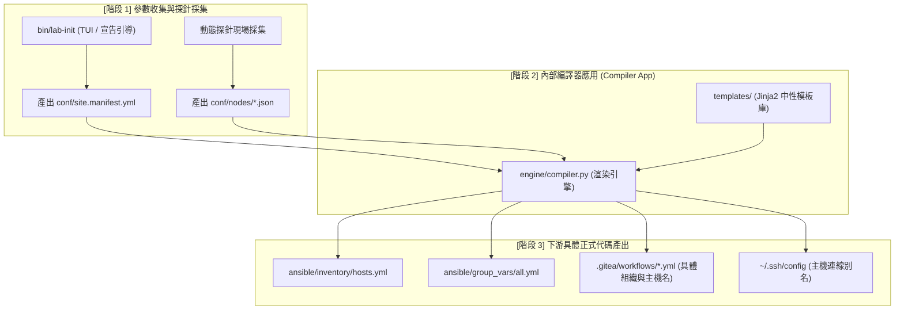

# 模板編譯渲染架構與中性語意模組規範
## (Template Compiler Architecture & Neutral Role Specifications)

> **核心定位**：規範 `openlabops` 與開源版 `openlabops` 之「模板驅動編譯引擎」與「母體倉庫零靜態配置」架構原則。

---

## 1. 核心動機：為何 Ansible 與 CI/CD 必須走模板渲染？

在現代 GitOps 與 IaC 架構中，動態讀取外部設定存在系統性的能力差異：
* **動態 Python 工具 (`tools/*.py`)**：能在執行階段即時讀取外部 JSON/YAML 設定（如 `conf/tools.config.json` 或環境變數），具備高度動態適配能力。
* **靜態語法工具 (Ansible & Gitea Actions)**：
  - **Ansible Inventory (`inventory/hosts.yml`) 與變數 (`group_vars/`)**：底層語法要求固定明確的主機名、IP 與群組層次，無法在解析階段直接調用外部腳本動態決定群組。
  - **CI/CD Workflow (`.gitea/workflows/*.yml`)**：Runner 在解析工作流時，必須具備靜態的 `runs-on`、`uses:` 與觸發路徑，無法在不渲染的前提下動態重組代碼結構。

因此，**透過模板渲染（Template Rendering）產生固定參數的具體代碼**，是唯一既能保有母體通用性、又能滿足下游工具固定語法要求的架構解法。

---

## 2. 三階段編譯流程 (Three-Stage Compilation Pipeline)

### 具體執行時序：
1. **`bin/lab-init` 完成後**：自動調用內部編譯器 `engine/compiler.py`。
2. **編譯器輸入**：
   - 站點宣告檔：`conf/site.manifest.yml`（或 `openlab.manifest.yml`）。
   - 節點遙測快照：`conf/nodes/*.json`。
   - 中性模板庫：`templates/ansible/`、`templates/workflows/`、`templates/configs/`。
3. **編譯器輸出**：
   - 渲染具體 Ansible Inventory、Group Vars 與 Gitea Actions 工作流檔案。
   - 支援 `--diff`（變更預覽對比）與 `--apply`（寫入目標倉庫或下游聯邦目錄）。

---

## 3. 母體倉庫規範：零硬編碼靜態配置 (Zero Static Production Code in Master)

在 `openlabops` 與未來 `openlabops` 母體倉庫中，嚴格恪守以下資產邊界：

| 目錄 / 組件 | 母體倉庫收錄內容 (Master Repo Assets) | 嚴禁收錄內容 (Strictly Forbidden in Master) |
| :--- | :--- | :--- |
| **`templates/`** | 100% 參數化之 Jinja2 模板 (`*.j2`) | 寫死特定 IP、特定網域名稱之靜態檔案 |
| **`ansible/roles/`** | 純粹無狀態、中性化之通用 Roles（如 `baseline`, `dotfiles`, `tools`） | 綁定特定使用者名稱之硬編碼 Task |
| **`workflows/actions/`** | 純粹邏輯抽象之 Composite Actions（7 大標準 Actions） | 包含特定 Gitea 網址之雜揉腳本 |
| **`ansible/inventory/`** | 僅作為編譯產出目標，**不預設提交特定站點實體主機** | 寫死正式私有雲生產主機 IP 的 `hosts.yml` |
| **`workflows/`** | 僅保留模板與通用 CI，具體生產工作流由編譯器渲染產出 | 寫死 `gitea.lab` 或 `ansible.key` 的具體工作流 |

---

## 4. 模組中性語意命名清單 (Neutral Token Mapping)

代碼與模板一律使用中性抽象名稱，由站點宣告檔注入實體映射：

| 中性語意 Token (Neutral Token) | 職責與含義 | OpenLabOps 站點映射實例 | OpenLabOps 開源預設 |
| :--- | :--- | :--- | :--- |
| `keys.ansible` | 自動化運維連線私鑰 | `ansible.key` | `ansible.key` |
| `keys.user` | 管理員/端點白名單私鑰 | `id_user.key` / `$hostname.key` | `admin.key` |
| `keys.git` | 版本控制平台 SSH 私鑰 | `git.key` | `git.key` |
| `users.ansible` | 自動化執行系統帳號 | `lab` | `ansible` |
| `users.admin` | 系統管理員主帳號 | `labadmin` | `admin` |
| `git.platform_host` | 內部 Git 服務主機名/IP | `gitea.lab` (192.168.1.90) | `git.local` |

---

## 5. 後續擴充策略：高度客製化 Playbook 清單之遞延規劃

針對備份還原、特定服務管線等高度客製化之 Playbooks 清單：
* **當前策略**：暫時維持現有清單不作過早抽象，優先將「底層地基（三層宣告、中性命名、模板編譯引擎、基礎 Roles、Composite Actions）」徹底打穩。
* **後續演進**：待地基完全收斂完畢後，再以擴充模組（Playbook Extension Matrix）形式，透過宣告式清單進行二次精煉與自訂掛載。
