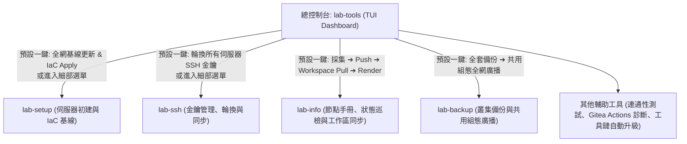

# OpenLabOps Homelab Tools - 架構規範與設計原則

本文件定義 `openlab-tools` 專案的核心架構、運作模式標準、維運動作調用矩陣、五大模組套件體系、雙語言平行開發原則以及語言限制標示規範。

---

## 1. 工具設計與運作模式 (Operating Modes)

所有的工具與控制台腳本皆依循以下兩種運作模式之一設計：

### 模式一：單一功能 CLI 工具 (Single-purpose CLI Tool)

- **用途**：執行單一且明確的維運自動化任務（例如：`generate_host_ssh_key.py`、`sync_ssh_keys.py`、`sync_ssh_config.py`）。
- **UI 規範**：
  - 不需要複雜交談介面。
  - 僅提供**動態文字提示**（如 `[INFO]`、`[SUCCESS]`、`[WARN]`、`[ERROR]`）與**載入進度提示 (Spinner)**。
  - 可接收命令列參數或標準輸入。

### 模式二：TUI 綜合控制台 (TUI Suite & Console Applications)

- **用途**：作為叢集維運的主要進入點（`lab-tools` 主控制台）與領域專屬控制台（`lab-setup`、`lab-ssh`、`lab-info`、`lab-backup`）。
- **UI 規範**：
  - **雙重選取模式**：
    1. **光棒選擇**：支援鍵盤方向鍵 (↑/↓) 移動高亮光棒選取。
    2. **數字直接輸入**：支援直接輸入數字編號（如 `1`、`2`）按下 Enter 立即啟動。
  - **視覺樣式**：高質感色彩主題（ANSI / TUI 渲染）、清晰的主機資訊儀表板與區隔線。

---

## 2. 五大模組套件體系 (The 5-Suite Modular Architecture)

`openlab-tools` 採用「單一總入口 (`lab-tools`) + 四大獨立專業套件」之階層式設計。每一個專業套件既能獨立作為 CLI / TUI 執行，亦可由 `lab-tools` 一鍵整合調用：



### 核心套件職責與調用行為

| 模組名稱 | 獨立執行行為 (Standalone) | 從 lab-tools 呼叫時的行為 (Invoked from lab-tools) | 對應後端與工作流 |
| :--- | :--- | :--- | :--- |
| **`lab-tools`** | 叢集總維運儀表板，提供頂層各領域與輔助工具導航。 | *（本身為總入口）* | TUI 控制台整合 |
| **`lab-setup`** | 顯示逐步微調選單（步驟 0 至 6、自訂目標主機、本地/遠端模式切換）。 | **預設直接執行全域更新與全節點 IaC 基線套用** (`system-base-setup.yml`)，亦可選進入細部選單。 | `system-base-setup.yml`<br>`node-provisioning.yml` |
| **`lab-info`** | 採集節點 JSON ➔ Push 遠端 ➔ 本機工作區自動 Git Pull ➔ 渲染 Obsidian Markdown。 | 行為一致：**採集 ➔ 遠端更新 ➔ 本機工作區自動 Pull 同步 ➔ 渲染手冊**。 | `update-node-docs.yml`<br>`render_node_doc.py` |
| **`lab-backup`** | 顯示備份專屬選單（Gateway 防火牆備份、共用組態採集廣播）。 | **預設執行全套備份**（Gateway 備份 + 採集本機組態並廣播共用變更至全網）。 | `backup-gateway-config.yml`<br>`sync-node-config.yml` |

---

## 3. 維運動作與五庫調用矩陣 (Action & Invocation Matrix)

| 維運目標動作 (Action) | Tools 操作端點 | Gitea Actions 工作流 | Ansible 劇本 | 說明與安全邊界 |
| :--- | :--- | :--- | :--- | :--- |
| **全網基線建置與容器掛載** | `lab-setup` / `lab-tools setup` | `system-base-setup.yml` | `node-provisioning.yml` | 系統基線、時區語系、基礎套件與 Docker Compose Hook 掛載 |
| **Ops Tools 節點安裝更新** | `lab-setup` (步驟 0.2) | `deploy-ops-tools.yml` | `deploy-ops-tools.yml` | 由 Runner 連線目標節點，以 Playbook 標準化部署工具鏈 (相容別名: `deploy-openlab-tools.yml`) |
| **節點 SSH 金鑰與連線組態同步** | `lab-setup` (步驟 0.3) | `deploy-ssh-keys.yml` | `deploy-node-ssh-keys.yml` | 由 Runner 注入 authorized_keys、管理私鑰與標準 config |
| **Ansible 語意管理金鑰輪換** | `lab-ssh --rotate-lab` / `--rotate-ansible` | `rotate-ansible-keys.yml` | `rotate-ansible-keys.yml` | 私鑰寫入 `openlab-secrets` 與 Gitea Secrets (相容別名: `rotate-lab-keys.yml`) |
| **OpenLabOps & Virtualization 金鑰輪換** | `lab-ssh --rotate-openlab` | `rotate-openlab-keys.yml` | `rotate-openlab-keys.yml` | 同步更新伺服器與 Virtualization 專用之 `ansible.key` |
| **Git-OpenLabOps 版控金鑰輪換** | `lab-ssh --rotate-git` | `rotate-git-openlab-keys.yml` | 無 (直連 REST API) | 透過 Gitea / GitHub API 註冊新公鑰並清理舊金鑰，雙端 SSH 驗證 |
| **本機端點金鑰生成 (WSL 自動偵測)** | `lab-ssh --gen-key` / `generate-host-ssh-key` | `deploy-host-key.yml` | `deploy-host-key.yml` | 本機生成 Ed25519 金鑰對 (WSL 內核自動命名 `_wsl`)，公鑰注入伺服器 |
| **清除特定端點公鑰** | `lab-ssh --revoke <host>` | `revoke-host-key.yml` | `revoke-host-key.yml` | 全網 authorized_keys 剔除，並自 `openlab-secrets` 抹除 |
| **全網節點手冊巡檢與工作區同步** | `lab-info` | `update-node-docs.yml` | `update-node-docs.yml` | 採集硬體與 Docker 狀態 ➔ 提交 Gitea ➔ 工作區自動 Git Pull ➔ 渲染 Markdown |
| **共用組態採集與廣播 (Family Deploy)**| `lab-backup --broadcast` | `sync-node-config.yml` | `fetch-node-configs.yml`<br>`deploy-dotfiles.yml` | 來源主機採集 ➔ 若檢測全域組態變更 (`openlab.*`, `.vimrc`) 則廣播全網 |
| **Gateway 防火牆/DNS 備份** | `lab-backup --gateway` | `backup-gateway-config.yml` | `backup-gateway-config.yml` | 採集 pfSense/OPNsense/BSD 防火牆規則與 Unbound DNS 設定 |
| **全網節點與服務連通性檢測** | `lab-tools test` | `test-connectivity.yml` | 無 (Runner 輕量探測) | 驗證 11 節點 SSH 認證、Gitea SSH/Web、Network、DNS 與外網連通 |
| **軟體包 IaC 差異比對與同步** | `lab-tools sync-iac` | `sync-package-inventory.yml` | `sync-package-inventory.yml` | 手動比對節點軟體包與 IaC 狀態，互動確認同步 |

---

## 4. 標準 Linux CLI 應用架構原則 (Standard Linux CLI Application Architecture)

為兼顧架構乾淨、維護性與標準 Linux CLI 使用體驗，工具鏈全面採用純 Python 3 標準庫打造，並依標準 Linux 軟體包規範進行分層：

| 目錄 / 組件 | 定位與規範 | 依賴需求與權限 |
| :--- | :--- | :--- |
| **`bin/` (可執行檔)** | 標準 Linux 命令列進入點（**無 `.py` 或任何副檔名**，如 `lab-tools`） | Shebang `#!/usr/bin/env python3`，權限 `0755` |
| **`lib/` (Python 模組庫)** | 核心業務邏輯、工具實作與模組庫（如 `lab_tools.py`） | 僅需 Python 3.8+ (全採用標準庫，零第三方依賴) |
| **`lib/core/` (通用函式庫)** | 跨工具底層通用模組（UI 主題、互動選單、Gitea API、版本控制） | Python 標準庫，權限 `0755` |
| **`/usr/local/bin/<cmd>`** | 系統全局軟連結，直接指向 `/usr/local/bin/openlab/bin/<cmd>` | 系統層級標準 CLI 體驗，零 `.py` 外露 |

### 設計與開發原則

1. **零外部依賴 (Zero External Dependency)**：
   - 僅使用 Python 3.8+ 內建標準庫 (`urllib`, `json`, `os`, `sys`, `subprocess`, `argparse`, `termcolor`/原生 ANSI 等)，端點主機無需 `pip install` 任何套件。
2. **無副檔名標準 CLI (Extensionless Executables)**：
   - 使用者在 Shell 中直接輸入 `lab-tools`、`lab-setup`，與 Linux 原生系統工具 (如 `git`, `docker`, `systemctl`) 體驗完全一致。
3. **優雅降級與跨終端相容**：
   - UI 互動選單支援方向鍵光棒移動與數字輸入雙模操作，ANSI 色彩在非 TTY 管道中自動安全降級。

---

## 5. 專案目錄結構 (Directory Structure)

```
openlab-tools/
├── VERSION                                # 單一版本真相源 (SemVer SSOT: 1.0.0)
├── bin/                                   # 標準 Linux 可執行檔 (無 .py 副檔名，chmod 0755)
│   ├── lab-tools                         # 叢集主維運控制台
│   ├── lab-status                        # 叢集全域狀態儀表板 (工具、金鑰對齊、節點套件)
│   ├── lab-setup                         # 伺服器初建與基線控制台
│   ├── lab-ssh                           # 叢集金鑰管理與輪換控制台
│   ├── lab-upgrade                       # 叢集多節點並行升級與儀表板工具
│   ├── lab-info                          # 節點資訊、工作區同步與渲染
│   ├── lab-backup                        # 叢集備份與共用組態廣播控制台
│   ├── sync-ops-tools                     # 中性維運工具鏈自更新與系統目錄部署工具
│   ├── sync-openlab-tools               # (相容別名軟連結)
│   ├── sync-ssh-config                    # 標準 ~/.ssh/config 同步工具
│   ├── sync-ssh-keys                      # 受控 SSH 管理私鑰/公鑰同步工具
│   ├── generate-host-ssh-key              # 端點 SSH 金鑰生成 (支援 WSL 自動辨識)
│   ├── revoke-host-ssh-key                # 端點 SSH 金鑰全網清除工具
│   ├── render-node-doc                    # 節點資訊 Markdown 渲染引擎
│
├── lib/                                   # Python 3 實作模組庫 (全採用標準庫)
│   ├── core/                              # 通用核心模組庫
│   │   ├── ui_theme.py                    # ANSI 終端色彩與樣式
│   │   ├── ui_menu.py                     # TUI 選單、方向鍵光棒、確認框與 Spinner
│   │   ├── gitea_api.py                   # Gitea REST API 封裝、Token 載入與 Action 錯誤診斷
│   │   ├── network_audit.py                 # Network 拓撲採集底層邏輯
│   │   ├── version.py                     # 版本比對與查詢模組
│   │   └── render_node_doc.py             # 節點資訊 Markdown 渲染引擎底層邏輯
│   ├── lab_tools.py                      # 叢集主維運控制台實作
│   ├── lab_status.py                     # 叢集全域狀態儀表板實作
│   ├── lab_upgrade.py                    # 叢集多節點並行升級與即時看板實作
│   ├── lab_setup.py                      # 伺服器初建與基線控制台實作
│   ├── lab_ssh.py                        # 叢集金鑰管理與輪換控制台實作 (整合三大語意金鑰輪換派發)
│   ├── lab_info.py                       # 節點資訊、工作區同步與渲染實作
│   ├── lab_backup.py                     # 叢集備份、Docker Compose 同步廣播與狀態檢查控制台實作
│   ├── generate_host_ssh_key.py           # 端點 SSH 金鑰生成實作
│   ├── revoke_host_ssh_key.py             # 端點 SSH 金鑰全網清除實作
│   ├── sync_ssh_config.py                 # 標準 ~/.ssh/config 同步實作
│   ├── sync_ssh_keys.py                   # 受控 SSH 管理私鑰/公鑰同步實作
│   └── sync_ops_tools.py                  # 中性維運工具鏈更新實作 (相容 sync_openlab_tools.py)
│
└── docs/                                  # 架構與工具詳細說明文件
    ├── README.md                          # 文件總導覽
    ├── todo.md                            # 專案待辦事項與改善追蹤清單
    ├── architecture/                      # 架構、安裝規範與金鑰整合說明
    │   ├── architecture.md                # 本文件 (核心架構規範)
    │   ├── curses-tui-spec.md             # Curses TUI 互動介面與美化方案規格書
    │   ├── installation-spec.md           # 工具鏈安裝與部署規範
    │   ├── ssh-tools-integration.md       # 金鑰管理與工具整合規範
    │   └── versioning-spec.md             # 版本號管控規範
    ├── core/                              # 核心模組 API 手冊
    └── tools/                             # 專業套件 CLI / TUI 應用手冊
        ├── lab-tools.md                  # 主控制台手冊
        ├── lab-status.md                 # 全域狀態監控手冊
        ├── lab-setup.md                  # 伺服器初建手冊
        ├── lab-ssh.md                    # 金鑰管理與輪換手冊
        ├── lab-info.md                   # 節點資訊與工作區同步手冊
        ├── lab-backup.md                 # 備份與共用組態廣播手冊
        ├── endpoint-ssh-tools.md          # 端點金鑰生成與 Config 同步手冊
        └── rotate-keys.md                 # 金鑰輪換單一功能工具手冊
```

---

## 6. 全架構效能優化與執行標準 (Architectural Performance Standards)

為了確保在邊緣主機、端點開發機以及 Gitea Actions CI/CD 環境下具備極致的執行速度與敏捷反饋，整個工具鏈與自動化體系貫徹以下五大效能基準：

### 1. OpenSSH 連線多工與通道共享 (OpenSSH Multiplexing)
- **實作配置**：在全域 SSH Config (`Host *`) 中宣告 `ControlMaster auto`、`ControlPersist 10m` 與 `ControlPath ~/.ssh/sockets/%r@%h:%p`。
- **目錄保障**：`sync-ssh-config` 與安裝腳本自動確保通訊端目錄 `~/.ssh/sockets` 權限維持嚴格 `0700`。
- **實測效能**：同主機複數 SSH 連線延遲由 **188ms 降至 35ms (降低 81.4%)**，後續操作近乎 0ms 連線握手延遲。

### 2. Python 字節碼事前編譯 (AOT Bytecode Compilation)
- **實作配置**：在 `sync-openlab-tools` 部署完畢時以 root 調用 `python3 -m compileall -f -q /usr/local/bin/openlab/lib`，預先產出系統全域唯讀之 `.pyc` (權限 `0644`)。
- **實測效能**：徹底消除一般使用者 (`labadmin`) 因對 `/usr/local/bin/openlab/` 無寫入權限而每次被迫即時編譯 AST 的延遲，達到即開即用。

### 3. CLI 非同步多線程探測 (`ThreadPoolExecutor`)
- **實作配置**：在 `lab-status` 等巡檢工具中採用 Python 3 標準庫 `concurrent.futures.ThreadPoolExecutor(max_workers=2)` 平行發起 Gitea 與 GitHub 認證探測。
- **實測效能**：`lab-status` 完整探測模式執行耗時由 **2.361 秒降至 0.833 秒 (提速 64.7%)**，全網狀態可在 1 秒內極速反饋。

### 4. Ansible 批次遞迴與 Fact 最小化
- **實作配置**：
  - 在 `deploy-openlab-tools.yml` 與 `endpoint-setup.yml` 中將逐檔遍歷迴圈重構為批次遞迴（`recurse: yes`）。
  - 明確宣告 `gather_subset: ['!all', '!min', 'distribution', 'user']`，排除冗餘的全硬體與磁碟掃描。
- **實測效能**：權限設定耗時由 **11.86s 降至 0.86s (提速 92.7%)**，Playbook 總耗時由 **27.45s 降至 15.78s (整體提速 42.5%)**。

### 5. Gitea Actions 工作流淺層拉取 (Shallow Clone)
- **實作配置**：在 `openlab-workflows` 全數 17 支工作流中，對唯讀倉庫（`openlab-ansible`, `openlab-secrets`, `openlab-tools`）全面加入 `--depth 1`。
- **實測效能**：消除完整 Git 歷史傳輸與解包開銷，使 Runner 在各 Job 的初始化階段提速 30% 以上。

