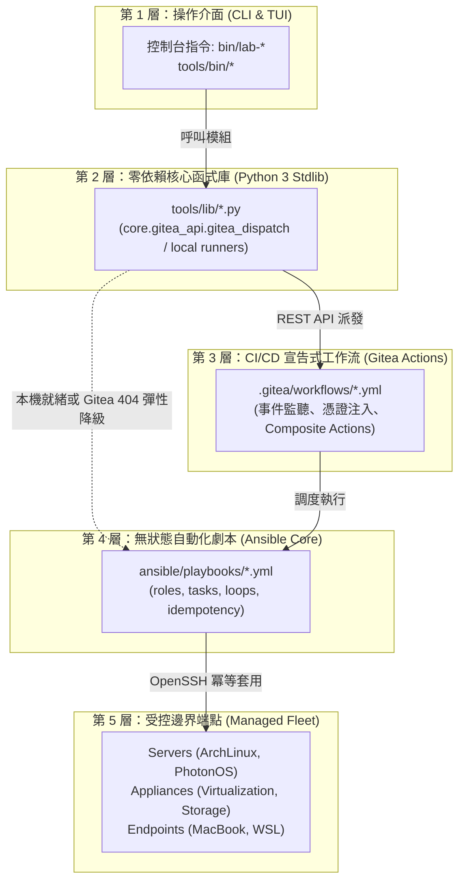

# 全網調度對應全表：Tools CLI/API ➔ Gitea Workflows ➔ Ansible Playbooks ➔ 參數規格書
## (Full Invocation Chain: Tools CLI/API -> Gitea Workflows -> Ansible Playbooks -> Tunable Parameters)
<!-- MACHINE-OPTIMIZED CONTEXT SPECIFICATION: MANDATORY FOR ALL AGY / AI AGENTS -->

> **系統定位**：
> 本手冊為 OpenLabOps 全網自動化調度的**端到端調度對應全表 (Master Invocation Matrix)**。
> 詳盡記錄從使用端 CLI 指令、底層 Python 工具庫 API、觸發之 Gitea Actions 工作流、下游執行的 Ansible Playbook，乃至於全鏈路中**所有可調整參數 (Tunable Parameters)** 的精確映射關係。

---

## 1. 端到端調度架構全景

全網自動化調度遵循嚴格的「分層觸發與職責解耦」原則：



---

## 2. 端到端調度對應全表 (Master Invocation Matrix)

| 序號 | 業務領域 | CLI 指令 (Tool) | Python API / 觸發函式 | Gitea Workflow 檔案 | 下游 Ansible Playbook / Action | 核心可調參數 (Tunable Parameters) | 目標範圍 (Target Scope) |
| :---: | :--- | :--- | :--- | :--- | :--- | :--- | :--- |
| **01** | **通用檔案備份** | `lab-backup --node <host>` | `lab_backup.dispatch_node_backup()` | `sync-node-config.yml` | `backup-node.yml` (原 `fetch-node-configs.yml`) | • `target`: 目標主機<br>• `backup`: `[{src, dest, mode, owner}]`<br>• `configs_repo_dir`: 存放倉庫路徑 | 單一主機或全網節點 |
| **02** | **網關專用備份** | `lab-backup --gateway` | `lab_backup.dispatch_gateway_backup()` | `backup-gateway-config.yml` | `backup-gateway-config.yml` (或 `backup-node.yml`) | • `target`: `gateway`<br>• `configs_repo_dir`: 目標目錄<br>• `backup`: `[{src: /etc/pf.conf, ...}]` | `gateway` (BSD) |
| **03** | **宣告式配置同步** | `lab-config --update`<br>`lab-config --reset`<br>`lab-config --restore` | `lab_config.push_config_to_repo()`<br>`lab_config.fetch_remote_config()` | `(Git Push Event)`<br>➔ `sync-node-config.yml` | `backup-node.yml` | • `commit_msg`: 提交資訊<br>• `ref`: Git 分支或 commit<br>• `custom_path`: 本機 YAML 路徑 | 本機至 `openlab-configs` |
| **04** | **維運工具庫部署** | `sync-ops-tools` | `sync_openlab_tools.dispatch_sync()` | `deploy-ops-tools.yml` | `deploy-ops-tools.yml` | • `target_hosts`: 目標主機群 (預設 `servers`)<br>• `tools_install_dir`: 安裝目標 (預設 `/usr/local/bin`) | `servers` |
| **05** | **全網 SSH 公鑰收斂** | `sync-ssh-keys` | `sync_ssh_keys.dispatch_sync_keys()` | `deploy-ssh-keys.yml` | `deploy-node-ssh-keys.yml` | • `target_hosts`: 目標主機群<br>• `authorized_keys`: 公鑰清冊與白名單<br>• `purge_unauthorized`: 是否剔除後門公鑰 | `servers` |
| **06** | **單機專屬公鑰注入** | `generate-host-ssh-key --node <host>` | `generate_host_ssh_key.dispatch_deploy()` | `deploy-host-key.yml` | `deploy-host-key.yml` | • `target_host`: 目標主機名稱<br>• `key_name`: 公鑰識別別名<br>• `allowed_subnets`: 來源 IP 白名單 (`from="..."`) | 單一受控主機 |
| **07** | **主機授權金鑰吊銷** | `revoke-host-ssh-key --node <host>` | `revoke_host_ssh_key.dispatch_revoke()` | `revoke-host-key.yml` | `revoke-host-key.yml` | • `target_host`: 欲剔除金鑰之主機<br>• `key_identifier`: 欲註銷之公鑰名稱或指紋 | 單一受控主機 |
| **08** | **自動化私鑰輪換** | `lab-ssh --rotate-ansible` | `lab_ssh.rotate_ansible_keys()` | `rotate-ansible-keys.yml` | `rotate-ansible-keys.yml` | • `target_hosts`: 需輪換之主機群 (預設 `servers`)<br>• `key_name`: 正式私鑰檔名 (預設 `ansible.key`)<br>• `allowed_subnets`: 限制連線網段 | `servers` |
| **10** | **版控平台金鑰輪換** | `lab-ssh --rotate-git` | `lab_ssh.rotate_git_keys()` | `rotate-git-keys.yml` | `(Direct Composite Action)`<br>`generate-key-pair` + Gitea API | • `gitea_user`: 版控帳號<br>• `key_title`: Gitea 公鑰標題<br>• `key_type`: `ed25519` | Gitea Server |
| **11** | **節點基礎環境初始化**| `lab-setup --base` | `lab_setup.dispatch_base_setup()` | `system-base-setup.yml` | `node-provisioning.yml` | • `target_hosts`: 新納管之節點<br>• `users`: 宣告之使用者清單與 sudo 權限<br>• `timezone`: 時區 (`UTC`)<br>• `locale`: 語系 (`en_US.UTF-8`) | 新增節點或全體伺服器 |
| **12** | **端點工作站配置** | `lab-setup --endpoint` | `lab_setup.dispatch_endpoint()` | `deploy-endpoint-key.yml` | `endpoint-setup.yml`<br>`deploy-endpoint-key.yml` | • `endpoint_host`: 端點主機名<br>• `admin_user`: 端點登入帳號<br>• `wireguard_ip`: 端點 VPN 內部 IP | 個人工作站 / 筆電 |
| **13** | **強化 2FA 雙因子** | `lab-setup --2fa` | `lab_setup.dispatch_2fa()` | `harden-ssh-2fa.yml` | `harden-ssh-2fa.yml` | • `target_hosts`: 加固主機群<br>• `enable_pam_google_authenticator`: 啟用開關<br>• `ssh_allowed_groups`: 允許登入群組 | `servers` |
| **14** | **全網主機連通測試** | `lab-tools --ping` | `lab_tools.dispatch_ping()` | `test-connectivity.yml` | `ansible.builtin.ping` | • `target_hosts`: 測試主機群 (預設 `all`)<br>• `timeout`: 探測超時時間 (秒) | `all` |
| **15** | **套件清冊雙向同步** | `lab-tools --packages` | `lab_tools.dispatch_sync_packages()` | `sync-package-inventory.yml` | `sync-package-inventory.yml` | • `target_hosts`: 採集主機群<br>• `auto_sync`: 檢測到漂移是否自動寫回 `host_vars`<br>• `configs_root`: 套件 JSON 存放目錄 | `servers` |
| **16** | **套件檢查與互動升級**| `lab-upgrade` | `lab_upgrade.main()` | `(Direct Local Ansible)` | `check-and-upgrade-packages.yml` | • `target_hosts`: 欲升級節點群<br>• `auto_upgrade`: 自動升級開關 (True/False)<br>• `package_manager`: 指定套件管理員 | `servers` |
| **17** | **硬體遙測與手冊更新**| `lab-info --dispatch` | `lab_info.dispatch_node_docs_update()`| `update-node-docs.yml` | `update-node-docs.yml` | • `target_servers`: 採集事實主機群<br>• `configs_docs_dir`: 輸出 `node_<host>.json` 路徑<br>• `private_vault_dir`: 渲染 Markdown 目標路徑 | `servers`, `hypervisors` |
| **18** | **容器服務滾動重啟** | `lab-backup --pull` | `lab_backup.main()` (Gitea Dispatch) | `pull-docker-compose.yml` | `pull-docker-compose.yml` | • `target_hosts`: 運行 Docker 主機<br>• `compose_dirs`: Docker Compose 專案目錄列表<br>• `pull_policy`: 映像檔更新策略 | `docker_host` |
| **19** | **開發工作區一鍵就緒**| `./bin/lab-dev-setup`| `(Local Shell Bootstrap)` | `(Local Playbook Run)` | `dev-environment.yml` | • `target_user`: 當前開發者帳號<br>• `install_tools`: 是否注入四大標配工具 (ansible, cue, docker, agy) | `localhost` (Controller) |

---

## 3. 各維運領域參數細部結構與來源映射

### 3.1 檔案與備份領域 (Backup & Config Sync)
- **觸發工具**：`lab-backup`、`lab-config`
- **調度工作流**：`sync-node-config.yml`、`backup-gateway-config.yml`
- **對應劇本**：`ansible/playbooks/backup-node.yml`
- **參數結構**：
  ```yaml
  # 來源: conf/backup_profiles.yml 或 host_vars/<hostname>.yml
  backup:
    - src: "/path/to/remote/source/file"
      dest: "relative/path/in/backup"
      owner: "labadmin"         # (還原時選填)
      group: "wheel"        # (還原時選填)
      mode: "0644"          # (還原時選填)
  ```
- **核心 Extra Vars**：
  - `target`: 指定執行節點（預設 `all`）
  - `configs_repo_dir`: 本地備份目的地倉庫路徑（預設 `/home/labadmin/openlab-configs`）

### 3.2 身分安全與金鑰輪替領域 (Security & SSH Key Lifecycle)
- **觸發工具**：`lab-ssh`、`sync-ssh-keys`、`generate-host-ssh-key`、`revoke-host-ssh-key`
- **參數結構**：
  ```yaml
  # 來源: conf/openlab.manifest.yml (keys, ssh_keys) 與 group_vars/all.yml
  keys:
    ansible: "ansible.key"
    user: "id_user.key"
    git: "git.key"
  
  # 動態輪替注入參數 (Extra Vars)
  allowed_subnets: "192.168.1.0/24"
  old_key_path: "/tmp/ssh_rotation/lab.pub.old"
  new_key_path: "/tmp/ssh_rotation/lab.pub"
  ```

### 3.3 伺服器基線與帳號權限領域 (Baseline & Provisioning)
- **觸發工具**：`lab-setup`
- **調度工作流**：`system-base-setup.yml`、`harden-ssh-2fa.yml`
- **對應劇本**：`node-provisioning.yml`、`harden-ssh-2fa.yml`
- **參數結構**：
  ```yaml
  # 來源: group_vars/all.yml 或 conf/openlab.manifest.yml
  cluster:
    timezone: "UTC"
    locale: "en_US.UTF-8"
  users:
    - name: "labadmin"
      groups: ["wheel", "docker"]
      shell: "/bin/zsh"
    - name: "lab"
      groups: ["wheel"]
      shell: "/bin/sh"
  ```

### 3.4 軟體套件管理領域 (Package Management & Drift)
- **觸發工具**：`lab-upgrade`、`lab-tools --packages`
- **調度工作流**：`sync-package-inventory.yml`
- **對應劇本**：`sync-package-inventory.yml`、`check-and-upgrade-packages.yml`、`collect-package-list.yml`
- **參數結構**：
  ```yaml
  # 來源: node-information/packages_<hostname>.json 與 host_vars/<hostname>.yml
  # Extra Vars 控制項:
  auto_sync: false          # 是否自動寫回 host_vars
  auto_upgrade: false       # 是否非互動式自動升級套件
  target_hosts: "servers"   # 限制範圍
  ```

### 3.5 遙測採集與 CMDB 維護領域 (Telemetry & CMDB Update)
- **觸發工具**：`lab-info --dispatch`、`lab-status`
- **調度工作流**：`update-node-docs.yml`
- **對應劇本**：`update-node-docs.yml`
- **參數結構**：
  ```yaml
  # 輸出產物: node-information/node_<hostname>.json (SSOT JSON)
  # Extra Vars 控制項:
  target_servers: "servers,hypervisors"
  configs_docs_dir: "/home/labadmin/openlab-configs/node-information"
  private_vault_dir: "/home/labadmin/Private-Vault/80_Raw_Data/Homelab/Node Information"
  ```

---

## 4. 全鏈路除錯與追蹤指南

當任何調度環節異常時，依照下列層次順序排查：
1. **檢查 Tool CLI 輸出**：檢視 `tools/lib/` 是否正確取得 Gitea Token (`GITEA_TOKEN` 或 `~/.gitea_token`)。
2. **檢查 Gitea Actions 狀態**：使用 `lab-status --workflows` 或進入 Gitea Web UI 查看工作流 Run ID 與各 Step 輸出。
3. **檢查 Ansible 執行記錄**：檢視 Action 執行的 Composite Action `execute-federation-playbook` 步驟紀錄，確認 SSH 連線、Extra Vars 注入與 Target Hosts 是否正確。
4. **檢查受控端狀態**：透過 `lab-ssh <host>` 登入實機，檢查 `/var/log/` 與目標檔案是否正確套用。

