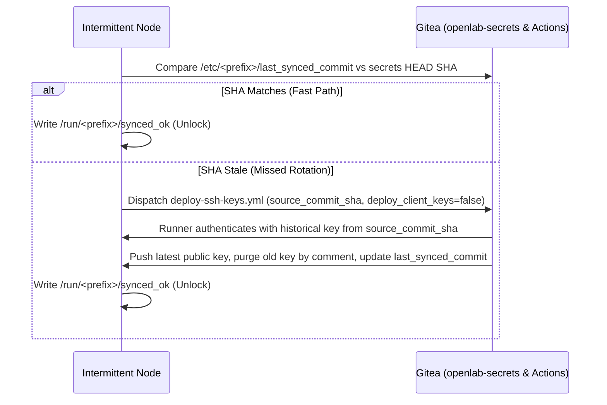

# Boot-Time Stale Key Auto-Sync & Lockout Guard

Workstations, laptops, and intermittent nodes (`always_online: false`) may be powered off when a cluster-wide SSH key rotation occurs. When they boot back up, their `authorized_keys` contain expired/deprecated public keys.

OpenLabOps solves this without ever distributing private keys over HTTP (`[INV-02]`):

## Mechanism Details

1. **Secrets Git SHA Index (`tools/lib/lab_boot_sync.py`)**:
   * Each node records `/etc/<prefix>/last_synced_commit`.
   * On boot (or `lab-boot-sync`), the node queries the remote `<prefix>-secrets` `HEAD` commit SHA via Gitea API.
2. **Fast Path vs. Roll-Forward Sync**:
   * **Identical SHA**: Keys are current; `/run/<prefix>/synced_ok` is created immediately.
   * **Stale SHA**: `lab-boot-sync` dispatches `deploy-ssh-keys.yml` with `target_hosts`, `source_commit_sha`, and `deploy_client_keys=false`. The Gitea Act Runner uses the historical key at `source_commit_sha` to log in, inject the latest public key, purge the expired key, and update `/etc/<prefix>/last_synced_commit`.
3. **Lockout Guard (`tools/lib/core/lockout.py`)**:
   * On intermittent nodes, `lab-*` automation commands remain locked until `/run/<prefix>/synced_ok` exists, preventing operations against out-of-sync credentials.
   * Always-online master consoles (`always_online: true`) bypass this lockout.
