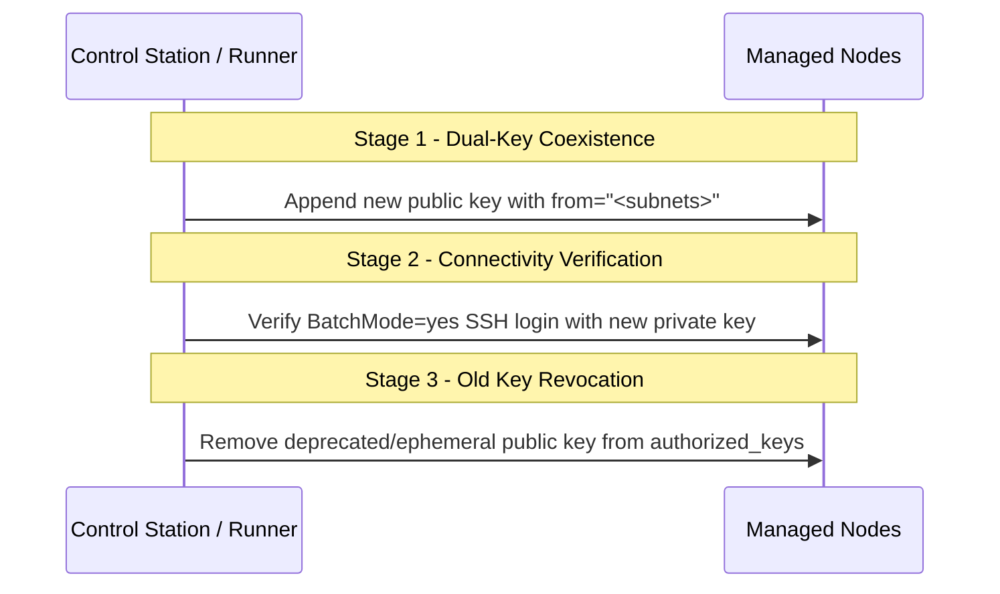

# Three-Phase Zero-Downtime SSH Key Rotation

OpenLabOps never replaces an active SSH key in a single destructive step. Both Day-0 handover (`lab-init`) and Day-2 rotation (`lab-ssh --rotate-*`) follow a three-stage protocol:

## Key Safeguards

1. **Authoritative Public Key Derivation (`ssh-keygen -y`)**:
   Before injecting or verifying keys, `initialize.py` and `onboard.py` derive the public key directly from the private key via `ssh-keygen -y -P "" -f <key>`. If an existing `*.key.pub` file is stale or mismatched, it is automatically regenerated to prevent OpenSSH `identity_sign` failures.
2. **Subnet-Restricted `from="..."` Options (`[INV-05]`)**:
   Permanent management keys are injected with `from="192.168.1.0/24"` (or configured internal subnets) so stolen private keys cannot be used from unauthorized networks.
3. **Strict `BatchMode=yes` Verification**:
   Stage 3 only executes after Stage 2 succeeds non-interactively with the new private key, guaranteeing zero SSH lockout.
