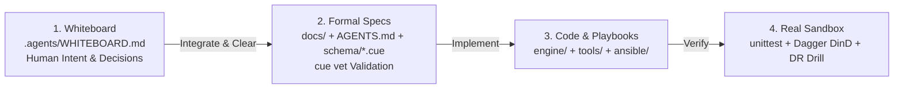

# Antigravity Vibe Coding & AI-Assisted SRE

**OpenLabOps** was built from the ground up using **Google Antigravity (AGY) Vibe Coding**—a structured human-AI engineering workflow where the human architect sets hard invariants and design intent, and AI coding agents execute implementation, testing, and verification inside strict guardrails.

---

## 1. The Human-AI Collaboration Model

Traditional "vibe coding" often breaks down on infrastructure projects due to dependency sprawl, drifting conventions, and skipped tests. OpenLabOps solves this with three mechanisms:

### A. Machine-Enforced Engineering Contract (`AGENTS.md`)
Instead of relying on ad-hoc chat prompts, all architectural rules are codified in `AGENTS.md` as non-negotiable invariants:
* **Zero External Dependencies (`[INV-01]`)**: Forces AI to write pure Python 3 stdlib code.
* **Zero Plaintext Keys (`[INV-02]`)**: Blocks AI from ever generating or committing hardcoded secrets.
* **Production-Tool Verification (`[INV-09]`)**: Forbids mock-only bypasses or swallowed exceptions in tests; AI must prove changes against real Docker/Dagger sandboxes.

### B. Spec-First Three-Stage Pipeline (`[INV-10]`)



1. **Whiteboard Ingestion**: The human operator jots down architectural ideas or requirements in `.agents/WHITEBOARD.md`.
2. **Spec & Schema Alignment**: The AI first integrates those decisions into formal `docs/` and `schema/*.cue` (verified with `cue vet ./schema/`), then clears the whiteboard.
3. **Implementation & Real Verification**: Only after specs are aligned does the AI edit Python/Ansible code and run real unit, CUE, and Dagger E2E tests.

---

## 2. Empowering `AGY-Remote` for Safe SRE Operations

Because OpenLabOps enforces hard security and blast-radius boundaries at the architecture level, you can safely bring **AGY-Remote** into your homelab as an AI SRE assistant without giving it unchecked root/key access.

### Provisioning `AGY-Remote`
During Day-0 bootstrap, enable the remote development/SRE container:
```bash
lab-init --with-remote-dev
```

### How the Boundaries Protect Your Fleet

| Boundary | Protection for AI SRE (`AGY-Remote`) |
| :--- | :--- |
| **Zero Plaintext Keys (`[INV-02]`)** | `AGY-Remote` never holds raw `ansible.key` or `user` private keys. All privileged changes are dispatched through Gitea Actions (`openlab-workflows`). |
| **Token Blast-Radius Isolation (`[INV-03]`)** | The automation token (`ci-bot`) can trigger workflows and push CMDB telemetry (`openlab-configs`), but is **physically barred** from modifying core Ansible playbooks (`openlab-operations`). |
| **Structured Read-Only Telemetry** | `AGY-Remote` inspects real-time cluster health and hardware state via `lab-status --json`, `lab-status -a` (key audit), and `node-information/node_*.json`. |
| **Scriptable Non-TTY CLI** | Tools support `--plain` / `--no-tui` / `--json` (e.g., `lab-tools --plain inspect-run <ID>`), allowing AI SRE agents to diagnose failed CI/CD runs and trigger safe remediation workflows cleanly. |
| **CUE & Lockout Guardrails** | `cue vet ./schema/` blocks invalid network/role changes before deployment, while `lab-boot-sync` and 3-phase key rotation prevent AI actions from ever locking out human administrators. |
