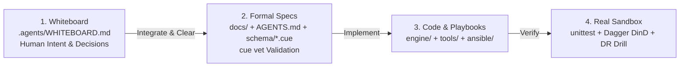

# Antigravity Vibe Coding & AI-Assisted SRE

**OpenLabOps** was built from the ground up using **Google Antigravity (AGY) Vibe Coding**—a structured human-AI engineering workflow where the human architect defines hard invariants and design intent, and AI coding agents execute implementation, testing, and verification inside strict guardrails.

---

## 1. The Human-AI Collaboration Model

Traditional "vibe coding" often breaks down on infrastructure projects due to dependency sprawl, drifting conventions, and skipped tests. OpenLabOps solves this with three mechanisms:

### A. Machine-Enforced Engineering Contract (`AGENTS.md`)
Instead of relying on ad-hoc chat prompts, all architectural rules are codified in `AGENTS.md` as non-negotiable invariants:
* **Zero External Dependencies (`[INV-01]`)**: Forces AI to write pure Python 3 stdlib code.
* **Zero Plaintext Keys (`[INV-02]`)**: Blocks AI from ever generating or committing hardcoded secrets.
* **Production-Tool Verification (`[INV-09]`)**: Forbids mock-only bypasses or swallowed exceptions in tests; AI must prove changes against real Docker/Dagger sandboxes.

### B. Spec-First Three-Stage Pipeline (`[INV-10]`)



1. **Whiteboard Ingestion**: The human operator jots down architectural ideas or requirements in `.agents/WHITEBOARD.md`.
2. **Spec & Schema Alignment**: The AI first integrates those decisions into formal `docs/` and `schema/*.cue` (verified with `cue vet ./schema/`), then clears the whiteboard.
3. **Implementation & Real Verification**: Only after specs are aligned does the AI edit Python/Ansible code and run real unit, CUE, and Dagger E2E tests.

---

## 2. Empowering `AGY-Remote` for Safe SRE Operations

Because OpenLabOps enforces hard security and blast-radius boundaries at the architecture level, you can safely bring **AGY-Remote** into your homelab as an AI SRE assistant without giving it unchecked root or SSH key access.

### Provisioning `AGY-Remote`
During Day-0 bootstrap, enable the remote development/SRE container:
```bash
lab-init --with-remote-dev
```

### Practical AI SRE Workflows Inside Hard Boundaries

1. **Fleet Health & Security Triage (Read-Only)**:
   * `lab-status --json` — Structured JSON health telemetry for every managed node.
   * `lab-status -a` — Live `authorized_keys` fingerprint audit to detect unauthorized keys.
   * `node-information/node_<hostname>.json` — Inspect live RAM, disks, running containers, and listening ports before proposing changes.
2. **CI/CD Failure Diagnosis**:
   * `lab-tools --plain inspect-run <ID>` — Pulls full Gitea Actions job logs without requiring a TTY or raw SSH access to the runner.
3. **Audited Remediation Dispatch**:
   * `AGY-Remote` triggers pre-approved GitOps workflows via `lab-setup -s <step>`, `lab-upgrade`, or `lab-ssh --rotate-ansible` (`ci-bot` token).
   * Because `ci-bot` is **physically barred** from modifying `openlab-operations`, an AI SRE agent cannot rewrite Ansible playbooks or exfiltrate private keys (`openlab-secrets`).
4. **Pre-Flight Schema Guardrails**:
   * Any manifest or network change proposed by an AI agent must pass `cue vet ./schema/` before `lab-diff` / `lab-apply` can render downstream configs, while `lab-boot-sync` and 3-phase key rotation guarantee human administrators are never locked out.
