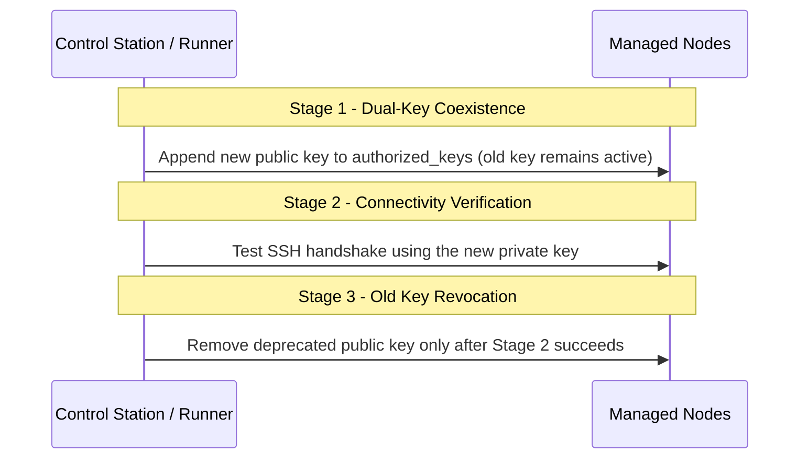

# Security Policy & Key Lifecycle

OpenLabOps enforces a zero-trust, zero-plaintext-credentials security model across the control workstation, GitOps federation, and managed Linux fleet.

## 1. Zero Credentials in Repository

* **No Private Keys or Tokens in Git**: Plaintext SSH private keys (`*.key`, `id_*`) and API tokens are strictly forbidden in any repository.
* **Native OpenSSH Integration**: Control tools delegate authentication to the workstation's `~/.ssh/`, `~/.ssh/config`, and active `ssh-agent`.
* **Token Blast-Radius Isolation**: The Gitea Actions automation user (`ci-bot`) only has write permissions to `openlab-workflows` and `openlab-configs` telemetry—it cannot alter Ansible playbooks or engine code in `openlab-operations`.

## 2. Canonical Key Roles

Internal engine code and playbooks never hardcode key filenames. Instead, they reference three semantic roles mapped in `conf/openlab.manifest.yml`:

| Role | Purpose | Typical Identity |
| :--- | :--- | :--- |
| **`ansible`** | Stateless automation key used by Gitea Act Runner and Ansible playbooks | `ansible.key` |
| **`user`** | Interactive administrator login key for human operators | `admin.key` |
| **`git`** | SSH deploy/fetch key for GitOps repository synchronization | `git-openlab.key` |

Endpoint workstations (`dev` / `desktop`) receive per-host keys dynamically named `<hostname>.key` via `generate-host-ssh-key` and can be globally revoked in one command via `revoke-host-ssh-key`.

## 3. Three-Phase Zero-Downtime Key Rotation

To prevent locking out the control plane during key rotation (`lab-ssh --rotate-ansible` / `--rotate-all`), Ansible executes a strict three-stage sequence:

If Stage 2 fails on any node, Stage 3 is aborted so administrative access is never lost.

## 4. `authorized_keys` IP Restrictions & Auditing

* **Source IP Pinning**: Playbooks preserve `from="..."` restrictions on `authorized_keys` entries for automation keys.
* **Live Backdoor Detection (`lab-status -a`)**: Audits `authorized_keys` across all managed nodes and compares key fingerprints against known keys in `conf/openlab.manifest.yml` and `openlab-secrets`, flagging unknown or unauthorized keys immediately.

## 5. Boot Public Key Sync & Lockout Guard (`lab-boot-sync`)

On managed `dev` and `desktop` endpoints, `lab-boot-sync` prevents stale-key lockouts after offline periods or key rotations:

1. Compares the local secrets state against the remote `openlab-secrets` commit SHA (`--check`).
2. If out of sync, triggers the Gitea Actions key deployment workflow (`--force` / `--wait`) and waits for convergence.
3. Writes `/run/openlab/synced_ok` only after verification succeeds, allowing endpoint login/session guards (`tools/lib/core/lockout.py`) to unlock safely.
