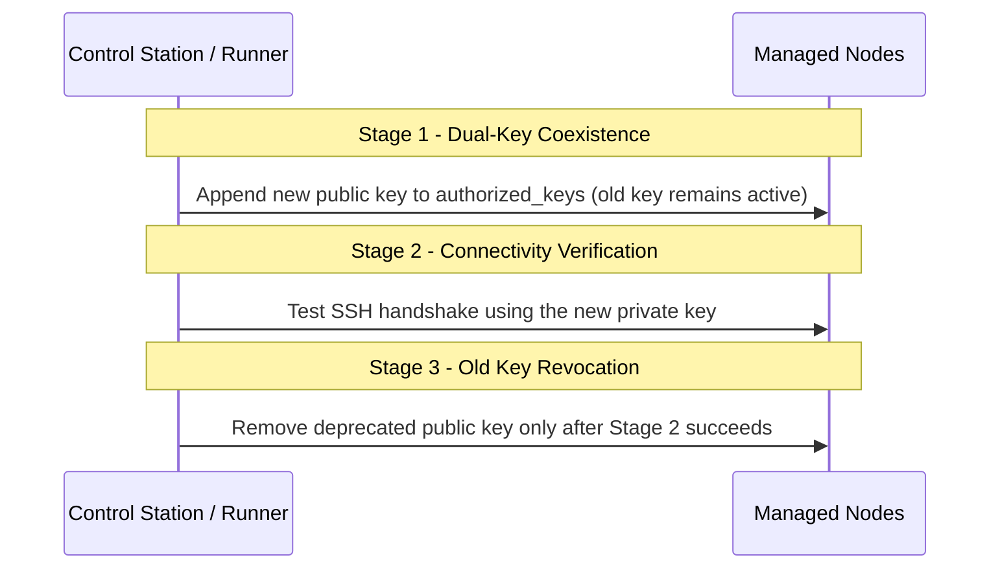
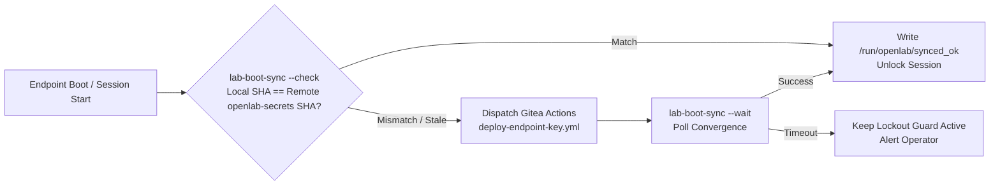

# Security Policy & Key Lifecycle

OpenLabOps enforces a zero-trust, zero-plaintext-credentials security model across the control workstation, GitOps federation, and managed Linux fleet.

## 1. Zero Credentials in Repository (`[INV-02]`)

* **No Private Keys or Tokens in Git**: Plaintext SSH private keys (`*.key`, `id_*`) and API tokens are strictly forbidden in any repository.
* **Native OpenSSH Integration**: Control tools delegate authentication to the workstation's `~/.ssh/`, `~/.ssh/config`, and active `ssh-agent`.
* **Token Blast-Radius Isolation**: The Gitea Actions automation user (`ci-bot`) only has write permissions to `openlab-configs` telemetry—it cannot alter Ansible playbooks or framework code in `openlab-operations`.

## 2. Canonical Key Roles & Endpoint Keys

Internal framework code and playbooks never hardcode key filenames. Instead, they reference three semantic roles mapped in `conf/openlab.manifest.yml`:

| Role | Purpose | Typical Identity | Rotation Command |
| :--- | :--- | :--- | :--- |
| **`ansible`** | Stateless automation key used by Gitea Act Runner and Ansible playbooks | `ansible.key` | `lab-ssh --rotate-ansible` |
| **`user`** | Interactive administrator login key for human operators | `admin.key` | Managed via `~/.ssh/` |
| **`git`** | SSH deploy/fetch key for GitOps repository synchronization | `git-openlab.key` | `lab-ssh --rotate-git` |

### Per-Endpoint Workstation Key Lifecycle
* **Provision (`generate-host-ssh-key -H <hostname>`)**: Generates a dedicated Ed25519 keypair (`<hostname>.key`) on the endpoint, registers the public key in `openlab-secrets`, and dispatches `ansible/playbooks/deploy-endpoint-key.yml` via Gitea Actions.
* **Revoke (`revoke-host-ssh-key -H <hostname>`)**: Immediately purges the endpoint's public key from `authorized_keys` across the entire managed fleet via `ansible/playbooks/revoke-host-key.yml` and removes it from `openlab-secrets` (unless `--keep-secrets` is passed).

## 3. Three-Phase Zero-Downtime Key Rotation

To prevent locking out the control plane during key rotation (`lab-ssh --rotate-ansible` / `--rotate-all`), Ansible executes a strict three-stage sequence (`ansible/roles/ssh_keys/tasks/rotate_stage1_add.yml`, `rotate_stage2_verify.yml`, `rotate_stage3_remove.yml`):

If Stage 2 fails on any node, Stage 3 is aborted immediately so administrative access is never lost.

## 4. SSH Hardening, IP Pinning & Backdoor Auditing

* **Source IP Pinning**: Playbooks preserve `from="..."` restrictions on `authorized_keys` entries for automation keys.
* **SSHD & 2FA Baseline**: `ansible/roles/baseline/tasks/sshd.yml` and `sshd_2fa.yml` (dispatched via `harden-ssh-2fa.yml`) enforce key-only authentication, disable root password login, and configure optional 2FA.
* **Live Backdoor Detection (`lab-status -a`)**: Audits `authorized_keys` across every managed node and compares live SHA-256 fingerprints against known keys in `conf/openlab.manifest.yml` and `openlab-secrets`, flagging unauthorized keys immediately.

## 5. Boot Public Key Sync & Lockout Guard (`lab-boot-sync`)

On managed `dev` and `desktop` endpoints, `lab-boot-sync` prevents stale-key lockouts after offline periods or key rotations:

