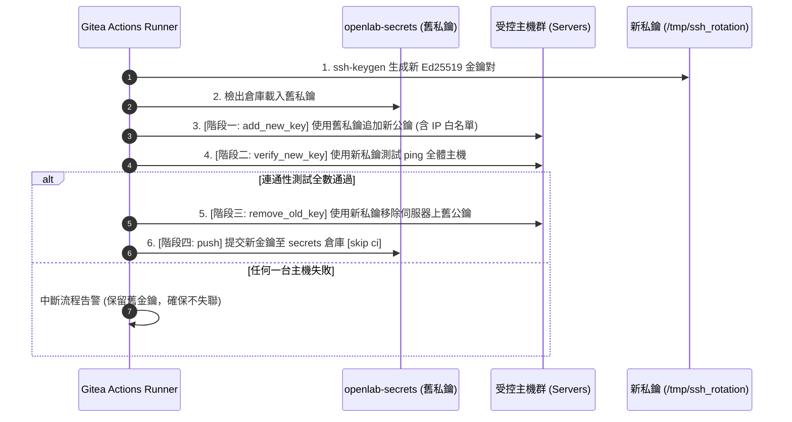

# CI/CD 工作流與金鑰對應拓撲 (Workflow Key & Secrets Mapping)

本文件定義 Gitea Actions 集中流水線在執行各項自動化維運任務時，所依賴的 CI/CD Secrets、SSH 金鑰憑證與權限隔離機制。

> [!NOTE]
> 全網 SSH 金鑰對（屬性欄位、生成位置、檔案權限、目標帳號與 IP 白名單）之完整單一真相源（Single Source of Truth, SSOT）請參見：
> 👉 `openlab-secrets/docs/security/ssh-keys-spec.md`。

---

## 1. Gitea Actions 依賴之 Secrets 清冊 (Secrets Matrix)

Gitea Actions 工作流在 Alpine / Debian Runner 容器中執行，所有跨系統連線與 API 憑證均由 Gitea Secrets 集中注入：

| 秘密名稱 (Secret Name) | 用途與職責 | 注入之工作流 (Workflows) | 安全邊界與權限 |
| :--- | :--- | :--- | :--- |
| **`BOT_TOKEN`** | Gitea 自動化機器人 API Token，用於 Git 提送更新 (`openlab-secrets`)、呼叫 Dispatch 與清理 API Key | `rotate-*-keys.yml` `pull-docker-compose.yml` `deploy-host-key.yml` | 具備 Gitea 倉庫寫入與 User Key 管理權限 |
| **`GH_TOKEN`** | GitHub 個人存取權杖 (PAT)，用於多平台同步更新 GitHub 上的 SSH 公鑰 | `rotate-git-openlab-keys.yml` | 僅具備 `admin:public_key` 最小必要權限 |
| **`MASTER_TOKEN`** | 組織專屬全域最高權限 Gitea API Token（僅存於 Gitea Secrets，嚴禁落地） | 全體 Workflows (私有庫 Clone、金鑰輪替 API、節點採集與廣播) | 具備組織 Full Admin 權限，負責跨倉庫檢出與金鑰寫入 |

---

## 2. 工作流執行之 SSH 金鑰流動與四階段安全機制

---

## 3. 各工作流專屬金鑰拓撲 (四大語意角色)

1. **Ansible 語意管理金鑰 (`ansible` 角色，實體對應 `ansible.key`)**：
   - 僅注入至 Runner 執行 Ansible 劇本，連線全網伺服器的 `ansible` (lab) 帳號。
   - 來源 IP 限制嚴格鎖定於內網網段 `from="192.168.1.0/24"`。
2. **底層儲存設備金鑰 (`storage` 角色，實體對應 `storage.key` / `ansible.key`)**：
   - 專門用於 Storage 唯讀儲存設備（`/cf` 唯讀掛載相容）。
3. **全網萬能管理金鑰 (`user` 角色，實體對應 `id_user.key`)**：
   - 全網萬能最高權限管理金鑰 (Universal Master Admin Key，Ed25519)。
   - 部署於標準伺服器群 (`servers`) 的 `labadmin` 使用者帳號。
   - 部署於底層儲存設備 (`appliances`: 儲存主機 `storage1`, `storage2`) 的 `root` 帳號。
   - 來源 IP 限制嚴格鎖定於內部網管網段 `from="192.168.1.0/24"`。
4. **Virtualization 宿主機獨立專用管理金鑰 (`ansible.key`)**：
   - Generic Linux 專用最高權限管理金鑰 (ECDSA 384 位元 `ecdsa-sha2-nistp384`)。
   - **獨立架構緣由**：Generic Linux 核心嚴格遵循 FIPS 企業密碼學規範，SSH 服務預設僅接受 ECDSA/RSA，拒絕 Ed25519 認證。因此為 Virtualization 獨立建立專用金鑰對。
   - **輪替體系統一**：其金鑰產生、部署、驗證與輪替完全納入 `rotate-openlab-keys.yml` 輪替工作流同週期管理，不需手動或額外流程。
   - 僅部署於 Virtualization 宿主機 (`virt-node1`，`192.168.1.250`) 的 `root` 帳號 (`/etc/ssh/keys-root/authorized_keys`)。
   - 來源 IP 限制嚴格鎖定於內部網管網段 `from="192.168.1.0/24"`。
5. **外部端點公鑰 (`$hostname.pub`)**：
   - 由 `deploy-endpoint-key.yml` (或 `deploy-host-key.yml`) 部署至全網伺服器之使用者帳號；由 `revoke-host-key.yml` 執行定點清除吊銷。
   - 絕對禁止部署至任何 `appliances` 底層設備 (Storage 與 Virtualization)。

