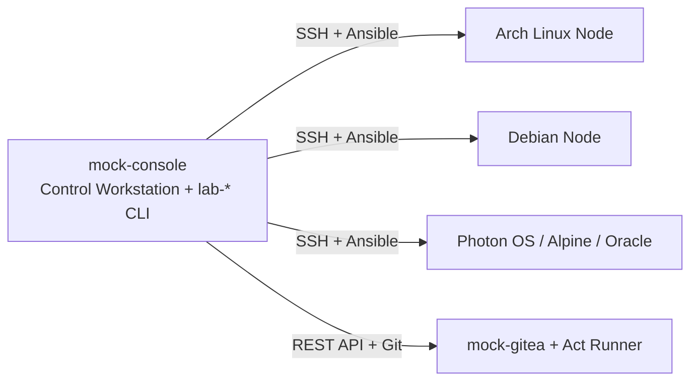

# Testing Methodology & Sandbox Internals

OpenLabOps validates every release end-to-end against real Linux containers and real CLI binaries—never mock-only bypasses.

## 1. Core Testing Principles (`[INV-09]`)

* **Production-Tool Verification**: The sandbox and Dagger pipelines exist solely to execute the actual production commands (`bin/lab-init`, `bin/lab-node`, `engine/classifier.py`, `tools/bin/lab-*`) from a clean slate. No test-only bypass logic is permitted in production code.
* **Zero-Fabrication Integrity**: Test scripts are strictly forbidden from swallowing exceptions (`try...except: return True`) or faking pass statuses. Any non-zero exit or failed assertion fails the pipeline with full logs.
* **Domain Decoupling & Ephemeral `/tmp` Workspaces**: Test environments use isolated sandbox hostnames (`mock-gitea`, `gitea.mock`) so they never collide with production DNS or clusters, and clean up temporary artifacts automatically on exit.

## 2. Five-Layer Verification Matrix

| Layer | Command / Entrypoint | Scope Verified |
| :--- | :--- | :--- |
| **1. Schema & Syntax** | `cue vet ./schema/` & `ansible-playbook --syntax-check` | Network CIDRs, role/key invariants, all Ansible playbooks |
| **2. Python Unit Tests** | `python3 -m unittest discover -s tests/unit` | Built-in YAML parser, i18n completeness, `classifier.py`, SemVer & injection guards |
| **3. Multi-Distro Sandbox** | `lab-test --manual` / `lab-test --auto` | `mock-console`, `mock-gitea`, Act Runner, Arch/Debian/Alpine/Photon/Oracle containers |
| **4. Dagger DinD E2E** | `lab-test --dagger` (`tests/e2e/test_dagger.py`) | Isolated DinD clean-slate Day-0 onboarding & fleet tool verification |
| **5. SHA-256 DR Drill** | `lab-test --dr [target]` (`tests/sandbox/dr_drill.sh`) | Backup, simulated node wipe, `restore-node.yml` recovery, 100% SHA-256 parity |

## 3. Multi-Distro Docker Sandbox (`lab-test`)

* **`tests/sandbox/docker-compose.yml`**: Boots `mock-console`, `mock-gitea`, an Act Runner with `ansible-core`, and multi-distro target containers (`Dockerfile.arch`, `Dockerfile.debian`, `Dockerfile.alpine`, `Dockerfile.photon`, `Dockerfile.oracle`).
* **Inspection Inside `mock-console`**: All onboarding and verification commands execute **inside** `mock-console` rather than bypassing from the host. In `--manual` mode, `lab-test` automatically attaches `docker exec -it mock-console bash`.
* **Live Working Tree Sync (`tests/bin/test-gitea-init`)**: Automatically syncs uncommitted workspace edits into `mock-gitea` before running tests so the Act Runner never tests stale `HEAD`.
* **PTY Human Simulator (`tests/sandbox/simulate_human_operator.py`)**: Drives `lab-init` and interactive TUI prompts over a real pseudo-terminal (PTY) across `en_US`, `zh_TW`, and `ja_JP` locales.

## 4. SHA-256 Disaster Recovery Drill (`dr_drill.sh`)

1. **Sentinel Creation**: Plants test configuration files on the target node and records their SHA-256 digests.
2. **Backup**: Runs `lab-backup` to capture node and gateway state into GitOps backup storage.
3. **Destructive Simulation**: Wipes the sentinel files on the target container.
4. **Restore & Parity Gate**: Runs `ansible/playbooks/restore-node.yml` and asserts 100% SHA-256 checksum match against Step 1.
