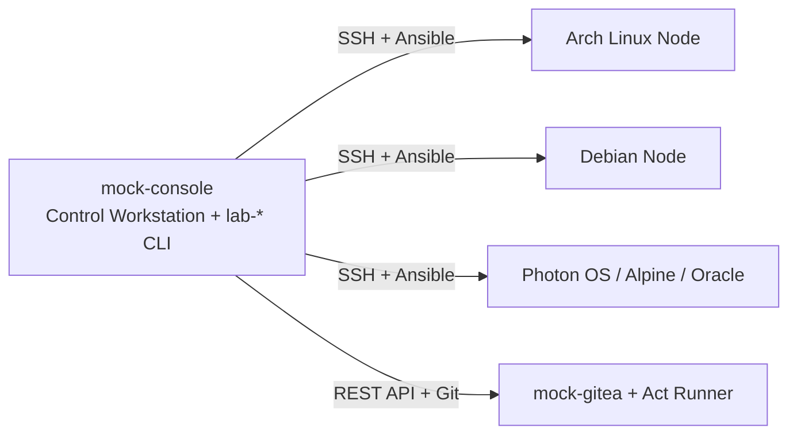

# Testing Methodology & Sandbox Internals

OpenLabOps validates every release end-to-end against real containers and real CLI binaries—never mock-only bypasses.

## 1. Core Testing Principles

* **Production-Tool Verification**: The sandbox and Dagger pipelines exist solely to run the actual production commands (`bin/lab-init`, `bin/lab-node`, `engine/classifier.py`, `tools/bin/lab-*`) from a clean slate.
* **Zero-Fabrication Integrity**: Test scripts are forbidden from swallowing exceptions or faking pass statuses. Any non-zero exit or failed assertion immediately fails the pipeline with full logs.
* **Domain Decoupling & Ephemeral Workspaces**: Test environments use isolated sandbox hostnames (`mock-gitea`, `gitea.mock`) and clean up temporary artifacts automatically on exit.

## 2. Validation Layers

### Layer 1: Schema & Syntax Verification
* **`cue vet ./schema/`**: Validates network tables (`network.cue`), node role schemas (`roles.cue`), key contracts (`keys.cue`), and system invariants (`invariants.cue`).
* **`ansible-playbook --syntax-check`**: Verifies all playbooks under `ansible/playbooks/`.

### Layer 2: Python Unit Tests
* `python3 -m unittest discover -s tests/unit` (`tests/unit/test_core_units.py`) validates:
  * Built-in zero-dependency YAML parser and manifest loading
  * Multi-locale i18n dictionary completeness (`en_US`, `zh_TW`, `ja_JP`)
  * Node classification and inventory compilation (`engine/classifier.py`)
  * Input sanitization (e.g., hostname injection guards) and SemVer comparison

### Layer 3: Multi-Distro Docker Sandbox (`lab-test`)

* **`tests/sandbox/docker-compose.yml`**: Spins up `mock-console`, `mock-gitea`, an Act Runner with `ansible-core`, and multi-distro target containers (`Dockerfile.arch`, `Dockerfile.debian`, `Dockerfile.alpine`, `Dockerfile.photon`, `Dockerfile.oracle`).
* **Inspection Inside `mock-console`**: All onboarding and verification commands execute inside `mock-console` rather than bypassing from the host.
* **PTY Human Simulator (`tests/sandbox/simulate_human_operator.py`)**: Drives `lab-init` and interactive TUI prompts over a real pseudo-terminal (PTY) to verify interactive onboarding without human intervention.

### Layer 4: Dagger DinD Pipeline (`lab-test --dagger`)
* `tests/e2e/test_dagger.py` runs the full lifecycle inside an isolated Docker-in-Docker Dagger pipeline:
  1. Boots the sandbox fleet and `mock-gitea`
  2. Executes `lab-init` Day-0 onboarding
  3. Verifies `lab-node`, `lab-discover`, `lab-status`, and `lab-ssh`
  4. Tears down cleanly

### Layer 5: SHA-256 Disaster Recovery Drill (`lab-test --dr`)
* `tests/sandbox/dr_drill.sh` (invoked via `tests/bin/test-dr-drill` or `lab-test --dr <target>`):
  1. Plants sentinel data and computes SHA-256 checksums on a target node
  2. Runs backup via `lab-backup`
  3. Simulates destructive node failure / wipe
  4. Restores the node via `ansible/playbooks/restore-node.yml` and verifies 100% SHA-256 parity.
