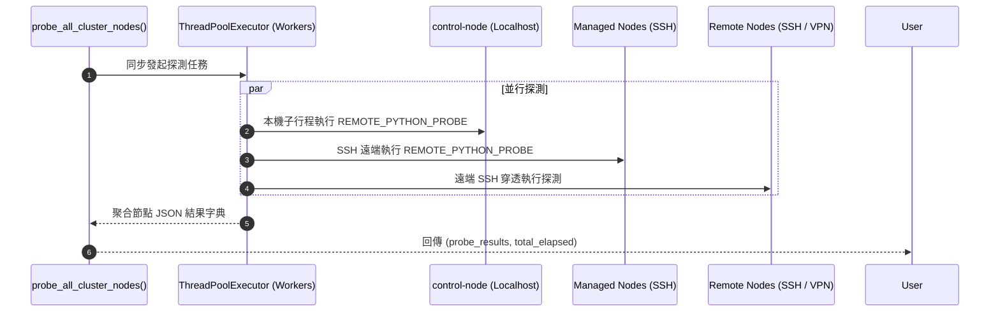

# Core Live Probe 活體並行狀態探測引擎 (`lib/core/live_probe.py`)

[`lib/core/live_probe.py`](../../../tools/lib/core/live_probe.py) 是 OpenLabOps 叢集之 **零快取即時活體探測引擎 (Zero-Cache Real-Time Telemetry Engine)**。它完全屏除過時的磁碟快取與定時同步機制，透過 Python 標準庫 `ThreadPoolExecutor` 在約 1.3 秒內並行連線全網 12 台實體主機、虛擬機、存儲設備與海外雲端邊緣節點，精確獲取**此時此刻瞬間**的真實狀態。

---

## 1. 核心設計目標

1. **零陳舊、零快取 (Zero Cache, Pure Live State)**：
   - 不再讀取昨日或數小時前由 CI 寫入的靜態 JSON 檔案。
   - 解決「剛剛手動輪替的金鑰在狀態報表中看不到」或「剛發布的套件更新無法即時警示」之痛點。
2. **極速並行 (High-Concurrency Parallelism)**：
   - 使用 12 個背景 Worker 線程同時發起連線，總耗時取決於最慢的海外節點（約 1.3 秒），本地內網節點多在 0.05 ~ 0.3 秒內完成。
3. **安全審計與套件更新雙軸探測**：
   - 同時採集各主機全帳號之 `authorized_keys` 授權清冊（含 Comment 與 IP 白名單限制）。
   - 同時調用各作業系統原生套件管理器，即時精確統計待升級套件數量與候選包名稱。

---

## 2. 探測架構與流程



---

## 3. 探測對象與支援系統矩陣

| 節點類型 | 作業系統範例 | 套件管理器 | 連線與執行機制 |
| :--- | :--- | :--- | :--- |
| `control-node` | Linux (Arch / Debian / Fedora) | `pacman` / `apt` / `dnf` | 本機直接調用 Python 探測腳本 |
| `srv-node1` | Standard Linux (Ubuntu / Debian / RHEL) | `apt` / `dnf` | SSH 遠端執行標準探測 |
| `srv-node2` | Standard Linux (Photon OS / Alpine) | `tdnf` / `apk` | SSH 遠端執行標準探測 |
| `remote-edge` | Cloud / VPN Linux Node | `dnf` / `apt` | 遠端 SSH 穿透執行探測 |

---

## 4. 探測技術細節與相容性處理

### 4.1 全帳號金鑰採集 (`REMOTE_PYTHON_PROBE`)
- **路徑涵蓋**：
  - `/home/*/.ssh/authorized_keys`（動態辨識使用者帳號，如 `labadmin`, `lab`, `opc`）
  - `/root/.ssh/authorized_keys`（超級管理員）
  - `/etc/ssh/keys-root/authorized_keys`（Generic Linux 專用路徑）
  - `/cf/conf/authorized_keys`（Storage 嵌入式系統路徑）
- **解析屬性**：
  - `account`：所屬帳號
  - `options`：前置指令與來源限制（例如 `from="192.168.1.0/24"`，無則標記為 `(無 IP 限制)`）
  - `key_type`：金鑰型態（`ssh-ed25519`, `ecdsa-sha2-nistp384`, `ssh-rsa`）
  - `comment`：金鑰 Comment 標籤（用於版本對齊與存活時長推算）
  - `fingerprint`：SHA256 公鑰指紋（標準 OpenSSH 格式）

### 4.2 原生套件更新檢測
- **Arch Linux (`pacman`)**：
  - 執行 `pacman -Qu`，計算行數為待更數，取前 3 個套件名為摘要。
- **Photon OS (`tdnf`)**：
  - 執行 `sudo tdnf check-update`，過濾 Loading/Refreshing 行首，統計更新項目。
- **Oracle Linux (`dnf`)**：
  - 執行 `sudo dnf check-update`。
  - **重要處理**：`dnf check-update` 發現待更新時之 Exit Code 為 `100`（正常無更新時為 `0`），引擎正確攔截此狀態碼並依 `.x86_64` / `.aarch64` 等架構後綴提取待更清單。
  - 執行 `pkg upgrade -n`，從 `The following X package(s) will be affected (of X checked): to be upgraded` 解析總數，並從 `->` 欄位抓取升級套件名稱。

### 4.3 終端與 Shell 相容性
- BSD 預設使用 `csh` / `tcsh`，對 `2>/dev/null` 重定向會噴出 `Ambiguous output redirect` 錯誤；探測引擎全面封裝於 Python 子行程或標準 POSIX `sh -c` 中執行，確保跨 UNIX/Linux 系統穩定。
- Storage 無內建 Python 環境，改以輕量級純文字讀取與本機後製正規化解析。

---

## 5. API 介面

```python
from core.live_probe import probe_all_cluster_nodes, probe_single_node

# 1. 單機探測
result = probe_single_node({
    "name": "srv-node1",
    "host": "srv-node1",
    "os": "Linux",
    "mgr": "apt"
})
# 回傳結構:
# {
#     "hostname": "srv-node1",
#     "os": "Linux",
#     "package_manager": "apt",
#     "status": "ONLINE",
#     "keys": [...],
#     "upg_count": 26,
#     "upg_samples": ["bash", "curl"],
#     "elapsed": 0.25
# }

# 2. 全網節點並行探測
results_dict, total_time = probe_all_cluster_nodes(max_workers=8)
print(f"全網探測完成，耗時 {total_time:.2f} 秒，共探測 {len(results_dict)} 台節點。")
```
