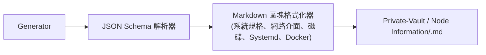

# render-node-doc 工具說明文件 (Markdown Documentation Generator)

## 1. 模組簡介

---

## 2. 核心架構與渲染邏輯



* **無外部第三方依賴**：完全採用 Python 3 標準庫（`json`, `os`, `sys`, `argparse`, `datetime`）。
* **單檔與批次目錄渲染**：支援指定單一 JSON 檔案進行轉出，亦支援傳入整個 `node-information/` 目錄進行全網 12 台節點批次轉出。

---

## 3. 使用方式 (CLI Usage)

```bash
# 1. 批次將整個 node-information 目錄渲染至指定資料夾
render-node-doc /home/labadmin/openlab-configs/node-information \
  --out-dir "/home/labadmin/Private-Vault/80_Raw_Data/Homelab/Node Information"

# 2. 僅渲染單一節點 JSON 至終端 (標準輸出)
render-node-doc /home/labadmin/openlab-configs/node-information/node_srv-node1.json

# 3. 透過 lab-info 或 lab-tools 控制台進入點執行:
# lab-info -r (或 lab-info 選單選項 4: 僅渲染 Markdown 手冊)
```

---

## 4. 產出 Markdown 區塊結構

生成的 Markdown 包含五大標準區塊：
1. **主機狀態與即時摘要 (Host Overview)**：OS、核心版本、CPU 型號/核心數、記憶體與 Swap 使用量。
2. **網路介面與 IP 拓撲 (Network Interfaces)**：實體網卡、Docker Bridge、IP/遮罩、MAC 與 MTU。
3. **儲存空間與掛載點 (Disk & Mounts)**：掛載路徑、總容量、已用量、百分比。
4. **關鍵系統服務 (Systemd Services)**：服務名稱、載入狀態、活躍狀態（Active/Running）。
5. **容器環境 (Docker Containers)**：執行中的容器名稱、映像檔、對應連接埠與所屬 Docker 網路。
