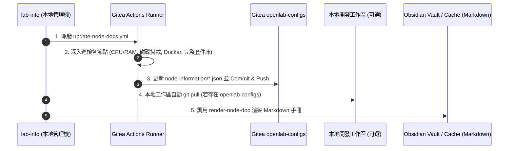

# lab-info 節點資訊巡檢、工作區同步與手冊渲染套件說明文件

[`bin/lab-info`](../../tools/bin/lab-info)（實作：[`lib/lab_info.py`](../../tools/lib/lab_info.py)）（系統指令：`lab-info`）為 OpenLabOps 全網節點 CMDB 事實庫巡檢、`openlab-configs` 遠端更新、本地 Antigravity 工作區自動 Pull 同步與 Obsidian Markdown 節點手冊渲染之整合套件。

---

## 1. 架構定位：與 `lab-status` 的職責劃分

為了確保維運操作的極致敏捷與精準分工，OpenLabOps 工具鏈將「狀態查閱」與「事實彙編」分為兩大專業工具：

| 工具 | 核心定位 | 執行耗時 | 運作機制 | 適用場景 |
| :--- | :--- | :--- | :--- | :--- |
| **`lab-status`** | **零快取即時活體儀表板** | **~1.3 秒** | 本機多執行緒平行直連 12 節點，採集活體 `authorized_keys` 與即時原生待更新套件數 | 隨手查閱、安全巡檢、確認套件待更新現況、金鑰輪換驗證 |
| **`lab-info`** | **節點 CMDB 巡檢與文件手冊建置** | ~1-2 分鐘 (含 CI) | 派發 Gitea Actions 深度巡檢硬體/網路/磁碟/Docker，提交至 `openlab-configs` 並渲染 Obsidian 文件 | 節點硬體規格異動、AI 上下文庫更新、產生 Obsidian 筆記 |

---

## 2. 核心工作流循環 (The Info & Sync Loop)

無論是從 `lab-tools` 呼叫還是獨立執行 `lab-info`，皆具備自動化完整循環能力：

---

## 3. 路徑解耦與環境變數支援

`lab-info` 採用動態路徑解耦，不綁死特定開發者家目錄：
- **`WORKSPACE_CONFIGS_DIR`**：可指定本地 `openlab-configs` 工作區路徑。若未指定且同層無該倉庫，則以獨立 API 模式執行，略過本機 Git Pull。
- **`NODE_INFO_DIR`**：可指定節點 JSON 檔案所在目錄，預設支援同層倉庫或自動降級至 `~/.cache/openlab/node-information`。
- **`OBSIDIAN_VAULT_DIR`**：手冊渲染目標目錄。預設為 `~/.cache/openlab/docs`，若設定則自動輸出至個人 Obsidian Vault。

---

## 4. 常用 CLI 命令

| 指令 | 說明 |
| :--- | :--- |
| `lab-info` | 啟動 TUI 選單（顯示工作區與手冊路徑，預設推薦選項 1 一鍵全流程） |
| `lab-info -a` / `--all` | **[預設一鍵]** 遠端巡檢 ➔ 工作區 Pull ➔ 渲染 Markdown |
| `lab-info -d` / `--dispatch-only` | 僅派發 Gitea Actions 執行遠端節點巡檢 |
| `lab-info -p` / `--pull-only` | 僅在本地工作區執行 Git Pull |
| `lab-info -r` / `--render-only` | 僅依據本地 JSON 渲染 Obsidian Markdown 節點手冊 |
| `lab-info -v` / `--version` | 顯示當前工具版本號 |
