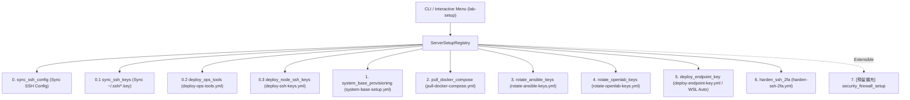

# lab-setup 伺服器初建與基線設定套件說明文件

[`bin/lab-setup`](../../tools/bin/lab-setup)（實作：[`lib/lab_setup.py`](../../tools/lib/lab_setup.py)）（系統指令：`lab-setup`）為 OpenLabOps 伺服器初建、基線設定 (Provisioning)、Docker Compose 同步與系統安全加固之專業套件。

---

## 雙重調用行為規範 (Invocation Behaviors)

依據系統架構規範，`lab-setup` 具備雙重執行模式：

1. **從總控制台 `lab-tools` 選取時**：
   - **預設行為**：一鍵全域更新並套用全網節點之基線與 IaC（派發 `system-base-setup.yml`，執行時區語系設定、基礎軟體包安裝、SSH 基線硬化與 Docker Compose Hook 掛載）。
   - **選單進入**：亦可選取進入微調選單，進行單項目微調。
2. **獨立執行 `lab-setup` 時**：
   - 開啟 TUI 選單儀表板，支援個別執行步驟 0 至 6、自訂目標節點以及切換執行模式（遠端 Gitea Runner 或本地 Ansible）。

---

## 模組化步驟註冊器 (Setup Steps)

---

## 常用 CLI 命令

| 指令 | 說明 |
| :--- | :--- |
| `lab-setup` | 啟動 TUI 步驟選單控制台 |
| `lab-setup -p` / `--provision` | **[預設一鍵]** 全網伺服器節點基線設定與容器環境掛載 |
| `lab-setup -l` / `--list` | 列出所有已註冊的步驟清單與狀態 |
| `lab-setup -s <step_id>` | 僅執行指定步驟 (例如: `-s pull_docker_compose`) |
| `lab-setup -a` / `--all` | 依序執行所有已啟用的 Trigger 步驟 |
| `lab-setup -t <target>` | 指定目標主機群組 (預設: `servers`) |
| `lab-setup -m local` | 切換為本地 Ansible 執行模式 |
