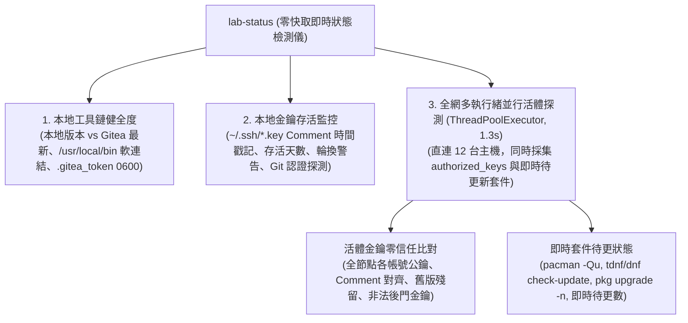

# lab-status 叢集全域狀態巡檢與對齊監控工具說明文件

[`bin/lab-status`](../../tools/bin/lab-status)（實作：[`lib/lab_status.py`](../../tools/lib/lab_status.py)）（系統指令：`lab-status`）是 OpenLabOps 工具鏈的全域健康度儀表板。它採用 **零快取即時並行活體探測 (Zero-Cache Real-Time Telemetry)** 架構，約 1.3 秒內一站式獲取當下瞬間的真實狀態：

1. **工具鏈自身狀態 (Tools Health)**：本地安裝版本、Gitea 遠端版本比對、系統軟連結完整性與 Token 權限。
2. **SSH 金鑰全景安全檢測 (SSH Keys Dual-Perspective Security)**：
   - **視角 A (控制端 / Client)**：受控私鑰類型、Comment 時間戳記、存活時長推算、健康評級與 90 天輪換警示。
   - **視角 B (節點端 / Server)**：全網各節點帳號（`labadmin`, `root`, `lab`, `opc`）之活體 `authorized_keys` 授權矩陣、金鑰版本判定、來源 IP 白名單、以及**非法/未知金鑰 (Rogue Keys) 入侵稽核**。
3. **全網各節點即時套件與系統更新現況 (Nodes & Live Updates Status)**：各節點線上狀態、作業系統發行版、套件管理器（pacman, tdnf, dnf, pkg）、**即時待更新套件數量與可升級套件摘要**。

---

## 核心架構與並行探測機制



### 1. 為什麼採用「零快取純即時探測 (Zero-Cache Live Probe)」？
- **零陳舊、零誤判**：告別過期快取檔案，每一秒敲 `lab-status`，數字都是**此刻當下**的真實狀態。10 秒前被塞入的未知公鑰當場抓包，剛發布的軟體安全性更新立即亮黃燈。
- **零磁碟路徑依賴**：客戶端工具不依賴本地是否有 clone `openlab-configs`，也不需維護背景快取同步。只要有 SSH 金鑰與權限，隨處敲擊即可在 1.3 秒內完成全網探測。
- **多執行緒平行發起**：使用 Python 標準庫 `ThreadPoolExecutor(max_workers=12)` 同時連線內網與海外 Oracle Cloud 節點，總耗時由最慢的雲端節點決定（約 1.3 秒），內網節點多在 0.05 ~ 0.3 秒內回傳。

### 2. SSH 金鑰全景安全監控

#### 2.1 視角 A：控制端私鑰狀態與存活監控 (Client-Side Key Lifecycle)
- **受控金鑰清冊**：
  - `id_user.key` / `openlab.pub`（萬能管理金鑰，編碼：`ed25519`）
  - `ansible.key` / `lab.pub`（Ansible 自動化金鑰，編碼：`ed25519`）
  - `git.key` / `git-openlab.pub`（版控 Gitea/GitHub 認證金鑰，編碼：`ed25519`）
- **存活時長推算與生命週期警告**：
  - `0 - 29 天`：🟢 **良好** (`FRESH`) - 新建立或剛輪換之金鑰。
  - `30 - 90 天`：🟢 **正常** (`NORMAL`) - 處於健康安全使用週期。
  - `91 - 180 天`：🟡 **需換** (`WARNING`) - 超越 90 天建議輪換週期，終端顯示警示提示。
  - `> 180 天`：🔴 **過期** (`EXPIRED`) - 超越 180 天安全底線，強烈警告並建議立即輪換。
- **權限與連通性檢測**：
  - 嚴格稽核私鑰權限是否為 `0600`。
  - 平行探測 `git@gitea.lab` 與 `git@github.com`。

#### 2.2 視角 B：節點端帳號 authorized_keys 活體零信任稽核 (Server-Side Access Audit)
- **全節點與各帳號活體採集**：
  - 同時清查 `/home/labadmin/.ssh/authorized_keys`、`/root/.ssh/authorized_keys`、`/home/lab/.ssh/authorized_keys`、`/home/opc/.ssh/authorized_keys` 與 Virtualization `/etc/ssh/keys-root/authorized_keys`。
- **四種安全狀態裁定標準**：
  - 🟢 **AUTHORIZED (合法最新)**：公鑰內容與 Comment 完全符合最新 SSOT 標準，且符合帳號授權白名單（`labadmin`, `root`, `opc`）。
  - 🟡 **RESIDUAL (舊版殘留)**：辨識為受控金鑰族系，但 Comment 時間戳記為已被輪替之舊版（如 `openlab-202610210803`），提示應執行清理。
  - 🔴 **ROGUE / UNKNOWN (非法未受控)**：不在受控金鑰庫與已知白名單內的未知公鑰，立即標紅並拉響入侵後門警報！
  - ⚠️ **POLICY_VIOLATION (帳號越權)**：金鑰合法但違反帳號隔離原則。

### 3. 全網節點套件與系統更新現況 (Nodes & Live Updates)
- **即時原生套件探測**：
  - Arch Linux: `pacman -Qu`
  - Photon OS: `sudo tdnf check-update`
  - Oracle Linux: `sudo dnf check-update`
  - BSD: `pkg upgrade -n` (第三方套件) + `sudo system-update updatesready` (零延遲 0.05s 檢測 Base System 補丁)
- **行動導向更新狀態呈現**：
  - 🟢 **● 最新 (0 待更)**：該節點所有套件皆為最新版本。
  - 🟡 **▲ N 待更新**：精確標示待更新數量，並附上可升級套件摘要（如 `openssl, git, tmux`）。
  - 🔴 **✖ 連線逾時**：主機離線或網路連線中斷。
- **即時核心重開機狀態識別 (Reboot Required Detection)**：
  - 🟢 **● 正常**：目前核心與系統函式庫版本一致，無需重開機。
  - 🟡 **🔄 待重開**：精確探測到 Linux Kernel (`linux`, `linux-esx`, `kernel-uek-core`) Kernel 或關鍵核心系統程式（`systemd`, `glibc`, `dbus`）已完成更新，但主機**尚未重新開機**！

---

## 常用 CLI 命令

| 指令 | 說明 |
| :--- | :--- |
| `lab-status` | **預設全網即時探測**：1.3 秒平行連線 12 台節點，輸出卡片式全域儀表板 |
| `lab-status -q` / `--quick` | **快速模式**：僅探測本機，略過全網遠端連線（耗時 0.04 秒） |
| `lab-status -a` / `--audit-keys` | **活體金鑰深度稽核**：列出全網各節點每一行公鑰身分、Comment 標籤、IP 限制與稽核狀態表格 |
| `lab-status -k` / `--keys-only` | **控制端私鑰檢測**：僅輸出本地私鑰編碼、Comment、存活時長與 Git 認證狀態 |
| `lab-status -n` / `--nodes-only` | **節點更新專用檢測**：僅輸出伺服器節點之即時套件更新統計與摘要清冊 |
| `lab-status --json` | 輸出純 JSON 格式結構化數據，供外部腳本或 CI 解析 |
| `lab-status -v` / `--version` | 顯示當前工具版本號 |

---

## 輸出範例

### 1. 全域儀表板 (`lab-status`)

```text
============================================================
  OpenLabOps Cluster Status Dashboard (lab-status) v1.0.0
============================================================

╭── 🛠️  工具鏈狀態 (Tools Health) ───────────────────────────────────────────────────╮
│ 本地安裝版本  : v1.0.0 (遠端最新: 1.0.0 ● 最新)                                    │
│ 系統 CLI 軟連結: ● ALL OK (14/14 連結正常，零斷鏈)                                 │
│ Gitea API 認證 : ● 就緒 (0600 安全隔離) [http://gitea.lab]                        │
╰──────────────────────────────────────────────────────────────────────────────────╯

╭── 🔑 SSH 金鑰狀態與存活監控 (SSH Keys Status & Lifecycle) ────────────────────────╮
│ 受控金鑰           編碼類型  Comment / 標籤             存活時長    對齊與權限     │
│ ────────────────────────────────────────────────────────────────────────────────── │
│ id_user.key      ED25519   openlab-202610221008     ● 1d (良好) ● ALIGNED 0o600 │
│ ansible.key           ECDSA     kvm-202610221008          ● 1d (良好) ● ALIGNED 0o600 │
│ ansible.key           ED25519   lab-ansible-202610210829  ● 2d (良好) ● ALIGNED 0o600 │
│ git.key  ED25519   git-openlab-202610221007 ● 1d (良好) ● ALIGNED 0o600 │
│ ────────────────────────────────────────────────────────────────────────────────── │
│ 🛡️ 活體零信任稽核: 12 節點 ● 16 合法 | ▲ 13 殘留 | ✖ 0 非法 (▲ 發現 13 個舊版殘留) │
╰──────────────────────────────────────────────────────────────────────────────────╯

╭── 🖥️  全網節點套件與系統更新現況 (Nodes & Live Updates) (全網活體探測耗時: 1.94s) ──────╮
│ 節點主機     OS 發行版          套件管理   系統更新現況    重開狀態    可升級套件摘要 │
│ ────────────────────────────────────────────────────────────────────────────────── │
│ control-node Arch Linux         pacman     ● 最新 (0 待更) ● 正常      -              │
│ srv-node1    Linux              generic    ● 最新 (0 待更) ● 正常      -              │
│ srv-node2    Linux              generic    ● 最新 (0 待更) ● 正常      -              │
│ srv-node3    Linux              generic    ● 最新 (0 待更) ● 正常      -              │
│ gw-node      Linux              generic    ▲ 26 待更新     ● 正常      openssh, bash… │
│ storage-node Linux              generic    ● 最新 (0 待更) ● 正常      -              │
│ edge-node1   Linux              generic    ▲ 82 待更新     ● 正常      NetworkManag…  │
│ edge-node2   Linux              generic    ▲ 78 待更新     🔄 待重開   NetworkManag…  │
╰──────────────────────────────────────────────────────────────────────────────────╯

🔄 重開警示: 發現 1 台節點核心/關鍵模組已更新但尚未重啟 (edge-node2)！請安排維護時間重啟。
📢 更新警示: 叢集共有 186 個套件待升級！執行 `lab-upgrade` 啟動維護升級。
```

### 2. 深入授權安全稽核 (`lab-status -a`)

```text
============================================================
  Cluster Authorized Keys Live Security Audit Report
============================================================

節點主機       帳號     金鑰身分         公鑰 Comment / 標籤        來源 IP 限制           安全稽核狀態      
──────────────────────────────────────────────────────────────────────────────────────────────────────────────
control-node   admin    id_user.key (舊版) user-202610210803         from="192.168.1.0...   ▲ RESIDUAL (舊版殘留)
control-node   admin    id_user.key      user-master                from="192.168.1.0...   ● AUTHORIZED (最新)
srv-node1      admin    id_user.key (舊版) user-202610210803         from="192.168.1.0...   ▲ RESIDUAL (舊版殘留)
srv-node1      admin    id_user.key      user-202610221008          from="192.168.1.0...   ● AUTHORIZED (最新)
gw-node        admin    gateway.key      admin@example.local        (無 IP 限制)           ● AUTHORIZED (最新)
gw-node        admin    id_user.key      user-202610221008          from="192.168.1.0...   ● AUTHORIZED (最新)
storage-node   admin    id_user.key      user-202610221008          from="192.168.1.0...   ● AUTHORIZED (最新)
edge-node1     admin    mesh.key         mesh-key-2026-05-13        (無 IP 限制)           ● AUTHORIZED (最新)
edge-node1     admin    id_user.key (舊版) user-202610210809         from="192.168.1.0...   ▲ RESIDUAL (舊版殘留)
edge-node1     admin    id_user.key      user-202610221008          from="192.168.1.0...   ● AUTHORIZED (最新)
──────────────────────────────────────────────────────────────────────────────────────────────────────────────
稽核結果統計: 共 12 個節點, 29 筆授權金鑰 | ● 16 合法最新 | ▲ 13 舊版殘留 | ✖ 0 非法金鑰

⚠️ 注意: 發現舊版殘留金鑰，建議執行 'lab-ssh' 啟動輪替清理工作流！
```
