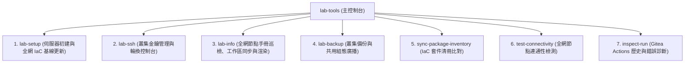

# lab-tools 叢集總控制台說明文件

[`bin/lab-tools`](../../tools/bin/lab-tools)（實作：[`lib/lab_tools.py`](../../tools/lib/lab_tools.py)）為整個 OpenLabOps 叢集自動化維運的主要總入口控制台（系統指令：`lab-tools`）。

---

## 核心設計：五大模組套件統合調用 (5-Suite Ecosystem)

`lab-tools` 作為頂層 Umbrella 控制台，整合調用四大專業模組與基礎維運工具：

### 主選單預設行為 (Default Behaviors)

1. **選取 `lab-setup`**：預設一鍵執行全網伺服器節點基線設定與容器環境掛載 (`system-base-setup.yml`)，亦可選取進入微調選單。
3. **選取 `lab-info`**：遠端節點狀態巡檢 ➔ 遠端倉庫 Commit & Push ➔ 本地工作區自動 Git Pull ➔ Markdown 手冊渲染。
4. **選取 `lab-backup`**：預設一鍵全套備份（閘道備份 + 本機共用組態採集廣播 Family Deploy），亦可選取進入微調選單。

---

## 常用 CLI 命令

| 指令 | 說明 |
| :--- | :--- |
| `lab-tools` | 啟動互動式主控制台 (TUI 選單) |
| `lab-tools -v` / `--version` | 顯示當前工具版本號 |
| `lab-tools setup [args...]` | 轉發執行 `lab-setup` (伺服器初建與基線) |
| `lab-tools ssh [args...]` | 轉發執行 `lab-ssh` (金鑰管理與輪換) |
| `lab-tools info [args...]` | 轉發執行 `lab-info` (節點手冊與工作區同步) |
| `lab-tools backup [args...]` | 轉發執行 `lab-backup` (備份與共用組態廣播) |
| `lab-tools sync [host]` | 採集並廣播共用組態 (Family Deploy) |
| `lab-tools test` | 執行全網節點 SSH 與服務連通性檢測 |
| `lab-tools sync-iac [target]` | IaC 套件清冊差異比對 |
| `lab-tools inspect-run <id>` | 診斷特定 Action Run 錯誤日誌 |
| `lab-tools update-tools` | 檢查並升級本地工具鏈 |
