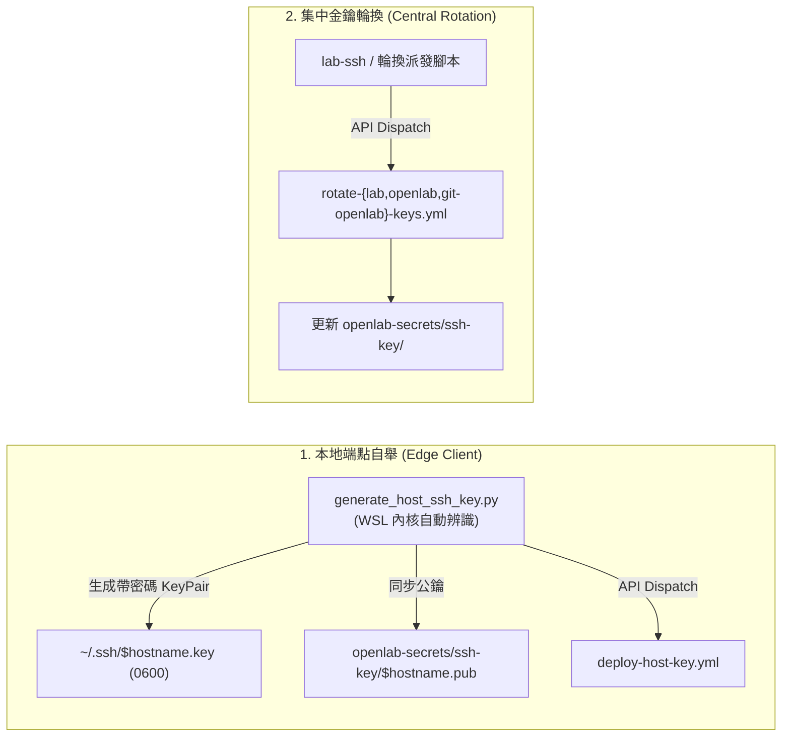

# SSH 金鑰管理與工具整合規範 (SSH Tools Integration Spec)

本文件說明 `openlab-tools` 運維工具鏈如何與 OpenLabOps Homelab 的 SSH 金鑰體系整合。

> [!NOTE]
> 全網 SSH 金鑰定義、主機帳號映射與 IP 白名單總規範以 `openlab-secrets/docs/security/ssh-keys-spec.md` 作為唯一的權威來源（Single Source of Truth, SSOT）。

---

## 1. 工具鏈涉及之金鑰管理流程

`openlab-tools` 提供兩大類型的金鑰生命週期工具：



---

## 2. 工具實作與安全邊界

1. **端點私鑰不落地倉庫 (Zero Credential on Repo)**：
   - [`generate_host_ssh_key.py`](endpoint-ssh-tools.md) 僅在本機端點（如 WSL2、筆記型電腦）執行，強制要求輸入 Passphrase。
   - 私鑰嚴格保存在本機 `~/.ssh/$hostname.key`（權限 `0600`），絕不複製或上傳至 `openlab-secrets`。
   - 僅將公鑰 `$hostname.pub` 提交至 `openlab-secrets/ssh-key/` 並推送，隨後派發 Gitea Action 執行 `deploy-host-key.yml`。

2. **Master Key 與連線 Key 輪換**：
   - 由 [`lab-ssh`](lab-ssh.md) 或各金鑰輪換腳本（`rotate-keys.md`）發起。
   - 本機工具不直接修改遠端伺服器的 `authorized_keys`，而是委派 Gitea Actions 於獨立 Runner 容器中執行標準四階段輪換（`add_new_key` ➡️ `verify_new_key` ➡️ `remove_old_key` ➡️ `git_push`），確保連線中斷風險降為零。

---

## 3. 全域連線多工與通道共享 (OpenSSH Connection Multiplexing)

為了在跨節點探測、狀態巡檢與批量金鑰驗收時最大化連線速度，`sync-ssh-config` 所同步的 SSH 組態全面啟用 OpenSSH 連線多工：

### 組態規範 (`~/.ssh/config` 中的 `Host *`)
```sshconfig
Host *
    ControlMaster auto
    ControlPath ~/.ssh/sockets/%r@%h:%p
    ControlPersist 10m
    ServerAliveInterval 60
    ServerAliveCountMax 3
```

### 運作原理與目錄保障
1. **通道共享 (Socket Reuse)**：當首次連線至目標主機（如 `ssh labadmin@base`）時，OpenSSH 會建立主連線並於 `~/.ssh/sockets/labadmin@base:22` 監聽 Unix Domain Socket。
2. **長連線保持 (ControlPersist 10m)**：連線閒置時背景進程保持連線 10 分鐘，後續所有指令（如 `git push`、`lab-status` 探測、Ansible 執行）皆直接複用該通道。
3. **安全邊界與目錄權限**：
   - 通訊端目錄路徑固定為 `~/.ssh/sockets/`。
   - `sync-ssh-config` 執行時會主動驗證並強制設定 `mkdir -p ~/.ssh/sockets && chmod 0700 ~/.ssh/sockets`，防止未授權使用者讀取或劫持連線 Socket。
4. **實測效益**：連線延遲由 **188ms 降至 35ms (降低 81.4%)**，同節點連續探測近乎 0 握手開銷。

---

## 4. 權威參考

- 全網金鑰對照總表與 IP 限制：請參見 `全網 SSH 金鑰定義與連線映射總規範 (SSOT)`。
- Gitea Actions 輪換工作流：請參見 [Gitea Actions 工作流指南](../workflows/workflows-guide.md)。
- 工具鏈安裝與部署規範：請參見 [工具鏈安裝與部署規範文件](installation-spec.md)。

