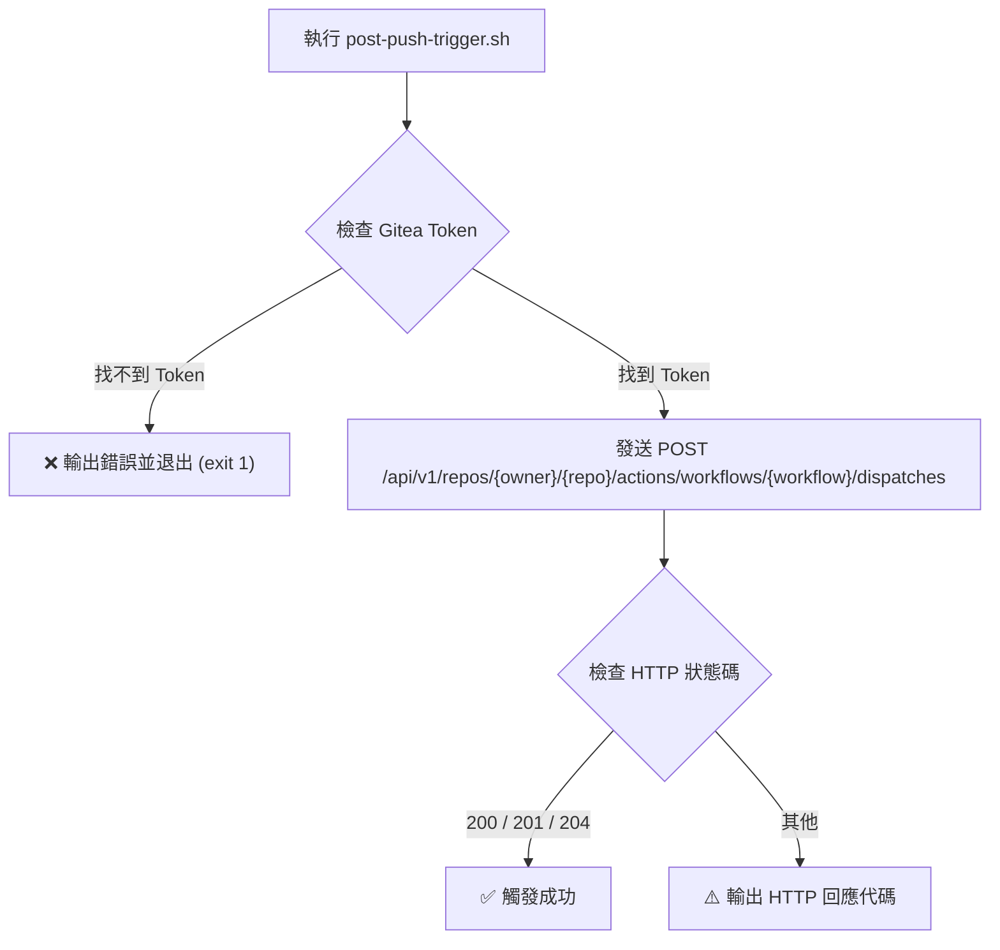

# Git Post-Push Hook Script 說明文件

本文件說明 [`scripts/post-push-trigger.sh`](../../ansible/scripts/post-push-trigger.sh) 腳本之功能、架構與使用方式。

---

## 1. 概述 (Overview)

[`scripts/post-push-trigger.sh`](../../ansible/scripts/post-push-trigger.sh) 是一個 POSIX Shell 腳本，設計作為本機或伺服器端 Git 的 `post-push` / `post-commit` Hook，用於在代碼推送至 Gitea 後，透過 Gitea REST API 自動觸發對應的 Gitea Action Workflow（預設觸發 [`workflows/pull-docker-compose.yml`](../../workflows/.gitea/workflows/pull-docker-compose.yml)）。

---

## 2. 環境變數與 Token 搜尋機制

腳本支援下列環境變數自定義：
- `GITEA_URL`：Gitea 實例網址（預設：`http://192.168.1.90:3000`）
- `REPO_OWNER`：倉庫擁有者（預設：`OpenLabOps`）
- `REPO_NAME`：倉庫名稱（預設：`action`）
- `WORKFLOW_FILE`：欲觸發的工作流檔案名稱（預設：`pull-docker-compose.yml`）
- `GITEA_TOKEN`：可選的直接 API Token

### Token 探索順序 (Token Discovery Hierarchy)
若未提供環境變數 `GITEA_TOKEN`，腳本會自動依序搜尋本機既有憑證：
1. `/home/labadmin/token`
2. `/root/token`
3. `$HOME/.gitea_token`

---

## 3. 工作流程 (Execution Flow)



---

## 4. 安裝與測試方式

在 Git 倉庫中建立 Hook：
```bash
ln -sf /path/to/openlab-workflows/scripts/post-push-trigger.sh .git/hooks/post-push
chmod +x .git/hooks/post-push
```

手動執行測試：
```bash
WORKFLOW_FILE=pull-docker-compose.yml ./scripts/post-push-trigger.sh
```
