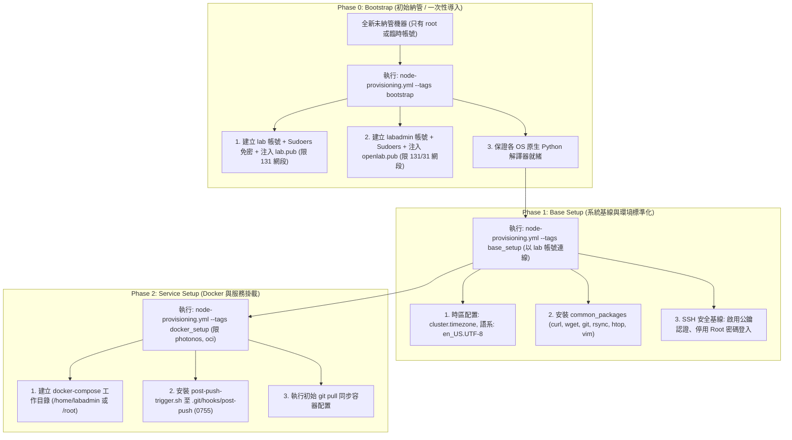

# 7/24 伺服器節點自動化安裝與基線設定規格文件 (docs/node-provisioning.md)

本文件定義 OpenLabOps Homelab 全網常態在線伺服器（**`servers`** 群組：全網常態在線伺服器與控制節點）之**初始納管 (Bootstrap)**、**系統基線調優 (Base Setup)** 與**服務掛載 (Service Provisioning)** 的全自動化規格。

---

## 1. 核心原則與調度架構

1. **Gitea Actions 擔任中央執行者**：
   - 伺服器節點之安裝與設定一律由 Gitea Actions（中央 Ansible Server）以無狀態模式派發執行。
   - 日常維護與基線更新統一使用 `lab` 帳號及 `ansible.key` 憑證進行。
2. **多作業系統 Distro 統一抽象**：
   - 受控伺服器涵蓋 **BSD**、**VMware Photon OS**、**Oracle Linux (OCI)** 與 **Arch Linux**。
   - 透過 `group_vars/` 解譯器映射，由 Ansible 統一抹平套件管理器與系統指令之差異。
3. **Playbook 階段化與標籤化 (Tags-Driven)**：
   - 透過單一或組合 Playbook（`playbooks/node-provisioning.yml`），切分為 `bootstrap`、`base_setup`、`docker_setup` 三大獨立階段，支援初次建置與日常冪等巡檢。

---

## 2. 伺服器自動化建置三階段 (Three-Phase Provisioning)



---

## 3. 各階段詳細技術規範

### 🔹 Phase 0: Bootstrap (初始納管)
- **觸發時機**：全新主機剛安裝完 OS、尚未加入 Ansible 管理時。
- **連線憑證**：使用 `--extra-vars "ansible_user=root ansible_password=..."` 或臨時密碼連線。
- **規範動作**：
  1. **建立 `lab` 系統運維專用帳號**：
     - Shell: `/bin/bash` (Linux) 或 `/bin/sh` (BSD)。
     - 建立 Sudoers 配置：`/etc/sudoers.d/lab`（權限 `0440`），內容 `lab ALL=(ALL) NOPASSWD: ALL`。在 BSD 則加入 `wheel` 群組。
     - 注入公鑰：將中央 `lab.pub` 寫入 `/home/lab/.ssh/authorized_keys`，並嚴格宣告 `key_options: 'from="192.168.1.0/24"'`。
  2. **建立 `labadmin` 管理員通用帳號**：
     - 加入 `sudo` / `wheel` 群組。
     - 注入公鑰：將中央 `openlab.pub` 寫入 `/home/labadmin/.ssh/authorized_keys`，宣告 `key_options: 'from="192.168.1.0/24"'`。
  3. **確保 Python 解譯器就緒**：
     - **Photon OS**：`tdnf install -y python3` (路徑 `/usr/bin/python3.14`)
     - **Oracle Linux**：`dnf install -y python3` (路徑 `/usr/bin/python3.12`)
     - **Arch Linux**：`pacman -Sy --noconfirm python` (系統預設)

---

### 🔹 Phase 1: Base Setup (系統基線與環境調優)
- **觸發時機**：日常基線檢查、或 Phase 0 完成後的環境初始化。
- **連線憑證**：`ansible_user: lab` + `ansible_ssh_private_key_file: ~/.ssh/ansible.key`。
- **規範動作**：
  1. **時區與語系**：
     - 時區統一設為 `cluster.timezone`（Linux 使用 `timedatectl` 或連結 `/usr/share/zoneinfo/${timezone}` 至 `/etc/localtime`）。
     - 語系統一配置 `en_US.UTF-8`。
  2. **共通套件安裝 (`common_packages`)**：
     - 依 `group_vars/` 指定之 `package_manager` 安裝：
       - `curl`, `wget`, `git`, `rsync`, `htop`, `vim`
  3. **SSHD 服務基本硬化**：
     - `PermitRootLogin prohibit-password` (或 `no`)
     - `PubkeyAuthentication yes`
     - `PasswordAuthentication`（依後續 2FA 劇本控制）

---

### 🔹 Phase 2: Service Setup (Docker 與服務掛載)
- **目標主機**：具備容器運行能力之 `docker_hosts` 群組節點。
- **規範動作**：
  1. **目錄建立**：
     - Photon OS: `/home/labadmin/docker-compose`（擁有者 `labadmin:users`，權限 `0755`）
     - OCI: `/root/docker-compose`（擁有者 `root:root`，權限 `0700`）
  2. **Git Post-Push Hook 安裝**：
     - 將 `scripts/post-push-trigger.sh` 部署至目標庫之 `.git/hooks/post-push`。
     - 強制賦予執行權限 `chmod 0755`。
  3. **拉取與同步**：
     - 執行 `git pull origin main` 確保節點獲得最新容器配置。

---

## 4. Playbook 檔案與執行語法規格

- **劇本路徑**：`playbooks/node-provisioning.yml`
- **語法範例**：

```bash
# 1. 全新節點初次納管 (Bootstrap):
ansible-playbook -i inventory/hosts.yml playbooks/node-provisioning.yml \
  --tags "bootstrap" \
  --limit "new_host" \
  --extra-vars "ansible_user=root ansible_password=MyInitialPassword"

# 2. 既有伺服器全網系統基線配置巡檢 (Base Setup):
ansible-playbook -i inventory/hosts.yml playbooks/node-provisioning.yml \
  --tags "base_setup"

# 3. 部署 Docker Compose 目錄與 Hook (Service Setup):
ansible-playbook -i inventory/hosts.yml playbooks/node-provisioning.yml \
  --tags "docker_setup"

# 4. 一鍵完成全流程 (Phase 0 ~ Phase 2):
ansible-playbook -i inventory/hosts.yml playbooks/node-provisioning.yml
```

---

## 5. 與 `server_setup.py` 之控制台整合

本規範與 [openlab-tools/python/linux/server_setup.py](../../../../tools/lib/lab_setup.py) 中的 `system_base_provisioning` 步驟完成精確對齊：
- **Step ID**：`system_base_provisioning`
- **名稱**：`系統基線與環境標準化配置 (Base Provisioning)`
- **Workflow File**：`system-base-setup.yml`
- **Playbook Path**：`playbooks/node-provisioning.yml`
- **啟用狀態**：正式啟用（`enabled=True`）
