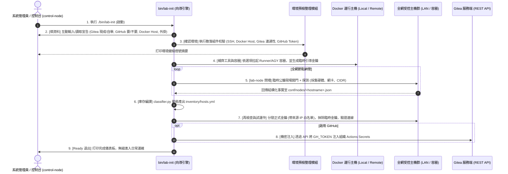

# OpenLabOps-Ops 戰略定位、初始化工作流與架構規範書
## (OpenLabOps-Ops: Incubator Architecture & Initialization Specification)

---

## 1. 專案戰略定位 (Strategic Positioning)

### 1.1 三位一體的演進格局
本專案與現有體系的關係明確定義如下：

```
┌────────────────────────────────────────────────────────┐
│ 1. 現行生產環境: openlab-* (5大倉庫)                   │
│    • 實體穩定運行的「綠色基準 (Green Baseline)」       │
│    • 不受任何實驗性質修改干擾                          │
└──────────────────────────┬─────────────────────────────┘
                           │ 抽象提煉與資產鏡像
                           ▼
┌────────────────────────────────────────────────────────┐
│ 2. 中繼孵化器: openlabops (全功能原型機)            │
│    • OpenLabOps 開源發布前的「尚未精簡之完整版試驗台」 │
│    • 包含本體特化：BSD 網關、Virtualization、Storage、OCI   │
│    • 在實體環境中驗證：Gitea 自動建庫、探測與金鑰閉環  │
└──────────────────────────┬─────────────────────────────┘
                           │ 剝除特化、扁平化 LAN 蒸餾
                           ▼
┌────────────────────────────────────────────────────────┐
│ 3. 開源產品版: openlabops (通用開源套件)               │
│    • 去除 OCI/Virtualization/NAS，僅保留通用 Linux 與 Flat LAN   │
│    • 提供外部社群大眾 60 秒開箱的 GitOps 框架          │
└────────────────────────────────────────────────────────┘
```

* **定位結論**：`openlabops` 是作為 `openlabops` 前身的**全功能實戰驗證台**。在這裡驗證所有自動化與 AI 輔助流程，待架構 100% 穩定後，再蒸餾出簡化開源版。

---

## 2. 核心初始化生命週期 (Day-0 Initialization Lifecycle: bin/lab-init)

`openlabops` 與 `openlabops` 提供端到端「零先決條件、一鍵開箱即用」的 Day-0 引導式嚮導（`bin/lab-init` 或 `bin/lab-init`）。
**本專案全域架構原則：如同 `archinstall`，以「互動式選單動態收集（Interactive Guided）」為預設核心，並於安裝完成後自動匯出宣告式 Manifest（`conf/openlab.manifest.yml`），徹底摒除靜態寫死依賴；同時保留 `--manifest` 讀取匯出檔進行自動化無人值守安裝之能力。**

整體執行生命週期嚴格遵循六大階段閉環：

```text
啟動 (Launch)
  └──> 0. 選擇語系 (Step 0 Language: 繁體中文 / English / 日本語，設定執行環境與全域語系)
         └──> 1. 動態互動填資料 (Interactive Guidance: 叢集識別、Gitea 現成/自舉、Docker Host、外掛)
                └──> 2. 確認環境預檢 (Preflight: 集合並校驗散落之 OpenSSH、Docker Host、Gitea/GitHub 狀態)
                       └──> 3. 補齊工具與容器 (Provisioning: 依選項自舉容器、生成 Ephemeral 臨時引導金鑰)
                              └──> 4. 動態節點納管 (Ingestion: lab-node 現場開門採集活體事實、Subnet 分析編譯庫存)
                                     └──> 5. 正式金鑰交接與宣告匯出 (Handover & Archinstall-Style Export: 生成永久金鑰、抹除臨時公鑰，自動匯出生成 conf/openlab.manifest.yml)
                                            └──> 6. Ready 儀表板退出 (Ready Dashboard: 全節點納管就緒，交接日常維運)
```

### 2.0 Archinstall 哲學：動態輸入優先與自動匯出落地 (Archinstall-Style Dynamic Input Standard)
* **預設互動建構 (Default Guided Mode)**：專案根目錄之 `conf/` 預設為純淨狀態，不強制依賴現存的靜態 `openlab.manifest.yml`。使用者執行 `lab-init` 時，由 TUI 嚮導逐步引導輸入網域、叢集名稱、管理帳號與服務偏好，動態組合目標拓撲。
* **安裝完畢自動匯出 (Export on Complete)**：在 Step 5 金鑰交接與編譯階段，嚮導自動將使用者全部的互動選單結果與節點探測事實，結構化匯出並持久化落地為 `conf/openlab.manifest.yml`（或 `conf/site.manifest.yml`）。使用者未來可隨時檢視或拷貝此 Manifest。
* **無人值守匯入模式 (Declarative Import Mode)**：依然完整保留 `--manifest <path>` 參數。當傳入既有 Manifest 時，系統自動載入先前匯出的 YAML/JSON 規格跳過互動問答，實現 100% CI/CD 與沙箱自動化安裝。

### 2.1 六大標準階段循序流程 (6-Phase Initialization Workflow)



### 2.2 詳細步驟規範與參數映射表 (Parameter Specification)

#### 步驟 1：取得原始碼 (Git Clone)
使用者於乾淨管理機執行 `git clone <repo_url>` 進入根目錄。

#### 步驟 2：參數收集與環境預檢 (Preflight & Parameter Setup)
執行 `./bin/lab-init`（或 `setup.py`），收集核心參數（提供 `openlabops` 與 `openlabops` 雙模式預設值）：

| 參數變數名 | 參數用途說明 | openlabops 預設值 | openlabops 開源版預設值 |
| :--- | :--- | :--- | :--- |
| `cluster_name` | 集群識別名稱 | `openlab` | `openlab` |
| `ansible_user` | 自動化運維專用帳號 | `lab` | `ansible` |
| `admin_user` | 管理者日常操作帳號 | `labadmin` | `admin` |
| `name_of_ansible_key` | 自動化 SSH 金鑰檔名 | `ansible.key` / `lab.pub` | `ansible.key` / `ansible.pub` |
| `name_of_admin_key` | 管理者通用 SSH 金鑰檔名 | `id_user.key` / `openlab.pub` | `openlab.key` / `openlab.pub` |
| `name_of_gitea_key` | 版控部署專用 SSH 金鑰檔名 | `git.key` / `git-openlab.pub` | `git-openlab.key` / `git-openlab.pub` |
| `gitea_url` | 內部 Gitea 服務端 URL | `http://gitea.lab` | 使用者自訂 (或提示安裝) |
| `gitea_user` / `password` | Gitea 一次性管理憑證 | (僅於記憶體中使用，不存盤) | (僅於記憶體中使用，不存盤) |
| `gitea_ssh_port` | Gitea SSH 端口 | `22` | `22` |
| `repo_org_name` | Gitea 所屬組織名稱 | 預設為 `{cluster_name}` | 預設為 `{cluster_name}` |
| `repo_prefix` | 下游倉庫前綴 | 預設為 `{cluster_name}` (如 homelab) | 預設為 `{cluster_name}` |
| `associate_github` | 是否納管外部 GitHub 平台 | 可選 (`y/N`，預設 `N` 純氣隙) | 可選 (`y/N`，預設 `N` 純氣隙) |
| `github_owner` | GitHub 組織或使用者帳號 | 使用者輸入 (如 `openlab`) | 使用者輸入 |
| `github_token` (`GH_TOKEN`) | GitHub PAT 權杖 (具備 `admin:public_key`) | 僅存於記憶體，不存盤 | 僅存於記憶體，不存盤 |

#### 步驟 3：生成臨時引導金鑰 (Ephemeral Bootstrap Key Pair)
* **生命週期管理**：於臨時隔離目錄（如 `/tmp/lab_bootstrap_keys/`）生成無密碼 Ed25519 金鑰對。**嚴禁寫入 `~/.ssh/`**，恪守 `[INV-02]` 避免污染管理機原生憑據環境。
* **唯一用途**：僅供本次 Day-0 納管階段透過 `lab-node` 開門與初期事實採集。

#### 步驟 4：Gitea API 自動初始化 (Parallel Gitea Bootstrap)
透過 Gitea REST API（以記憶體管理員憑證）平行發起：
1. 自動建立 Organization (`{repo_org_name}`)。
2. 自動建立自動化專用帳號 `ci-bot`。
3. 產生 `ci-bot` Master API Token 並注入組織 Secrets (`BOT_TOKEN`)。
4. **GitHub 納管機密注入 (可選)**：若步驟 2 選擇關聯 GitHub，自動調用 `PUT /api/v1/orgs/{repo_org_name}/actions/secrets/GH_TOKEN` 將 `github_token` 登記為組織 Actions Secret，並調用 `https://api.github.com/user` 完成即時身分驗證。

#### 步驟 5：動態節點引導與事實回傳 (Dynamic Node Ingestion: lab-node)
自動循環調用 [`lab-node`](../../../tools/lib/lab_node.py)：
1. 互動式輸入節點連線資訊，遠端注入純 POSIX Shell 腳本 [`bootstrap_probe.sh`](../../../engine/bootstrap_probe.sh)。
2. 現場自舉 `ansible_user`（`lab`）、配置 visudo 免密 Sudoers、注入步驟 3 之**臨時引導公鑰**（附帶來源 IP 白名單）。
3. 採集硬體（CPU/RAM/Disk）、網路（IP/Subnet CIDR/MAC/Gateway）與容器能力，回傳至 `conf/nodes/<hostname>.json`。
4. 針對不可變設備自動特徵識別（Generic Linux RAMDisk 固化備份、Storage `/cf` 解鎖與鎖回）。
5. 重複執行，直到使用者確認全網受控節點新增完畢。

#### 步驟 6：本地動態庫存編譯 (Inventory Generation: classifier.py)
調用多維分類引擎 [`classifier.py`](../../../engine/classifier.py)，解析全體 `conf/nodes/*.json`，生成全網即時快照 `current.json` 與結構化 `inventory/hosts.yml`。

#### 步驟 7：TUI 庫存分組確認與調整 (TUI Inventory Regrouping)
提供終端 TUI 選單：
1. 視覺化檢視節點特徵分類（作業系統發行版、網段、容器宿主機）。
2. 允許管理員互動式挑選節點加入自訂角色群組（如 `db_servers`, `dmz_gateways`）。
3. 嚴格確認 `appliances`（Hypervisor、NAS 韌體）與 `distros` 隔離防線。

#### 步驟 8：Gitea 倉庫生成與首次金鑰輪換交接 (First Key Rotation Handover)
1. **倉庫建立與代碼推送**：自動建立 5 大下游倉庫（`ansible`, `configs`, `secrets`, `tools`, `workflows`），首推 Main 分支。
2. **首次金鑰輪換管線接管 (Handover)**：
   - 觸發 Gitea Actions 的 `rotate-*-keys.yml` 工作流。
   - 在 CI 隔離沙箱內生成正式的生產環境長效金鑰對。
   - 依三階段輪換協議（`add_new_key` $\rightarrow$ `verify_new_key` $\rightarrow$ `remove_old_key`）分發正式公鑰。
   - **關鍵安全閉環：自動自全網節點之 `authorized_keys` 中徹底抹除步驟 3 之臨時引導公鑰！**
   - 本地自動銷毀 `/tmp/lab_bootstrap_keys/` 臨時私鑰，達成全網零殘留。

#### 步驟 9：遠端維運工具鏈分發 (Tools Suite Deployment)
使用已驗證就緒的正式自動化金鑰，對全體受控伺服器執行 `deploy-openlab-tools.yml`，將無依賴 CLI 工具鏈部署至 `/usr/local/bin/openlab` 並建立全域軟連結。

#### 步驟 10：初始化就緒看板 (Initialization Complete Dashboard)
終端輸出整體私有雲健康看板，展示全網節點清冊、Gitea 倉庫連結與日常常用維運命令提示。

---

## 3. 固定群組角色清冊 (Role Archetype Catalog)

為徹底消滅「每次新增節點都要叫 AI Vibe Coding 修改 Playbook」的惡性循環，全網收斂為固定角色清冊。每個角色直接對應通用、冪等的 Ansible Role 與預設備份 targets：

| 角色標籤 (Role Tag) | 適用主機群 | 內建通用 Ansible Roles | 角色綁定之預設備份 targets |
| :--- | :--- | :--- | :--- |
| **`base`** | 所有標準受控主機 | `common`, `ssh_hardening`, `dotfiles` | 系統審計資訊、安全指紋、SSH 配置 |
| **`docker_host`** | 容器應用伺服器 (srv-node1, srv-node2) | `docker`, `compose_runner` | `/etc/docker`、運行容器動態狀態 |
| **`storage`** | 儲存伺服器 (NFS/ZFS) | `storage_nfs`, `zfs_health` | 儲存池狀態、共享目錄配置 |
| **`gateway`** | 核心流量網關 | `gateway_net`, `dnsmasq` | 路由轉發、`/etc/dnsmasq.conf` |
| **`hypervisor`** | 虛擬化宿主機 | `virt_host` | 虛擬機與虛擬磁碟狀態清冊 |
| **`workstation`** | 開發端點 (控制台, 工作站, 筆電) | `endpoint_client` | `~/.ssh/config`、個人化 Dotfiles |
| **`cloud_edge`** | 跨公網雲端節點 | `cloud_guard` (單向防禦障壁) | WireGuard Mesh 狀態、反向連線阻斷 |

---

## 4. 由下而上的推進策略 (Bottom-Up Implementation Strategy)

在進行 `openlabops` 的總控變數敲定前，採取**由下而上 (Bottom-Up) 的漸進式重構**：

1. **五庫各自建立 `conf/`**：
   依序檢查 `openlab-tools`、`openlab-ansible`、`openlab-workflows` 等倉庫，將硬編碼於代碼中的變數抽出至各自的 `conf/` 中。
2. **精確提煉所需參數**：
   透過五庫的 Code/Config 解耦，真實掌握每個組件「到底需要哪些輸入參數」，避免在頂層憑空想像不需要的變數。
3. **完成 `openlabops` 頂層調度對齊**：
   將提煉出的真實參數映射回 `conf/core.manifest.yml` 與 `conf/openlab.manifest.yml`，完成全生命週期的閉環！

---

## 5. 三層宣告架構、中性語意命名與模板渲染引擎 (Three-Tier Declarative Lifecycle & Neutral Template Rendering)

為了徹底解耦特定私有雲品牌（OpenLabOps）與通用運維引擎（OpenLabOps），全專案貫徹三大設計原則：

### 5.1 三層配置與事實生命週期 (Three-Tier Separation)
1. **Tier 1 (core - 不可變框架死定義)**：
   - 檔名：`conf/core.manifest.yml` 與 `schema/*.cue`。
   - 職責：定義跨站點通用架構基準、五庫聯邦結構、不可變架構約束（`[INV-01]`~`[INV-09]`）與三大金鑰合約。
2. **Tier 2 (userdefine / site - 站點客製意圖)**：
   - 檔名：`conf/openlab.manifest.yml`（通用名稱：`conf/site.manifest.yml`）。
   - 職責：由 `bin/lab-init` 引導收集之參數（叢集名稱、網段 CIDR、內部網域、管理員帳號、三大金鑰實體檔名綁定）。
3. **Tier 3 (node - 動態遙測事實與原生庫存)**：
   - 檔名：`conf/nodes/*.json` 與 `node-information/node_*.json`。
   - 職責：由現場探針採集真實硬體、動態網卡與容器清單。
   - **純 JSON 執行期契約**：節點採集之動態遙測直接由 Python 標準庫編譯為 `inventory/hosts.yml`，**執行期純 JSON，不經過 CUE 轉譯**，零相依、高效率。

### 5.2 核心代碼中性化合約 (Neutral Role Contract)
代碼庫、Playbook、Workflow 與 CLI 工具內部**嚴禁寫死任何特定站點名稱（如 `lab`, `openlab`, `labadmin`）**：
- **金鑰中性角色**：統一以 `ansible`（自動化金鑰）、`user`（使用者/端點金鑰）、`git`（版控金鑰）命名。
- **帳號中性角色**：統一以 `ansible_user` 與 `admin_user` 調用。
- **實體檔名映射**：由各站點宣告檔（如 `openlab.manifest.yml`）自行綁定：
  ```yaml
  keys:
    ansible: "ansible.key"
    user: "id_user.key"
    git: "git.key"
  ```

### 5.3 模板渲染引擎 (Template Rendering Engine)
`openlabops` 作為母體孵化器，其核心工作流檔、Ansible 劇本與主機配置皆採用 Jinja2 模板（存放於 `templates/`），由 `engine/compiler.py` 結合 `conf/*.manifest.yml` 渲染為固定參數之正式生產檔案（Blue-Green 對稱產出至下游倉庫），實現「一處宣告、全網收斂」之極致 GitOps。

