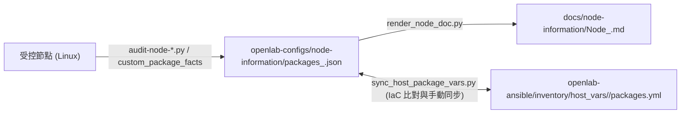

# 全網軟體包清單與節點資訊規範 (Package Information Spec)

本文件說明 `openlab-configs/node-information/` 中關於節點軟體包資料（`packages_<host>.json`）之結構規範、採集來源以及與 IaC 倉庫之映射關聯。

---

## 1. 概述與架構定位

為達成軟體包清單 IaC（Infrastructure as Code）化與機器資料完整度，OpenLabOps Homelab 在節點審計流程中導入了純粹主動安裝、非系統預設、非純依賴的軟體包採集機制。

採集成果同時維護於兩處：
1. **即時審計狀態庫 (`openlab-configs/node-information/packages_<host>.json`)**：存放節點最新回傳之完整 JSON 資料。
2. **IaC 清單宣告庫 (`openlab-ansible/inventory/host_vars/<host>/packages.yml`)**：以 YAML 格式宣告預期維護的主動安裝軟體包清單。



---

## 2. JSON 資料結構規範

`packages_<host>.json` 記錄該主機的主動安裝軟體包，依據作業系統與套件庫來源進行分組：

```json
{
  "host": "srv-node1",
  "os_family": "Archlinux",
  "package_manager": "pacman",
  "audit_timestamp": "2026-10-20T15:30:00+08:00",
  "pacman_explicit": [
    "neovim",
    "git",
    "zsh",
    "tmux"
  ],
  "aur_explicit": [
    "visual-studio-code-bin",
    "google-chrome"
  ],
  "system_packages": [
    "neovim",
    "git",
    "zsh",
    "tmux"
  ]
}
```

### 欄位定義說明

| 欄位名稱 | 型態 | 說明 |
| :--- | :--- | :--- |
| `host` | string | 節點主機名稱（與 Ansible inventory 主機名稱一致） |
| `os_family` | string | 作業系統家族（如 `Archlinux`, `RedHat`, `BSD`, `Photon Linux`） |
| `package_manager` | string | 主套件管理器（如 `pacman`, `dnf`, `tdnf`, `pkg`） |
| `audit_timestamp` | string | ISO-8601 格式的採集時間戳記 |
| `system_packages` | array[string] | 原生套件庫中主動明確安裝的軟體包名稱清單 |
| `aur_explicit` | array[string] | *(僅限 Arch Linux)* 由 AUR Helper (`yay` / `paru`) 安裝之外生套件 |
| `pacman_explicit` | array[string] | *(僅限 Arch Linux)* 由 pacman 原生庫顯式安裝之套件 |

---

## 3. 節點審計 Markdown 整合

透過 [`openlab-tools/python/core/render_node_doc.py`](../../../tools/lib/render_node_doc.py)，本 JSON 會自動注入至各節點的 `Node_<host>.md` 中，產生如下章節：

```markdown
## 📦 主動安裝軟體包清單 (Explicitly Installed Packages)
- **原生套件庫 (Native Packages)**: `git`, `neovim`, `tmux`, `zsh` ...
- **AUR 套件庫 (AUR Packages)**: `google-chrome`, `visual-studio-code-bin` ...
```

這使 AI 助手（如 Antigravity）與維運人員在檢視節點動態手冊時，能即時理解該主機的核心軟體生態，而不會被上千個底層相依函式庫干擾。
