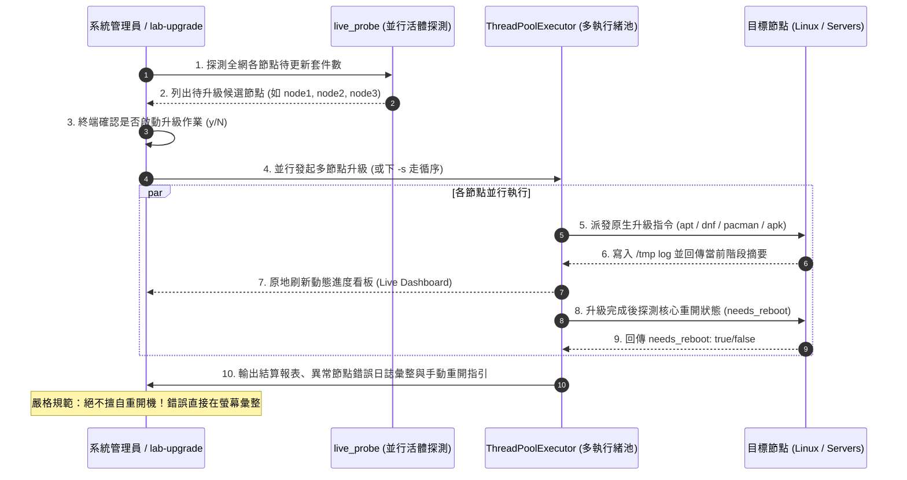

# lab-upgrade 叢集套件升級維護與重開機提醒套件說明文件

[`bin/lab-upgrade`](../../../tools/bin/lab-upgrade)（實作：[`lib/lab_upgrade.py`](../../../tools/lib/lab_upgrade.py)）（系統指令：`lab-upgrade` / `lab-tools upgrade`）是 OpenLabOps 叢集多發行版套件維護升級與重開機需求識別套件。

---

## 1. 核心維運原則 (Core Principles)

1. **依發行版原生套件管理器安全升級**：
   - Arch Linux: `yay -Syu --noconfirm --needed`（本機提權）
   - Photon OS: `sudo tdnf update -y`（透過管理帳號 `lab`）
   - Oracle Linux (OCI): `sudo dnf upgrade -y`（透過 `opc` 帳號）
   - BSD: `if sudo system-update updatesready; then sudo system-update install; fi; sudo pkg upgrade -y`（透過管理帳號 `lab` 同時完成 Base System 補丁與 Ports/Pkg 套件升級）
2. **預設多節點並行同步升級 (Live Dashboard)**：
   - 採用 `ThreadPoolExecutor` 針對候選節點發起並行升級，維護時間縮減 60% ~ 75%。
   - 終端採用現代化**原地更新進度看板**，動態顯示各主機狀態、耗時與即時進度摘要（下載、解壓、安裝、驗證），避免多主機 stdout 穿插交錯。
3. **【核心規範】錯誤自動提取彙整，無需人工翻找 Log (Error Aggregation Guard)**：
   - 每台主機背景留存完整原始日誌於 `/tmp/lab-upgrade-<host>.log`。
   - **若任何節點升級遭遇異常，工具於結算報表下方自動自日誌中提取關鍵 Error 摘要與最後輸出**，管理者於當前終端即可一目了然定位問題，無須翻查檔案。
4. **【核心規範】僅提醒需重開機，純手動排程重啟 (Remind Only, Manual Reboot Guard)**：
   - 套件升級過程中若替換了 Linux Kernel (`linux`, `linux-esx`, `kernel-uek-core`) Kernel 或關鍵核心系統程式（如 `systemd`, `glibc`, `dbus`），升級結束後**自動精確識別**並於結算報表中以顯目標記列出。
   - **絕不提供遠端自動重開機或未授權重啟**，杜絕因自動化重啟導致正在運行的 Docker 服務、資料庫或網路中斷之風險。
   - 升級結算時清楚列出需重開機的節點名稱與手動 SSH 指令，由管理者在合適的維護窗口純手動登入處置。

---

## 2. 升級與重開機檢測流程



---

## 3. 常用 CLI 命令

| 指令 | 說明 |
| :--- | :--- |
| `lab-upgrade` | **預設多節點並行升級**：動態儀表板原地刷新進度，完成後自動彙整錯誤與重開提醒 |
| `lab-upgrade -s` / `--serial` | **循序單台升級模式**：傳統逐台串流詳細套件升級日誌 |
| `lab-upgrade node1` | 僅針對指定節點（如 `node1`）執行套件升級 |
| `lab-upgrade node1 node2` | 針對多個指定節點執行並行升級 |
| `lab-upgrade -f` / `--force` | 免確認直接對有待更套件之節點執行升級 |
| `lab-tools upgrade` | 從總控制台捷徑調用升級套件 (預設並行) |
| `lab-upgrade -v` / `--version` | 顯示版本號 |

---

## 4. 執行與結算報表範例

### 4.1 執行中動態進度看板 (Live Dashboard)

```text
============================================================
  Cluster Package Upgrade (lab-upgrade)
============================================================

[INFO] 正在並行探測全網各節點之待升級套件現況...
[SUCCESS] 探測完成 (全網活體耗時 1.89s)。

待維護升級之目標節點清單 (多節點同步並行模式 (Live Dashboard)):
  • node1      : ▲ 26 待更新 (systemd, bash, openssh)
  • node2      : ▲ 82 待更新 (NetworkManager, coreutils, libssl)
  • node3      : ▲ 78 待更新 (NetworkManager, glibc, kernel)
  • node4      : ▲ 70 待更新 (NetworkManager, util-linux, curl)

確定要對上述 4 台節點同時同步並行升級作業？(y/N): y

------------------------------------------------------------
已為 4 台節點發起並行同步升級 (即時日誌留存於 /tmp/lab-upgrade-<host>.log):

╭── 🚀 叢集節點同步升級看板 (Parallel Upgrade Dashboard) ──────────────────╮
│  節點主機   狀態       耗時    當前進度與階段摘要                         │
│ ────────────────────────────────────────────────────────────────────── │
│  node1      ⠹ 升級中   00:14   下載: bash...                              │
│  node2      ⠼ 升級中   00:22   安裝: libssl...                            │
│  node3      ● 成功     00:19   升級完成 (🔄 需重開: core_libraries)       │
│  node4      ⠴ 升級中   00:18   執行交易與套件驗證中...                    │
╰────────────────────────────────────────────────────────────────────────╯
```

### 4.2 結算報表、錯誤日誌自動彙整與重開機指引

```text
============================================================
  📊 叢集套件升級維護作業結算報表
============================================================
  • node1        : 狀態=● 升級成功         重開狀態=● 無需重開機             (耗時: 15.2s)
  • node2        : 狀態=● 升級成功         重開狀態=🔄 需要重開機 (core_libraries) (耗時: 22.4s)
  • node3        : 狀態=● 升級成功         重開狀態=🔄 需要重開機 (core_libraries) (耗時: 20.1s)
  • node4        : 狀態=● 升級成功         重開狀態=🔄 需要重開機 (core_libraries) (耗時: 19.8s)
────────────────────────────────────────────────────────────
總作業耗時: 22.5s | 成功: 4 / 失敗: 0

============================================================
  🚨 升級異常節點錯誤日誌彙整 (已為您自日誌自動提取關鍵錯誤)  
============================================================

╭── ❌ 節點: failnode (指令結束代碼: 1) ────────────────────────╮
│ 日誌檔案: /tmp/lab-upgrade-failnode.log
│ 關鍵錯誤日誌摘要:
│ ────────────────────────────────────────────────────────────────────
│   > Error: Transaction test error:
│   >   file /usr/lib64/libssl.so conflicts with package bar-1.2.3
│   > Error: Check failed.
╰────────────────────────────────────────────────────────────────────╯

📢 【重要重開機提醒 (Reboot Reminder)】
本工具遵循高可用運維規範【絕不擅自執行重開機】。
檢測到下列節點核心或關鍵系統函式庫已完成升級，必須進行重開機以載入新版本：
  👉 node2
  👉 node3
  👉 node4

手動重開機指引:
  請管理者依據各業務容器與網路服務之維護窗口，手動登入節點執行重啟:
  • ssh node2 'sudo reboot'
  • ssh node3 'sudo reboot'
  • ssh node4 'sudo reboot'
```
