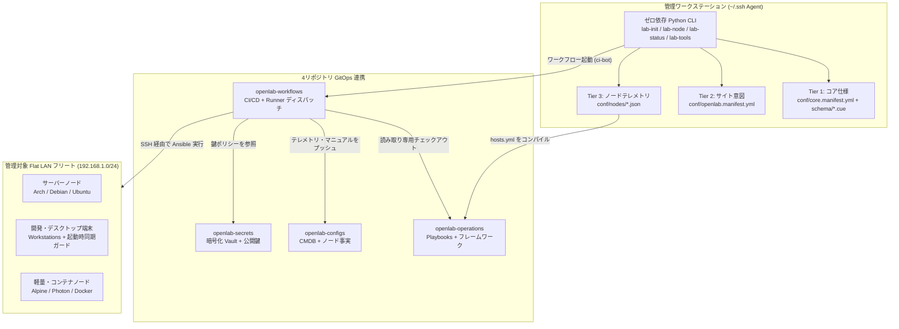

# システムアーキテクチャ

OpenLabOps は**ゼロ依存・宣言的 Homelab 運用フレームワーク（Operations Framework）**として設計されており、「不変フレームワーク契約」「サイト宣言意図」「ライブノードテレメトリ」を厳格に 3 層へ分離し、権限境界が分離された 4 つの下流 GitOps リポジトリへ展開します。



## 1. リポジトリ構造

```text
openlabops/
├── bin/                        # コントロールプレーン入口 (lab-init, lab-node, lab-apply, lab-test)
├── engine/                     # Python コアフレームワーク (compiler, classifier, discover, initialize, onboard)
├── schema/                     # 不変 CUE 契約 (invariants, network, roles, keys, nodes)
├── conf/                       # SSOT マニフェストと動的ノード分類 (nodes/*.json)
├── ansible/                    # ステートレスなプレイブック、ロール、group_vars
├── tools/                      # ゼロ依存エンドポイント・運用 CLI (bin/lab-* & lib/core/*)
├── workflows/                  # Gitea Actions ワークフローとコンポジットアクション
├── templates/                  # 下流リポジトリ展開テンプレート (ansible, configs, workflows)
├── lang/                       # 多言語 i18n 辞書 (en_US.json, zh_TW.json, ja_JP.json)
└── tests/                      # ユニットテスト、Dagger DinD E2E、マルチディストリビューション Docker サンドボックス
```

## 2. 3層分離モデル

1. **Tier 1 (`core`)：不変フレームワーク仕様**
   * `conf/core.manifest.yml` および `schema/*.cue` に定義されます。
   * 4リポジトリ構成、3つの標準鍵ロール（`ansible`、`user`、`git`）、セキュリティベースライン、CUE 検証ルールを規定します。
2. **Tier 2 (`site`)：サイト宣言意図**
   * `conf/openlab.manifest.yml` に保存されます。
   * クラスター名、ドメイン、Flat LAN サブネット（`192.168.1.0/24`）、ゲートウェイ、管理者/Ansible ユーザー、Gitea エンドポイントを保持します。`archinstall` と同様に `lab-init` で対話的に生成・エクスポートされ、`--manifest` で無人再現できます。
3. **Tier 3 (`node`)：動的マシンテレメトリ**
   * **インベントリ分類 (`conf/nodes/*.json`)**：分類属性（`os_family`、`distribution`、`role`、`capabilities`）のみを保持し、ハードウェアテレメトリ（`mac_address`、`cpu_cores`、`memory_mb`）は一切混在させません。
   * **CMDB ハードウェアテレメトリ (`node-information/node_<hostname>.json`)**：`lab-discover`（`engine/bootstrap_probe.sh`）が独立してプローブし、RAM、CPU、ディスク、Docker コンテナ、待機ポート、`authorized_keys` フィンガープリントを記録します。
   * **動的コンパイル**：`engine/classifier.py` が純粋な Python 標準ライブラリで `conf/nodes/*.json` を `ansible/inventory/hosts.yml` へコンパイルします（実行時 CUE 依存ゼロ）。

## 3. 4リポジトリ連携とブラスト半径の隔離

| リポジトリ | 内容 | `ci-bot` 権限 |
| :--- | :--- | :--- |
| **`openlab-operations`** | Ansible プレイブック、ロール、フレームワーク、CLI ツール | **読み取り専用**（改変不可） |
| **`openlab-workflows`** | Gitea Actions ワークフロー＆コンポジットアクション | **読み取り / ディスパッチ** |
| **`openlab-configs`** | CMDB `node-information/node_*.json`、パッケージ一覧、Markdown マニュアル | **テレメトリ書き込み** |
| **`openlab-secrets`** | 公開鍵、エンドポイント鍵レジストリ、暗号化シークレット | **鍵ポリシー参照** |

## 4. ゼロ依存フレームワークと Gitea Act Runner 実行モデル

* **100% Python 標準ライブラリ (`[INV-01]`)**：組み込み `yaml_parser.py`、`urllib.request` ベースの `gitea_api.py`、`curses` ベースの `ui_curses.py` により外部依存ゼロで動作します。
* **エンドポイント Ansible レス設計**：管理対象ノードや端末には Python 3 と OpenSSH のみ必要です。Ansible プレイブックは **Gitea Act Runner** コンテナ（`ansible-core` 内蔵）上で一元実行されます。
* **Flat LAN とマルチディストリビューション対応**：`schema/network.cue` が Flat LAN（`192.168.1.0/24`）境界を強制し、**Arch Linux**、**Debian**、**Ubuntu**、**Oracle Linux**、**Alpine Linux**、**VMware Photon OS** をネイティブサポートします。
