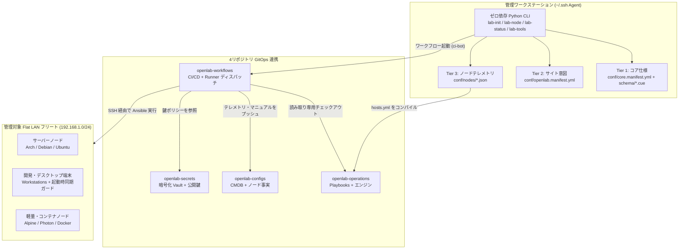

# システムアーキテクチャ

OpenLabOps は「不変フレームワーク契約」「サイト宣言意図」「ライブノードテレメトリ」を厳格に 3 層へ分離し、権限境界が分離された 4 つの下流 GitOps リポジトリへ展開します。

## 1. 3層分離モデル

1. **Tier 1 (`core`)：不変フレームワーク仕様**
   * `conf/core.manifest.yml` および `schema/*.cue` に定義されます。
   * 4リポジトリ構成、3つの標準鍵ロール（`ansible`、`user`、`git`）、セキュリティベースライン、CUE 検証ルールを規定します。
2. **Tier 2 (`site`)：サイト宣言意図**
   * `conf/openlab.manifest.yml` に保存されます。
   * クラスター名、ドメイン、Flat LAN サブネット（`192.168.1.0/24`）、ゲートウェイ、管理者/Ansible ユーザー、Gitea エンドポイントを保持します。`archinstall` と同様に `lab-init` で対話的に生成・エクスポートされます。
3. **Tier 3 (`node`)：動的マシンテレメトリ**
   * `conf/nodes/*.json`（インベントリ分類）と `node-information/node_<hostname>.json`（CMDB ハードウェア・コンテナ・鍵情報）に保存されます。
   * 静的マニフェストにはハードコードせず、`lab-node` と `lab-discover` で動的プローブし、`engine/classifier.py` が `ansible/inventory/hosts.yml` へコンパイルします。

## 2. 4リポジトリ連携とブラスト半径の隔離

CI/CD トークン侵害時の被害範囲（Blast Radius）を限定するため、下流リポジトリを 4 つに分離しています。

* **`openlab-operations`**：Ansible プレイブック、ロール、エンジン、CLI ツール。
* **`openlab-workflows`**：Gitea Actions ワークフロー。自動化トークン（`ci-bot`）の権限はここに限定され、`openlab-operations` のコード変更は**物理的に不可能**です。
* **`openlab-configs`**：ノードのハードウェア事実（`node-information/node_*.json`）、パッケージ一覧、自動生成された Markdown マニュアル。
* **`openlab-secrets`**：公開鍵、エンドポイント鍵レジストリ、暗号化シークレット。

## 3. Flat LAN とマルチディストリビューション Linux 対応

* **ネットワークスキーマ (`schema/network.cue`)**：標準的な単一サブネット（`192.168.1.0/24`）向けに設計され、サブネット重複や不正なゲートウェイ設定を CUE で防止します。
* **対応ディストリビューション**：**Arch Linux**、**Debian**、**Ubuntu**、**Oracle Linux**、**Alpine Linux**、**VMware Photon OS** および汎用 systemd Linux をネイティブサポートします。

## 4. ゼロ依存 Python エンジン

すべての CLI ツール（`bin/lab-*` / `tools/bin/lab-*`）は `tools/lib/core/` を共有し、100% Python 3 標準ライブラリで実装されています。管理対象ノードに Ansible をインストールする必要はなく、Gitea Act Runner コンテナが一元的に Ansible を実行します。
