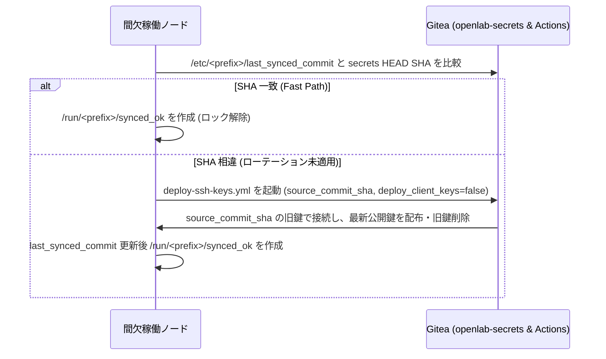

# 期限切れ鍵の起動時自動同期とロックアウト保護

ワークステーションやノート PC などの間欠稼働ノード（`always_online: false`）は、電源オフ中に鍵ローテーションを逃すことがあります。OpenLabOps は HTTP 経由で秘密鍵を配布することなく（`[INV-02]`）、起動時に自動追従します：

* **Secrets Git SHA インデックス (`tools/lib/lab_boot_sync.py`)**: `/etc/<prefix>/last_synced_commit` と `<prefix>-secrets` の `HEAD` を比較します。
* **ロックアウトガード (`tools/lib/core/lockout.py`)**: `/run/<prefix>/synced_ok` が作成されるまで、間欠ノード上の `lab-*` 自動化操作をロックします。
