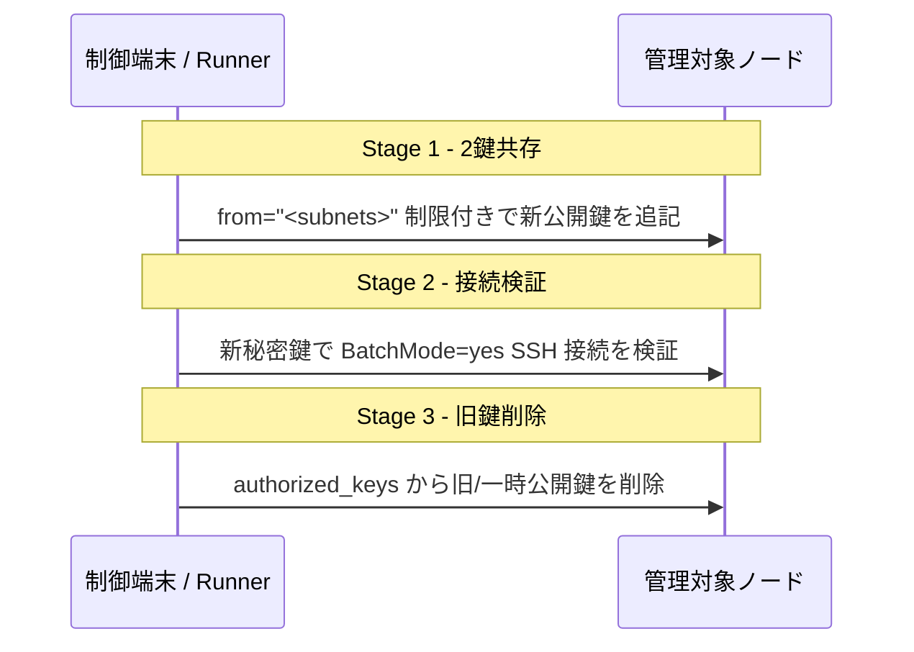

# 3段階ゼロダウンタイム SSH 鍵ローテーション

OpenLabOps は稼働中の SSH 鍵を単一ステップで上書きしません。Day-0 引き継ぎ（`lab-init`）および Day-2 ローテーション（`lab-ssh --rotate-*`）のいずれも 3段階プロトコルに従います：

* **`ssh-keygen -y` による公開鍵導出**: 秘密鍵から `ssh-keygen -y -P "" -f` で公開鍵を直接導出し、不整合な `*.key.pub` を自動修復します。
* **`from="..."` サブネット制限 (`[INV-05]`)**: 許可された内部サブネットからのみログインを許可します。
