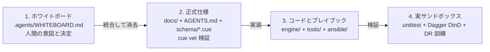

# Antigravity Vibe Coding と AI 支援 SRE

**OpenLabOps** は、**Google Antigravity (AGY) Vibe Coding** によって一から構築されたプロジェクトです。人間のアーキテクトが厳格な不変条件と設計意図を定義し、AI エージェントがその境界内で実装・テスト・検証を自律的に遂行します。

---

## 1. 人間と AI の協調開発モデル

従来の Vibe Coding はインフラ領域では依存関係の肥大化や仕様ドリフトを招きがちですが、OpenLabOps は 3 つの仕組みでこれを解決しています。

### A. 機械強制エンジニアリング契約 (`AGENTS.md`)
すべての設計規律を `AGENTS.md` に不変条件として明文化しています：
* **外部依存ゼロ (`[INV-01]`)**：AI に Python 3 標準ライブラリのみでの実装を強制。
* **平文認証情報ゼロ (`[INV-02]`)**：秘密鍵やトークンのハードコード・コミットを禁止。
* **本番ツール検証 (`[INV-09]`)**：モック回避や例外握りつぶしを禁止し、実 Docker/Dagger サンドボックスでの検証を義務付け。

### B. 仕様優先 3段階パイプライン (`[INV-10]`)



1. **ホワイトボード入力**：人間が要件や方針を `.agents/WHITEBOARD.md` に記述。
2. **仕様とスキーマの整合**：AI が正式な `docs/` と `schema/*.cue` へ統合（`cue vet ./schema/` で検証）し、ホワイトボードを消去。
3. **実装と実環境テスト**：その後で Python/Ansible を編集し、ユニットテストおよび Dagger E2E で検証。

---

## 2. 既存境界を活用した `AGY-Remote` の安全な SRE 運用

アーキテクチャレベルでセキュリティ境界とブラスト半径隔離が完成しているため、鍵漏洩やロックアウトのリスクなしに **AGY-Remote** を AI SRE として運用に参加させることができます。

### `AGY-Remote` のプロビジョニング
Day-0 導入時に `--with-remote-dev` を指定してリモート SRE コンテナを構築します：
```bash
lab-init --with-remote-dev
```

### 境界内で実行できる実践的 AI SRE ワークフロー

1. **フリート健全性＆セキュリティトリアージ（読み取り専用）**：
   * `lab-status --json` — 全管理ノードの構造化 JSON ヘルス情報を取得。
   * `lab-status -a` — `authorized_keys` フィンガープリント監査で不正鍵を検知。
   * `node-information/node_<hostname>.json` — RAM、ディスク、コンテナ、待機ポートのライブ状態を確認。
2. **CI/CD 障害診断**：
   * `lab-tools --plain inspect-run <ID>` — TTY や Runner への生 SSH アクセスなしで Gitea Actions の失敗ログを取得。
3. **監査済み修復ディスパッチ**：
   * `AGY-Remote` は `ci-bot` 経由で `lab-setup -s <step>`、`lab-upgrade`、`lab-ssh --rotate-ansible` 等の承認済みワークフローを起動。
   * `ci-bot` は `openlab-operations` の改変が**物理的に不可能**なため、AI SRE がプレイブックを書き換えたり秘密鍵を流出させたりする心配がありません。
4. **変更前スキーマガード**：
   * 提案された変更は `lab-diff` / `lab-apply` 前に `cue vet ./schema/` で検証され、`lab-boot-sync` と 3段階鍵ローテーションが管理者のロックアウトを防ぎます。
