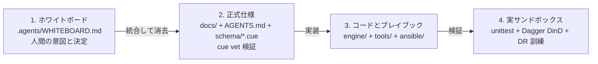

# Antigravity Vibe Coding と AI 支援 SRE

**OpenLabOps** は、**Google Antigravity (AGY) Vibe Coding** によって一から構築されたプロジェクトです。人間のアーキテクトが厳格な不変条件と設計意図を定義し、AI エージェントがその境界内で実装・テスト・検証を自律的に遂行します。

---

## 1. 人間と AI の協調開発モデル

従来の Vibe Coding はインフラ領域では依存関係の肥大化や仕様ドリフトを招きがちですが、OpenLabOps は 3 つの仕組みでこれを解決しています。

### A. 機械強制エンジニアリング契約 (`AGENTS.md`)
すべての設計規律を `AGENTS.md` に不変条件として明文化しています：
* **外部依存ゼロ (`[INV-01]`)**：AI に Python 3 標準ライブラリのみでの実装を強制。
* **平文認証情報ゼロ (`[INV-02]`)**：秘密鍵やトークンのハードコード・コミットを禁止。
* **本番ツール検証 (`[INV-09]`)**：モック回避や例外握りつぶしを禁止し、実 Docker/Dagger サンドボックスでの検証を義務付け。

### B. 仕様優先 3段階パイプライン (`[INV-10]`)



1. **ホワイトボード入力**：人間が要件や方針を `.agents/WHITEBOARD.md` に記述。
2. **仕様とスキーマの整合**：AI が正式な `docs/` と `schema/*.cue` へ統合（`cue vet ./schema/` で検証）し、ホワイトボードを消去。
3. **実装と実環境テスト**：その後で Python/Ansible を編集し、ユニットテストおよび Dagger E2E で検証。

---

## 2. 既存境界を活用した `AGY-Remote` の安全な SRE 運用

アーキテクチャレベルでセキュリティ境界とブラスト半径隔離が完成しているため、鍵漏洩やロックアウトのリスクなしに **AGY-Remote** を AI SRE として運用に参加させることができます。

### `AGY-Remote` のプロビジョニング
Day-0 導入時に `--with-remote-dev` を指定してリモート SRE コンテナを構築します：
```bash
lab-init --with-remote-dev
```

### AI SRE を安全に保つ境界メカニズム

| 境界メカニズム | AI SRE (`AGY-Remote`) に対する保護 |
| :--- | :--- |
| **平文秘密鍵ゼロ (`[INV-02]`)** | `AGY-Remote` は生の `ansible.key` 等を保持しません。特権操作はすべて Gitea Actions（`openlab-workflows`）経由で実行されます。 |
| **ブラスト半径の隔離 (`[INV-03]`)** | 自動化トークン（`ci-bot`）はワークフロー起動と CMDB 更新（`openlab-configs`）のみ可能で、`openlab-operations` のプレイブック改変は**物理的に不可能**です。 |
| **構造化テレメトリ参照** | `lab-status --json`、`lab-status -a`（鍵監査）、`node-information/node_*.json` によりクラスター状態を正確に把握できます。 |
| **非対話型 CLI 対応** | `--plain` / `--no-tui` / `--json`（例：`lab-tools --plain inspect-run <ID>`）により、AI SRE が CI 失敗ログを診断し復旧ワークフローを起動できます。 |
| **CUE とロックアウト防止** | `cue vet ./schema/` が不正な設定変更を阻止し、`lab-boot-sync` と 3段階鍵ローテーションが管理者のロックアウトを防ぎます。 |
