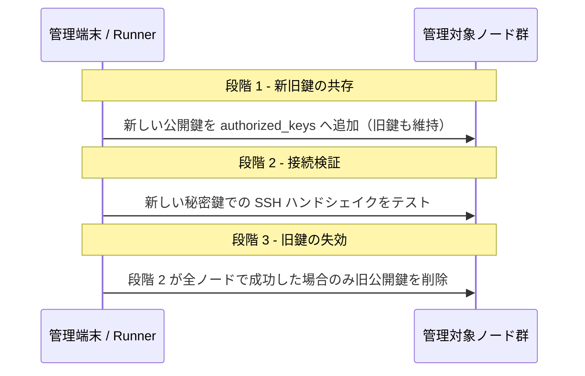
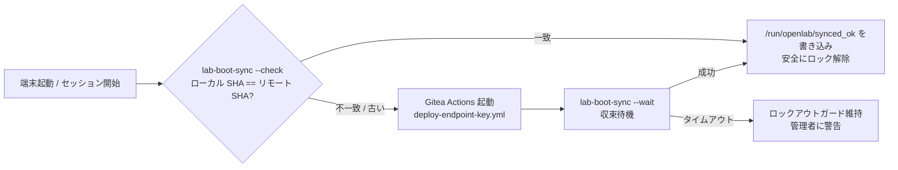

# セキュリティポリシーと鍵ライフサイクル

OpenLabOps は管理端末、GitOps 連携、および管理対象 Linux フリート全体でゼロトラストと平文認証情報排除を徹底します。

## 1. リポジトリ内認証情報ゼロ (`[INV-02]`)

* **秘密鍵・トークンの保存禁止**：平文の SSH 秘密鍵（`*.key`、`id_*`）や API トークンのコミットは厳禁です。
* **ネイティブ OpenSSH 連携**：管理端末の `~/.ssh/`、`~/.ssh/config`、および `ssh-agent` をそのまま利用します。
* **トークンのブラスト半径隔離**：`ci-bot` はワークフローのディスパッチと `openlab-configs` へのテレメトリ記録のみ許可され、`openlab-operations` のプレイブックを変更できません。

## 2. 標準鍵ロールとエンドポイント鍵ライフサイクル

内部フレームワークやプレイブックは鍵ファイル名をハードコードせず、`conf/openlab.manifest.yml` でマッピングされた 3 つの意味的ロールを参照します。

| ロール | 用途 | 代表的な鍵名 | ローテーションコマンド |
| :--- | :--- | :--- | :--- |
| **`ansible`** | Gitea Act Runner と Ansible プレイブックが使用する自動化鍵 | `ansible.key` | `lab-ssh --rotate-ansible` |
| **`user`** | 運用管理者の対話型 SSH ログイン鍵 | `admin.key` | `~/.ssh/` で管理 |
| **`git`** | GitOps リポジトリ同期用のデプロイ鍵 | `git-openlab.key` | `lab-ssh --rotate-git` |

### エンドポイント端末鍵の発行と失効
* **発行 (`generate-host-ssh-key -H <hostname>`)**：端末専用の Ed25519 鍵ペア（`<hostname>.key`）を生成し、`openlab-secrets` へ登録後、`ansible/playbooks/deploy-endpoint-key.yml` をディスパッチします。
* **失効 (`revoke-host-ssh-key -H <hostname>`)**：`ansible/playbooks/revoke-host-key.yml` により全管理ノードの `authorized_keys` から公開鍵を即時削除し、`openlab-secrets` からも抹消します（`--keep-secrets` 指定時を除く）。

## 3. 3段階ゼロダウンタイム鍵ローテーション

鍵ローテーション（`lab-ssh --rotate-ansible` / `--rotate-all`）実行時、ロックアウトを防ぐため Ansible は厳格な 3 段階シーケンス（`rotate_stage1_add.yml`、`rotate_stage2_verify.yml`、`rotate_stage3_remove.yml`）を実行します。

段階 2 でいずれかのノードが失敗した場合、段階 3 は中断され、管理アクセスが失われることはありません。

## 4. SSH ハードニング・送信元制限・バックドア監査

* **送信元 IP ピン留め**：自動化鍵の `authorized_keys` エントリには `from="..."` 制限が維持されます。
* **SSHD & 2FA ベースライン**：`ansible/roles/baseline/tasks/sshd.yml` および `sshd_2fa.yml`（`harden-ssh-2fa.yml` 経由）で鍵認証専用化・root パスワード禁止・2FA 設定を強制します。
* **リアルタイム不正鍵検知 (`lab-status -a`)**：全ノードの `authorized_keys` を走査し、SHA-256 フィンガープリントを既知リストと照合して未登録鍵を即座に警告します。

## 5. 起動時公開鍵同期とロックアウトガード (`lab-boot-sync`)

