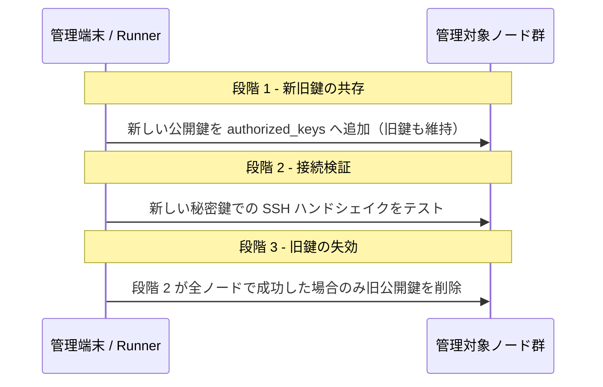

# セキュリティポリシーと鍵ライフサイクル

OpenLabOps は管理端末、GitOps 連携、および管理対象 Linux フリート全体でゼロトラストと平文認証情報排除を徹底します。

## 1. リポジトリ内認証情報ゼロ

* **秘密鍵・トークンの保存禁止**：平文の SSH 秘密鍵（`*.key`、`id_*`）や API トークンのコミットは厳禁です。
* **ネイティブ OpenSSH 連携**：管理端末の `~/.ssh/`、`~/.ssh/config`、および `ssh-agent` をそのまま利用します。
* **トークンのブラスト半径隔離**：`ci-bot` はワークフローのディスパッチと `openlab-configs` へのテレメトリ記録のみ許可され、`openlab-operations` のプレイブックを変更できません。

## 2. 標準鍵ロール (Canonical Key Roles)

内部エンジンやプレイブックは鍵ファイル名をハードコードせず、`conf/openlab.manifest.yml` でマッピングされた 3 つの意味的ロールを参照します。

| ロール | 用途 | 代表的な鍵名 |
| :--- | :--- | :--- |
| **`ansible`** | Gitea Act Runner と Ansible プレイブックが使用する自動化鍵 | `ansible.key` |
| **`user`** | 運用管理者の対話型 SSH ログイン鍵 | `admin.key` |
| **`git`** | GitOps リポジトリ同期用のデプロイ鍵 | `git-openlab.key` |

エンドポイント端末（`dev` / `desktop`）には `generate-host-ssh-key` によりホスト名ベースの鍵（`<hostname>.key`）が動的に発行され、`revoke-host-ssh-key` で全ノードから一括失効できます。

## 3. 3段階ゼロダウンタイム鍵ローテーション

鍵ローテーション（`lab-ssh --rotate-ansible` / `--rotate-all`）実行時、ロックアウトを防ぐため Ansible は厳格な 3 段階シーケンスを実行します。

段階 2 でいずれかのノードが失敗した場合、段階 3 は中断され、管理アクセスが失われることはありません。

## 4. `authorized_keys` 送信元制限とバックドア監査

* **送信元 IP ピン留め**：自動化鍵の `authorized_keys` エントリには `from="..."` 制限が維持されます。
* **リアルタイム不正鍵検知 (`lab-status -a`)**：全ノードの `authorized_keys` を走査し、マニフェストおよび `openlab-secrets` の既知フィンガープリントと照合して未登録鍵を即座に警告します。

## 5. 起動時公開鍵同期とロックアウトガード (`lab-boot-sync`)

管理対象の `dev` / `desktop` 端末では、`lab-boot-sync` がオフライン期間や鍵ローテーション後の不整合によるロックアウトを防止します。

1. ローカル状態とリモート `openlab-secrets` の最新コミット SHA を比較（`--check`）。
2. 古い場合は Gitea Actions の鍵配布ワークフローを起動して収束を待機（`--force` / `--wait`）。
3. 検証成功後に `/run/openlab/synced_ok` を書き込み、ロックアウトガード（`tools/lib/core/lockout.py`）を安全に解除します。
