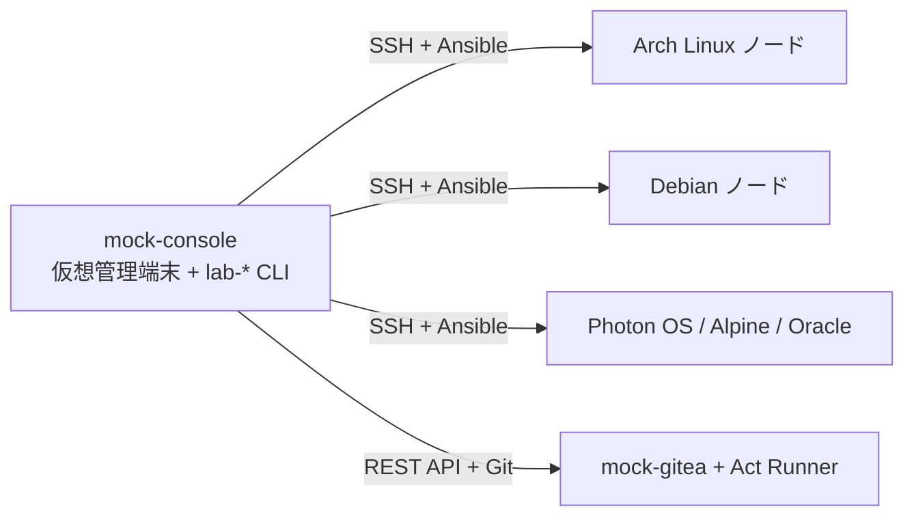

# テスト手法とサンドボックス原理

OpenLabOps はモック専用のバイパスを禁止し、実際の Linux コンテナと本番 CLI バイナリを用いたエンドツーエンド検証をすべてのリリースで実施します。

## 1. テスト基本原則

* **本番ツール検証原則**：サンドボックスと Dagger パイプラインは、実際の本番コマンド（`bin/lab-init`、`bin/lab-node`、`engine/classifier.py`、`tools/bin/lab-*`）をクリーンな状態から検証するためだけに存在します。
* **改ざんゼロ契約 (Zero-Fabrication)**：例外を握りつぶして成功扱いにするテストコードは厳禁です。アサーション失敗や非ゼロ終了は即座にログ付きで失敗となります。
* **ドメイン分離と一時領域の自動清掃**：テスト環境は独立したホスト名（`mock-gitea`、`gitea.mock`）を使用し、終了時に `/tmp/` の一時ファイルを自動削除します。

## 2. 5層の検証レイヤー

### レイヤー 1：スキーマ＆構文検証
* **`cue vet ./schema/`**：ネットワーク（`network.cue`）、ノードロール（`roles.cue`）、鍵契約（`keys.cue`）、システム不変条件（`invariants.cue`）を検証。
* **`ansible-playbook --syntax-check`**：`ansible/playbooks/` 配下の全プレイブックの構文を検査。

### レイヤー 2：Python ユニットテスト
* `python3 -m unittest discover -s tests/unit`（`tests/unit/test_core_units.py`）で以下を検証：
  * 組み込みゼロ依存 YAML パーサーとマニフェスト読み込み
  * 多言語 i18n 辞書（`en_US`、`zh_TW`、`ja_JP`）の整合性
  * ノード分類とインベントリ生成（`engine/classifier.py`）
  * ホスト名インジェクション防御と SemVer バージョン比較

### レイヤー 3：マルチディストリビューション Docker サンドボックス (`lab-test`)

* **`tests/sandbox/docker-compose.yml`**：`mock-console`、`mock-gitea`、`ansible-core` 内蔵 Act Runner、各種 Linux ノードコンテナを起動します。
* **`mock-console` 内部検査原則**：すべての導入・検証コマンドはホストから迂回せず、`mock-console` コンテナ内で実行します。
* **PTY 操作シミュレーター (`tests/sandbox/simulate_human_operator.py`)**：疑似端末（PTY）経由で `lab-init` の対話型 TUI を自動操作し、人間の入力フローを再現テストします。

### レイヤー 4：Dagger DinD パイプライン (`lab-test --dagger`)
* `tests/e2e/test_dagger.py` が独立した Docker-in-Docker 環境で「サンドボックス起動 $\rightarrow$ `lab-init` $\rightarrow$ `lab-node` / `lab-discover` / `lab-status` / `lab-ssh` 検証 $\rightarrow$ 自動破棄」を実行します。

### レイヤー 5：SHA-256 災害復旧訓練 (`lab-test --dr`)
* `tests/sandbox/dr_drill.sh`（`lab-test --dr <target>` で起動）がセンチネルデータの SHA-256 を記録し、`lab-backup` でバックアップ後にノード破壊を模擬、その後 `ansible/playbooks/restore-node.yml` で復元して SHA-256 が 100% 一致することを検証します。
