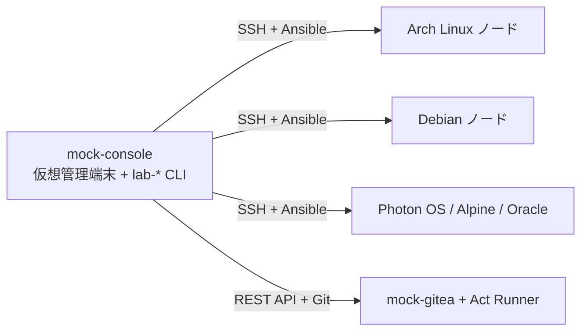

# テスト手法とサンドボックス原理

OpenLabOps はモック専用のバイパスを禁止し、実際の Linux コンテナと本番 CLI バイナリを用いたエンドツーエンド検証をすべてのリリースで実施します。

## 1. テスト基本原則 (`[INV-09]`)

* **本番ツール検証原則**：サンドボックスと Dagger パイプラインは、実際の本番コマンド（`bin/lab-init`、`bin/lab-node`、`engine/classifier.py`、`tools/bin/lab-*`）をクリーンな状態から検証するためだけに存在します。テスト専用のバイパスロジックを本番コードへ混入させることは禁止されています。
* **改ざんゼロ契約 (Zero-Fabrication)**：例外を握りつぶして成功扱いにするテストコード（`try...except: return True`）は厳禁です。アサーション失敗や非ゼロ終了は即座にログ付きで失敗となります。
* **ドメイン分離と一時領域の自動清掃**：テスト環境は独立したホスト名（`mock-gitea`、`gitea.mock`）を使用し、終了時に `/tmp/` の一時ファイルを自動削除します。

## 2. 5層検証マトリクス

| レイヤー | コマンド / エントリーポイント | 検証対象 |
| :--- | :--- | :--- |
| **1. スキーマ＆構文** | `cue vet ./schema/` & `ansible-playbook --syntax-check` | ネットワーク CIDR、ロール・鍵不変条件、全 Ansible プレイブック構文 |
| **2. ユニットテスト** | `python3 -m unittest discover -s tests/unit` | 組み込み YAML パーサー、i18n 完全性、`classifier.py`、SemVer・インジェクション防御 |
| **3. マルチディストリビューション** | `lab-test --manual` / `lab-test --auto` | `mock-console`、`mock-gitea`、Act Runner、Arch/Debian/Alpine/Photon/Oracle コンテナ |
| **4. Dagger DinD E2E** | `lab-test --dagger` (`tests/e2e/test_dagger.py`) | 隔離された DinD 環境での Day-0 導入と CLI 検証 |
| **5. SHA-256 DR 訓練** | `lab-test --dr [target]` (`tests/sandbox/dr_drill.sh`) | バックアップ、ノード破壊模擬、`restore-node.yml` 復元、SHA-256 完全一致検証 |

## 3. マルチディストリビューション Docker サンドボックス (`lab-test`)

* **`tests/sandbox/docker-compose.yml`**：`mock-console`、`mock-gitea`、`ansible-core` 内蔵 Act Runner、各種 Linux ノードコンテナを起動します。
* **`mock-console` 内部検査原則**：すべての導入・検証コマンドはホストから迂回せず、`mock-console` コンテナ**内部**で実行します（`--manual` 時は自動で `docker exec -it mock-console bash` に接続）。
* **ライブ作業ツリー同期 (`tests/bin/test-gitea-init`)**：未コミットのワークスペース変更も自動的に `mock-gitea` へ同期し、古い `HEAD` でのテストを防止します。
* **PTY 操作シミュレーター (`tests/sandbox/simulate_human_operator.py`)**：疑似端末（PTY）経由で `lab-init` の対話型 TUI を `en_US`・`zh_TW`・`ja_JP` 各ロケールで自動操作します。

## 4. SHA-256 災害復旧訓練 (`dr_drill.sh`)

1. **センチネル作成**：対象ノードにテスト設定ファイルを配置し、SHA-256 ハッシュを記録。
2. **バックアップ**：`lab-backup` でノードとゲートウェイ状態を GitOps へ保存。
3. **破壊シミュレーション**：対象コンテナのセンチネルファイルを削除。
4. **復元と検証**：`ansible/playbooks/restore-node.yml` を実行し、ステップ 1 の SHA-256 と 100% 一致することを検証します。
