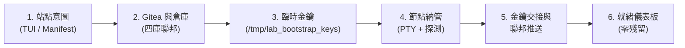

# `lab-init` — Day-0 初始化指揮官

**入口點：** `bin/lab-init` → **引擎：** `engine/initialize.py`

`lab-init` 是 OpenLabOps 的互動式 Day-0 叢集引導程式（靈感源自 `archinstall`），負責引導輸入站點意圖、建立 Gitea 四庫聯邦、使用臨時引導金鑰納管主機、輪替為網段限制的正式金鑰並部署維運工具鏈。

## 語法

```bash
lab-init [--lang {zh_TW,en_US,ja_JP}] [--manifest FILE] [--legacy-key FILE]
         [--non-interactive] [--with-gitea-runner] [--with-remote-dev]
         [--skip-nodes HOSTS] [--include-appliances] [--include-endpoints]
```

## 參數說明

| 參數 | 說明 |
| :--- | :--- |
| `--lang {zh_TW,en_US,ja_JP}` | 設定精靈與部署叢集預設語系。 |
| `--manifest FILE` | 指定宣告式 Day-0 清單（跳過互動問答）。 |
| `--legacy-key FILE` | 混合情境初始納管用的舊版 SSH 私鑰路徑。 |
| `--non-interactive` | 無人值守模式，不顯示互動 TUI/CLI 提示。 |
| `--with-gitea-runner` | 設定並建置 Gitea Act Runner 容器（含 `ansible-core`）。 |
| `--with-remote-dev` | 佈建選用的 Remote-Dev 遠端開發容器。 |
| `--skip-nodes HOSTS` | 逗號分隔的略過主機名稱清單。 |
| `--include-appliances` | 將設備節點（儲存/虛擬化）納入 Day-0 納管。 |
| `--include-endpoints` | 將端點工作站納入 Day-0 納管。 |

## 6 步驟執行生命週期



1. **`/tmp` 隔離工作區（`LAB_INIT_WORK_DIR`）**：
   啟動時於 `/tmp/lab_init_work_*` 建立隔離工作區（結束後自動清除）。所有 Day-0 中間產物（匯出的清單、`conf/nodes/*.json`、`hosts.yml`、`tools.config.json`）皆寫入 `/tmp`，不污染母體倉庫。
2. **Gitea 與四庫聯邦建置**：
   建立組織、`ci-bot` 帳號與 Token，以及 `<prefix>-operations`、`<prefix>-workflows`、`<prefix>-configs`、`<prefix>-secrets`。
3. **臨時引導金鑰（`/tmp/lab_bootstrap_keys/`）**：
   於 `/tmp` 生成無 `from="..."` 限制的 Ed25519 金鑰對（`[INV-02]`）。
4. **動態節點納管**：
   以 `ephemeral_pubkey` 呼叫 `onboard_node()` 並於 `/tmp` 內執行 `classifier.py --apply`。
5. **正式金鑰交接與聯邦推送**：
   * 以 `ssh-keygen -y -P "" -f` 由私鑰反推真實公鑰並自動修復不一致的 `*.key.pub`。
   * 透過 `_run_ssh_with_backoff` 在限流/瞬斷時自動退避重試。
   * 完成三階段輪替並將編譯產物推送至 Gitea `configs` 與 `secrets`，同時以 `deploy-ops-tools.yml` 部署 `lab-*` 工具。
6. **就緒儀表板**：
   顯示叢集摘要、Token 儲存路徑（`/usr/local/bin/<prefix>/.gitea_token`）與 `from="..."` CIDR 限制。
