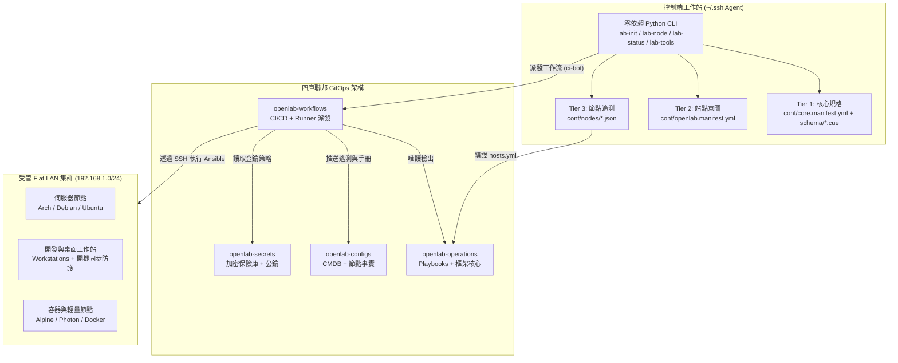

# 系統架構

OpenLabOps 是一套**零依賴宣告式 Homelab 維運框架（Operations Framework）**，透過嚴格的職責分離，將「不可變動框架合約」、「站點宣告式意圖」與「即時節點遙測」切分為三層，並映射到四個職責隔離的下游 GitOps 倉庫。



## 1. 倉庫目錄拓撲

```text
openlabops/
├── bin/                        # 控制平面入口指令 (lab-init, lab-node, lab-apply, lab-test)
├── engine/                     # Python 核心框架 (compiler, classifier, discover, initialize, onboard)
├── schema/                     # 不可變動 CUE 規格合約 (invariants, network, roles, keys, nodes)
├── conf/                       # 單一真實來源 Manifest 與動態節點分類 (nodes/*.json)
├── ansible/                    # 無狀態劇本、Roles、group_vars 與自訂 fact 模組
├── tools/                      # 零依賴端點與維運 CLI (bin/lab-* 與 lib/core/*)
├── workflows/                  # Gitea Actions 工作流與複合式 Actions
├── templates/                  # 下游聯邦渲染範本 (ansible, configs, workflows)
├── lang/                       # 多語系字典檔 (en_US.json, zh_TW.json, ja_JP.json)
└── tests/                      # 單元測試、Dagger DinD E2E 與多發行版 Docker 沙箱
```

## 2. 三層分離模型

1. **Tier 1 (`core`)：不可變動之框架規格**
   * 定義於 `conf/core.manifest.yml` 與 `schema/*.cue`。
   * 規範四庫聯邦拓撲、三大標準金鑰角色（`ansible`、`user`、`git`）、安全基線與 CUE 約束規則。
2. **Tier 2 (`site`)：站點宣告式意圖**
   * 定義於 `conf/openlab.manifest.yml`。
   * 儲存集群名稱、網域、Flat LAN 子網（`192.168.1.0/24`）、閘道器、管理員與 Ansible 帳號及 Gitea 端點。比照 `archinstall` 設計，預設由 `lab-init` 互動精靈動態產生，並匯出供 `--manifest` 無人值守重現。
3. **Tier 3 (`node`)：動態機器遙測事實**
   * **庫存分類 (`conf/nodes/*.json`)**：僅記錄分類屬性（`os_family`、`distribution`、`role`、`capabilities`），嚴禁寫入硬體遙測（`mac_address`、`cpu_cores`、`memory_mb`）。
   * **CMDB 硬體遙測 (`node-information/node_<hostname>.json`)**：由 `lab-discover`（`engine/bootstrap_probe.sh`）獨立探測，採集記憶體、CPU、磁碟、Docker 容器、監聽埠與 `authorized_keys` 指紋。
   * **動態編譯**：`engine/classifier.py` 以純 Python 標準庫直接將 `conf/nodes/*.json` 編譯為 `ansible/inventory/hosts.yml`，執行期零 CUE 依賴。

## 3. 四庫聯邦與爆破半徑隔離

為避免 CI/CD Token 遭濫用而篡改 IaC 程式碼，OpenLabOps 將下游倉庫拆分為四個獨立庫：

| 倉庫 | 內容 | `ci-bot` 權限 |
| :--- | :--- | :--- |
| **`openlab-operations`** | Ansible 劇本、Roles、框架核心與 CLI 工具 | **唯讀**（物理上禁止修改） |
| **`openlab-workflows`** | Gitea Actions 工作流與複合式 Actions | **讀取 / 派發** |
| **`openlab-configs`** | CMDB `node-information/node_*.json`、套件清單、Markdown 節點手冊 | **寫入遙測** |
| **`openlab-secrets`** | 公鑰、端點金鑰註冊表與加密機密 | **讀取金鑰策略** |

## 4. 零依賴框架與 Gitea Act Runner 中央執行架構

* **100% Python 標準函式庫 (`[INV-01]`)**：內建 `tools/lib/core/yaml_parser.py` 解析 YAML（無需 `pyyaml`）；`gitea_api.py` 採用 `urllib.request`（無需 `requests`）；`ui_curses.py` 採用內建 `curses`。
* **端點零 Ansible 依賴**：受管節點與操作端僅需 Python 3 與 OpenSSH。所有 Ansible 劇本統一於 **Gitea Act Runner** 容器（內建 `ansible-core`）集中執行，並由 `gitea_api.gitea_dispatch()` 遠端派發。
* **Flat LAN 與多發行版支援**：`schema/network.cue` 強制驗證 Flat LAN（`192.168.1.0/24`）邊界，`engine/classifier.py` 原生支援 **Arch Linux**、**Debian**、**Ubuntu**、**Oracle Linux**、**Alpine Linux**、**VMware Photon OS** 與通用 systemd Linux 主機。
