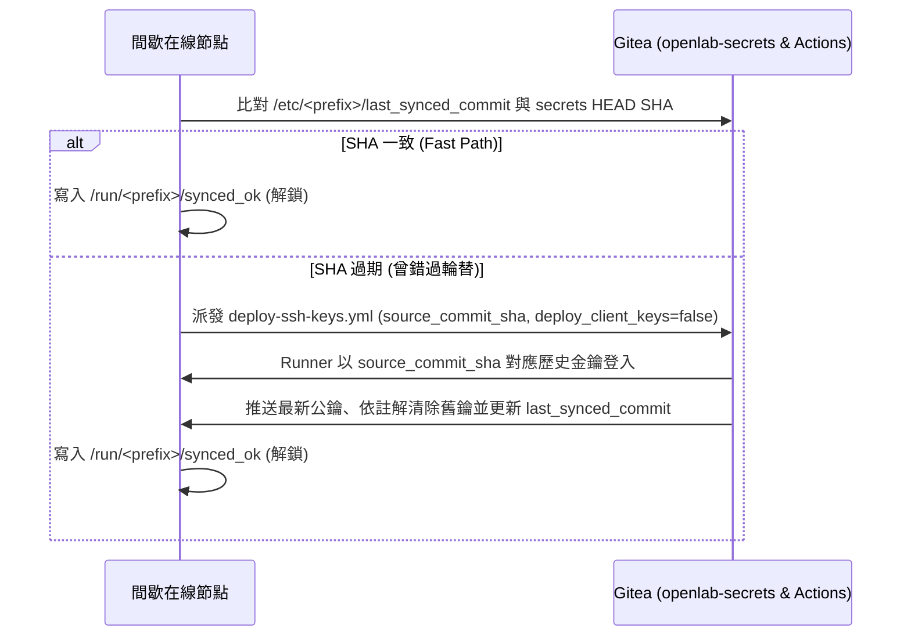

# 過期金鑰開機自動同步與鎖定防護

工作站、筆電等非 7/24 在線節點（`always_online: false`）在關機期間可能會錯過叢集金鑰輪替，開機後本機 `authorized_keys` 仍留有舊版過期公鑰。

OpenLabOps 在不透過 HTTP 下載私鑰的前提下（`[INV-02]`）自動完成追平：

## 運作機制細節

1. **Secrets Git SHA 索引（`tools/lib/lab_boot_sync.py`）**：
   * 節點本機於 `/etc/<prefix>/last_synced_commit` 記錄上次同步的 Git Commit SHA。
   * 開機（或執行 `lab-boot-sync`）時透過 Gitea API 查詢遠端 `<prefix>-secrets` 的 `HEAD` Commit SHA。
2. **快速路徑 vs. 滾動追平（Roll-Forward Sync）**：
   * **SHA 一致**：金鑰為最新狀態，立即寫入 `/run/<prefix>/synced_ok` 解除鎖定。
   * **SHA 過期**：派發 `deploy-ssh-keys.yml`（帶入 `target_hosts`、`source_commit_sha` 與 `deploy_client_keys=false`），由 Gitea Act Runner 使用當時 `source_commit_sha` 對應的歷史金鑰登入節點，補推最新公鑰、清除過期舊鑰並更新 `/etc/<prefix>/last_synced_commit`。
3. **鎖定防護閘門（`tools/lib/core/lockout.py`）**：
   * 在 `/run/<prefix>/synced_ok` 建立前，間歇在線節點上的 `lab-*` 自動化操作會被安全鎖定，防止在憑證過期狀態下誤操作。
   * 永遠在線的主控端（`always_online: true`）則不受此鎖定限制。
