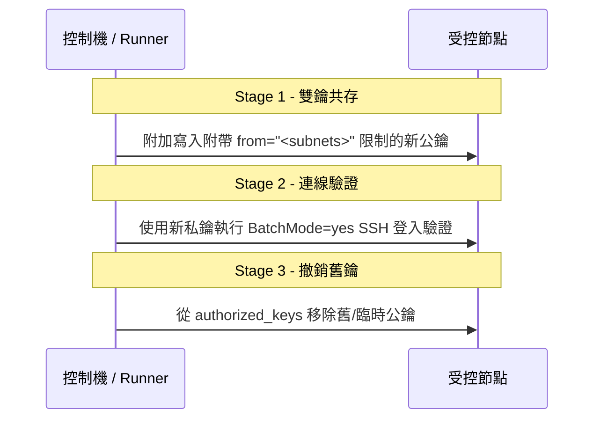

# 三階段零中斷 SSH 金鑰輪替

OpenLabOps 絕不以單步覆蓋的方式更換線上 SSH 金鑰。無論是 Day-0 交接（`lab-init`）還是 Day-2 輪替（`lab-ssh --rotate-*`），一律遵守三階段協定：

## 核心安全防護

1. **私鑰反推真實公鑰（`ssh-keygen -y`）**：
   在注入與驗證金鑰前，`initialize.py` 與 `onboard.py` 會直接以 `ssh-keygen -y -P "" -f <key>` 由私鑰反推真實公鑰；若既有 `*.key.pub` 與私鑰不一致，會自動重新產生修復，避免 OpenSSH `identity_sign` 失敗。
2. **網段來源限制（`from="..."`，`[INV-05]`）**：
   正式維運金鑰注入時必帶 `from="192.168.1.0/24"`（或自訂內部網段），確保即使私鑰外洩也無法從外部網段登入。
3. **嚴格 `BatchMode=yes` 驗證**：
   唯有 Stage 2 以新私鑰無密碼驗證成功後，才會執行 Stage 3 移除舊鑰，徹底杜絕鎖死風險。
